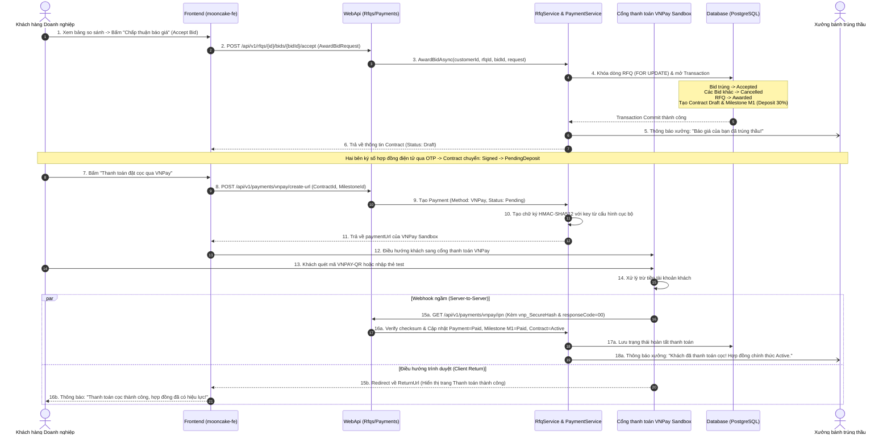
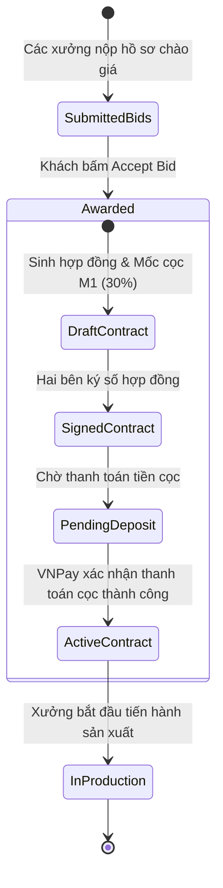

# [RFQ-BIDDING-13] - TÀI LIỆU THIẾT KẾ CHI TIẾT CHỌN THẦU, SINH HỢP ĐỒNG & THANH TOÁN KÝ QUỸ VNPAY (BID AWARDING & VNPAY ESCROW DEPOSIT)

---

## I. TÊN TÀI LIỆU, TÍNH NĂNG & TỔNG QUAN

### 1.1. Thông tin tài liệu
- **Tên tài liệu:** Tài liệu thiết kế chi tiết tính năng Chọn báo giá thắng thầu, Tự động sinh hợp đồng điện tử & Thanh toán tiền cọc ký quỹ qua VNPay (Bid Awarding, Contract Generation & VNPay Escrow Deposit)
- **Mã tính năng (Feature Key):** `rfq-bidding-award-vnpay` (Module 5, Tính năng #13)
- **Độ ưu tiên:** 🔴 P0 Critical
- **Phiên bản:** `1.0.0` | **Ngày lập:** 2026-10-29
- **Tác nhân tham gia (Actors):**
  - **Customer:** Khách hàng doanh nghiệp ấn chọn 1 báo giá tối ưu nhất, nhập lý do lựa chọn, ký số hợp đồng và thực hiện thanh toán tiền đặt cọc ký quỹ qua cổng VNPay.
  - **Supplier:** Xưởng trúng thầu nhận thông báo thắng thầu, ký số hợp đồng, nhận thông báo tiền cọc ký quỹ đã vào tài khoản đảm bảo và bắt đầu đưa bánh vào sản xuất.
  - **Cổng thanh toán VNPay:** Cổng trung gian xử lý giao dịch tài chính, cung cấp giao diện thanh toán thẻ/QR và thông báo kết quả qua IPN Webhook.
  - **System (Backend Engine):** Tự động điều phối chuyển trạng thái thầu, hủy các báo giá thua, sinh hợp đồng và khóa cọc.

### 1.2. Mục tiêu nghiệp vụ (Business Goals)
- Khép lại quy trình đấu thầu một cách tự động, minh bạch và không phát sinh tranh chấp: 1 báo giá được chọn -> Tất cả các báo giá còn lại tự động bị hủy -> Gói thầu RFQ hoàn tất.
- Liền mạch từ Đấu thầu sang Thực thi: Bản thảo Hợp đồng điện tử (`Contract`) được sinh tự động ngay lập tức từ snapshot của RFQ và hồ sơ dự thầu, không cần soạn thảo thủ công.
- **Bảo vệ rủi ro tài chính B2B (Escrow Protection):** Áp dụng cơ chế thanh toán tiền cọc bắt buộc (Milestone M1 = 30% giá trị hợp đồng) qua cổng **VNPay Sandbox**. Tiền cọc được giữ tại hệ thống trung gian và Hợp đồng chỉ chuyển sang `Active` khi VNPay xác nhận thanh toán thành công, đảm bảo xưởng an tâm sản xuất không lo bùng đơn.

### 1.3. Cấu hình Cổng thanh toán VNPay Sandbox
Cấu hình VNPay phải được lưu trong tệp Web API `appsettings.json` bị Git ignore:
- **Terminal ID / Mã Website (`vnp_TmnCode`):** `<VNPAY_TMN_CODE>`
- **Secret Key / Khóa tạo mã băm (`vnp_HashSecret`):** `<VNPAY_HASH_SECRET>`
- **Địa chỉ cổng thanh toán TEST (`vnp_Url`):** `https://sandbox.vnpayment.vn/paymentv2/vpcpay.html`
- **Chuẩn băm mật mã:** `HMAC-SHA512` (chuẩn VNPay API 2.1.0).

---

## II. FLOW CHART TOÀN BỘ LUỒNG (WORKFLOW DIAGRAM)

### 2.1. Sequence Diagram - Luồng Chọn thầu, Tạo hợp đồng & Thanh toán VNPay



### 2.2. State Transition Diagram - Vòng đời từ Chọn thầu đến Kích hoạt Hợp đồng



---

## III. CHI TIẾT TỪNG BƯỚC XỬ LÝ (STEP-BY-STEP LOGIC)

### Bước 1: Khách hàng Chấp thuận Báo giá (Award Bid)
1. Kiểm tra quyền: Chỉ khách hàng sở hữu RFQ mới được chọn thầu.
2. Kiểm tra điều kiện chọn thầu:
   - RFQ phải ở trạng thái `Open` hoặc `Closed`.
   - Báo giá được chọn phải thuộc về RFQ này, đang ở trạng thái `Submitted` và chưa bị quá hạn hiệu lực (`clock.UtcNow < bid.SubmittedAt + bid.ValidityDays`).
3. Thực thi Transaction nguyên tử:
   - Khóa dòng RFQ bằng lệnh `SELECT ... FOR UPDATE`.
   - Cập nhật RFQ: `status = Awarded`, `awarded_bid_id = bid.Id`, `awarded_at = clock.UtcNow`.
   - Cập nhật Bid thắng thầu: `status = Accepted`, `accepted_at = clock.UtcNow`.
   - Cập nhật tất cả các Bid khác của RFQ này: `status = Cancelled`.
   - Tạo bản ghi `Contract`:
     - `ContractNumber = "HD-YYYY-XXXXXX"`.
     - `TotalValue = bid.TotalPrice`.
     - `TermsAndConditions` chứa toàn bộ snapshot thông tin bên mua, bên bán, danh sách bánh và đơn giá trúng thầu.
     - `Status = ContractStatus.Draft`.
   - Tạo các mốc thanh toán `ContractMilestone`:
     - **Milestone M1 (Đặt cọc ký quỹ):** `is_deposit = true`, `percentage = 30.00%`, `amount = totalValue * 0.30`, `status = MilestoneStatus.AwaitingPayment`.
     - **Milestone M2 (Giao hàng đợt 1):** `percentage = 50.00%`, `amount = totalValue * 0.50`, `status = MilestoneStatus.Pending`.
     - **Milestone M3 (Nghiệm thu thanh lý):** `percentage = 20.00%`, `amount = totalValue * 0.20`, `status = MilestoneStatus.Pending`.
4. Gửi thông báo:
   - Gửi xưởng thắng thầu: Chúc mừng và mời xem hợp đồng.
   - Gửi các xưởng thua thầu: Thông báo lịch sự gói thầu đã có đơn vị trúng tuyển (tuyệt đối không để lộ giá của xưởng thắng).

### Bước 2: Ký số Hợp đồng (OTP Signature)
1. Cả hai bên mở xem chi tiết hợp đồng điện tử.
2. Hai bên bấm xác nhận và nhập mã OTP gửi qua Email/SMS để ký số.
3. Khi cả 2 bên hoàn tất ký: `Contract.Status` chuyển sang `ContractStatus.PendingDeposit`.

### Bước 3: Khởi tạo URL Thanh toán VNPay Sandbox (Create Payment URL)
1. Khách hàng bấm nút "Thanh toán đặt cọc qua VNPay" cho Milestone M1:
2. Hệ thống kiểm tra: Hợp đồng đang là `PendingDeposit`, Milestone M1 đang là `AwaitingPayment`.
3. Tạo bản ghi `Payment`:
   - `PaymentNumber = "PAY-YYYYMMDD-XXXXXX"`.
   - `Method = PaymentMethod.VNPay`.
   - `Amount = milestone.Amount`.
   - `Currency = "VND"`.
   - `Status = PaymentStatus.Pending`.
4. Sinh chữ ký số và xây dựng URL cổng thanh toán VNPay:
   - Thu thập các tham số chuẩn VNPay:
     - `vnp_Version`: `2.1.0`
     - `vnp_Command`: `pay`
     - `vnp_TmnCode`: lấy từ `VnPay:TmnCode` trong cấu hình cục bộ.
     - `vnp_Amount`: `(long)(payment.Amount * 100)` (VNPay quy định nhân 100)
     - `vnp_CreateDate`: `yyyyMMddHHmmss`
     - `vnp_CurrCode`: `VND`
     - `vnp_IpAddr`: IP người dùng
     - `vnp_Locale`: `vn`
     - `vnp_OrderInfo`: `"Thanh toan tien coc hop dong " + contract.ContractNumber`
     - `vnp_OrderType`: `other`
     - `vnp_ReturnUrl`: URL chuyển hướng Frontend sau khi thanh toán
     - `vnp_TxnRef`: `payment.PaymentNumber`
   - Sắp xếp các tham số theo thứ tự bảng chữ cái A-Z và tạo chuỗi thô (`rawHashData`).
   - Tạo chữ ký `vnp_SecureHash` bằng thuật toán **HMAC-SHA512** với secret trong `VnPay:HashSecret`.
   - Ghép thành URL hoàn chỉnh: `https://sandbox.vnpayment.vn/paymentv2/vpcpay.html?...`.
5. Trả về URL thanh toán cho Frontend để redirect người dùng.

### Bước 4: Xử lý Webhook IPN & Xác nhận hoàn tất Ký quỹ
1. Cổng thanh toán VNPay gửi yêu cầu ngầm tới máy chủ (IPN URL): `GET /api/v1/payments/vnpay/ipn`.
2. Backend xác thực tính toàn vẹn:
   - Trích xuất toàn bộ tham số gửi về từ VNPay.
   - Tính toán lại chữ ký HMAC-SHA512 với khóa bí mật trong cấu hình cục bộ.
   - So sánh với `vnp_SecureHash`: Nếu không khớp -> Trả về JSON lỗi `{ "RspCode": "97", "Message": "Invalid Checksum" }`.
3. Kiểm tra mã phản hồi:
   - Nếu `vnp_ResponseCode == "00"` (Giao dịch thành công):
     - Mở Transaction Database:
     - Cập nhật `Payment.Status = PaymentStatus.Paid`, `PaidAt = clock.UtcNow`.
     - Cập nhật `ContractMilestone.Status = MilestoneStatus.Paid`, `CompletionDate = DateOnly.FromDateTime(clock.UtcNow)`.
     - Cập nhật `Contract.DepositAmount = payment.Amount`, `Contract.DepositPaidAt = clock.UtcNow`.
     - Chuyển `Contract.Status = ContractStatus.Active` (Hợp đồng chính thức có hiệu lực!).
     - Gửi thông báo đến Supplier: "Khách hàng đã hoàn tất thanh toán tiền cọc ký quỹ. Xưởng bắt đầu tiến hành sản xuất."
     - Phản hồi cho VNPay: `{ "RspCode": "00", "Message": "Confirm Success" }`.
   - Nếu `vnp_ResponseCode != "00"` (Khách hủy hoặc lỗi thẻ):
     - Cập nhật `Payment.Status = PaymentStatus.Failed`.
     - Giữ nguyên trạng thái Hợp đồng để khách hàng có thể chọn thanh toán lại.

---

## IV. ĐẶC TẢ KỸ THUẬT API (API CONTRACT SPECIFICATION)

### 4.1. Chọn báo giá thắng thầu (Award Bid)
- **Endpoint:** `POST /api/v1/rfqs/{rfqId}/bids/{bidId}/accept`
- **Quyền:** `Authorized (Role: Customer)`
- **Request Body:**
```json
{
  "selectionNote": "Xưởng Tràng An có năng lực sản xuất hộp sơn mài chất lượng cao, giá chào thầu hợp lý và cam kết giao đúng hạn 7 ngày."
}
```

- **Response Body (HTTP 200 OK):**
```json
{
  "status": 200,
  "message": "Bid accepted and draft contract created.",
  "data": {
    "contractId": "7fa85f64-5717-4562-b3fc-2c963f66afc7",
    "contractNumber": "HD-2026-004567",
    "rfqId": "1fa85f64-5717-4562-b3fc-2c963f66afa1",
    "bidId": "5fa85f64-5717-4562-b3fc-2c963f66afa5",
    "totalValue": 250000000.00,
    "status": "Draft",
    "depositRequiredAmount": 75000000.00,
    "milestones": [
      {
        "sequenceNumber": 1,
        "name": "M1 - Đặt cọc ký quỹ sản xuất (30%)",
        "isDeposit": true,
        "amount": 75000000.00,
        "percentage": 30.00,
        "status": "AwaitingPayment"
      },
      {
        "sequenceNumber": 2,
        "name": "M2 - Giao hàng đợt 1 (50%)",
        "isDeposit": false,
        "amount": 125000000.00,
        "percentage": 50.00,
        "status": "Pending"
      },
      {
        "sequenceNumber": 3,
        "name": "M3 - Nghiệm thu & Thanh lý (20%)",
        "isDeposit": false,
        "amount": 50000000.00,
        "percentage": 20.00,
        "status": "Pending"
      }
    ]
  },
  "path": "/api/v1/rfqs/1fa85f64-5717-4562-b3fc-2c963f66afa1/bids/5fa85f64-5717-4562-b3fc-2c963f66afa5/accept",
  "traceId": "trace-award-001",
  "time": "2026-08-06T10:00:00Z"
}
```

### 4.2. Tạo URL thanh toán VNPay Sandbox (Create VNPay Payment URL)
- **Endpoint:** `POST /api/v1/payments/vnpay/create-url`
- **Quyền:** `Authorized (Role: Customer)`
- **Request Body:**
```json
{
  "contractId": "7fa85f64-5717-4562-b3fc-2c963f66afc7",
  "milestoneId": "8fa85f64-5717-4562-b3fc-2c963f66afd8",
  "returnUrl": "http://localhost:5173/#hop-dong-tien-do?paymentStatus=success"
}
```

- **Response Body (HTTP 200 OK):**
```json
{
  "status": 200,
  "message": "VNPay payment URL generated successfully.",
  "data": {
    "paymentId": "9fa85f64-5717-4562-b3fc-2c963f66afe9",
    "paymentNumber": "PAY-20260806-0099",
    "amount": 75000000.00,
    "paymentUrl": "https://sandbox.vnpayment.vn/paymentv2/vpcpay.html?...&vnp_TmnCode=<VNPAY_TMN_CODE>&vnp_TxnRef=PAY-20260806-0099&vnp_SecureHash=<GENERATED_HASH>"
  },
  "path": "/api/v1/payments/vnpay/create-url",
  "traceId": "trace-vnp-001",
  "time": "2026-08-06T10:30:00Z"
}
```

### 4.3. Webhook IPN xử lý ngầm từ VNPay (VNPay IPN Handler)
- **Endpoint:** `GET /api/v1/payments/vnpay/ipn`
- **Quyền:** `Anonymous (Được xác thực qua chữ ký vnp_SecureHash)`
- **Response trả về cho Server VNPay (Chuẩn VNPay Specification):**
```json
{
  "RspCode": "00",
  "Message": "Confirm Success"
}
```

---

## V. KIẾN TRÚC PHÂN TẦNG VÀ TỔ CHỨC MÃ NGUỒN (LAYER MAPPING)

```text
src/
├── Mooncake.EcommercePlatform.Domain/
│   ├── Entities/Contract.cs                   # Thực thể Hợp đồng
│   ├── Entities/ContractMilestone.cs          # Mốc thanh toán hợp đồng (M1, M2, M3)
│   ├── Entities/Payment.cs                    # Bản ghi thanh toán
│   ├── Enums/ContractStatus.cs                # Draft, PendingSignature, Signed, PendingDeposit, Active...
│   └── Enums/PaymentMethod.cs                 # VNPay, BankTransfer, Momo, Cash
│
├── Mooncake.EcommercePlatform.Application/
│   ├── DTOs/Rfqs/Requests/AwardBidRequest.cs
│   ├── DTOs/Payments/Requests/CreateVnPayUrlRequest.cs
│   ├── DTOs/Payments/Responses/VnPayUrlResponse.cs
│   ├── Common/Helpers/VnPaySecurityHelper.cs   # HMAC-SHA512 Checksum generator & verifier
│   ├── Services/Interfaces/IRfqService.cs
│   └── Services/Interfaces/IPaymentService.cs
│
├── Mooncake.EcommercePlatform.Infrastructure/
│   ├── Options/VnPayOptions.cs                # Đọc TmnCode, HashSecret, Url từ config
│   ├── Repositories/RfqRepository.cs          # Transaction Lock AwardBid & tạo Contract
│   └── Repositories/PaymentRepository.cs      # Xác nhận thanh toán & chuyển Contract sang Active
│
└── Mooncake.EcommercePlatform.WebApi/
    ├── Controllers/RfqsController.cs          # Endpoint Award Bid
    └── Controllers/PaymentsController.cs      # Endpoint sinh URL VNPay & Webhook IPN
```

---

## VI. BẢO MẬT & KIỂM THỬ (SECURITY & TESTING PLAN)

### 6.1. Tiêu chuẩn bảo mật tài chính
- [x] **Xác thực chữ ký số HMAC-SHA512:** Mọi thông tin phản hồi từ cổng VNPay đều được tính toán lại mã băm checksum với secret cấu hình cục bộ. Chặn các yêu cầu bị sửa đổi hoặc giả mạo trạng thái thanh toán thành công.
- [x] **Bảo mật khóa cấu hình:** `vnp_HashSecret` được quản lý trong cấu hình môi trường bảo mật, không để lộ ra Frontend hoặc commit vào mã nguồn công khai.
- [x] **Đảm bảo tính duy nhất của giao dịch (Idempotent Payment):** Một mã vận đơn thanh toán `vnp_TxnRef` chỉ được xác nhận xử lý đúng 1 lần; nếu VNPay gửi IPN lặp lại, hệ thống trả về mã `02` (Order already confirmed) mà không cộng tiền hay kích hoạt 2 lần.

### 6.2. Kịch bản kiểm thử (Test Cases)
1. **Happy Path:** Khách chọn thầu -> RFQ chuyển `Awarded`, Bid chuyển `Accepted`, Hợp đồng sinh ra ở dạng `Draft` -> Hai bên ký số -> Sinh URL VNPay -> Khách nhập thẻ test VNPay thành công -> IPN Webhook xác nhận -> Hợp đồng chuyển `Active`.
2. **Negative - Khách chọn bid đã hết hạn:** Báo giá có `validity_days = 10` nhưng nộp từ 15 ngày trước -> Bị từ chối với HTTP 409 Conflict.
3. **Negative - Giả mạo IPN Checksum:** Gửi request tới webhook IPN với `vnp_SecureHash` giả -> Bị từ chối với phản hồi `{ "RspCode": "97", "Message": "Invalid Checksum" }`.
4. **Hủy thanh toán giữa chừng:** Khách bấm hủy trên trang VNPay Sandbox -> `vnp_ResponseCode = 24` -> `Payment.Status = Failed`, Hợp đồng vẫn giữ nguyên trạng thái chờ thanh toán để khách thử lại.

