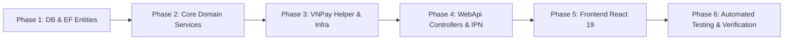

# [RFQ-BIDDING-08] - KẾ HOẠCH TRIỂN KHAI, KIỂM THỬ & BÀN GIAO (IMPLEMENTATION, TEST & ROLLOUT)

---

## I. LỘ TRÌNH TRIỂN KHAI THEO TỪNG GIAI ĐOẠN (IMPLEMENTATION PHASES)

Lộ trình phát triển Module 5 (Tính năng #10, #11, #12, #13) được phân bổ theo 6 giai đoạn tuần tự nhằm đảm bảo kiến trúc Clean Architecture, tích hợp an toàn cổng thanh toán VNPay Sandbox và đáp ứng tiêu chuẩn Zero-Error Build.



### Giai đoạn 1: Cơ sở dữ liệu & Thực thể Domain (Phase 1)
- [ ] Rà soát và hoàn thiện các thực thể: `RfqRequest`, `RfqItem`, `RfqSupplierInvitation`, `BidProposal`, `BidItemProposal`, `Contract`, `ContractMilestone`, `PaymentTransaction`.
- [ ] Bổ sung cấu hình Fluent API:
  - Chỉ mục tìm kiếm: `idx_rfq_customer_status`, `idx_rfq_deadline`, `idx_bid_rfq_supplier`, `idx_vnpay_txn_ref`.
  - Khóa ngoại và quan hệ: 1 RFQ có nhiều RfqItem, nhiều RfqSupplierInvitation, nhiều BidProposal.
  - Snapshot giá trị và trạng thái kiểm soát tính bất biến khi Bid đã được `Submitted`.
- [ ] Migration EF Core: Đảm bảo chạy di chuyển cơ sở dữ liệu trơn tru trên PostgreSQL/SQL Server mà không mất dữ liệu.

### Giai đoạn 2: Tầng Nghiệp vụ Application Services & Matching Engine (Phase 2)
- [ ] Hoàn thiện `IRfqService` và triển khai `RfqService`:
  - `CreateRfqAsync`, `PublishRfqAsync`, `CancelRfqAsync`.
  - Thuật toán `GetSuggestedSuppliersAsync`: Chấm điểm năng lực thầu dựa trên danh mục bánh, khoảng cách địa lý, sản lượng tối thiểu và xếp hạng uy tín.
  - `InviteSuppliersAsync`, `DeclineInvitationAsync`.
- [ ] Hoàn thiện `IBidService` và triển khai `BidService`:
  - `SubmitBidAsync`: Kiểm tra trạng thái RFQ còn `Open` và chưa quá `BidDeadline`, tính tổng giá trị từng dòng báo giá.
  - `CancelBidAsync`: Cho phép xưởng rút báo giá khi chưa có quyết định chọn thầu.
- [ ] Hoàn thiện `IAwardService` / `IContractService`:
  - `AwardBidAsync`: Khóa bi quan `Pessimistic Locking` trên RFQ, chuyển RFQ sang `Awarded`, Bid thắng sang `Accepted`, các Bid khác sang `Cancelled`.
  - Tự động sinh `Contract` điện tử ở trạng thái `Draft` và Milestone M1 cọc 30% (`is_deposit = true`).

### Giai đoạn 3: Cổng Thanh toán VNPay & Hạ tầng Ký quỹ Escrow (Phase 3)
- [ ] Xây dựng `VnPaySecurityHelper` tại tầng Infrastructure:
  - Sinh chuỗi query parameters theo thứ tự bảng chữ cái alphabet (ASCII sorted).
  - Tính mã băm bảo mật HMAC-SHA512 với `vnp_HashSecret` từ cấu hình cục bộ.
  - Xác thực chữ ký phản hồi từ VNPay (Return URL & IPN Webhook).
- [ ] Nâng cấp `IPaymentService` và `PaymentService`:
  - `CreateVnPayPaymentUrlAsync`: Tạo URL thanh toán sang `https://sandbox.vnpayment.vn/paymentv2/vpcpay.html`, nhân số tiền cọc với 100 (`amount * 100`), mã merchant từ cấu hình cục bộ.
  - Ghi nhận `PaymentTransaction` trạng thái `Pending`.
  - `ProcessVnPayIpnAsync`: Tiếp nhận IPN Webhook từ VNPay, xác thực chữ ký HMAC-SHA512, cập nhật giao dịch thành `Success`, chuyển Milestone M1 thành `Paid`, và kích hoạt hợp đồng sang `Active` (cho phép xưởng bắt đầu sản xuất).

### Giai đoạn 4: Tầng WebApi Endpoints & Phân quyền Truy cập (Phase 4)
- [ ] Nâng cấp `RfqsController`:
  - `POST /api/v1/rfqs`: Tạo RFQ mới (Customer).
  - `GET /api/v1/rfqs/mine`: Danh sách RFQ của tôi (Customer / Supplier).
  - `GET /api/v1/rfqs/{id}`: Chi tiết RFQ và danh sách Bids.
  - `POST /api/v1/rfqs/{id}/publish`: Mở thầu công khai / mời xưởng (Customer).
  - `GET /api/v1/rfqs/{id}/suggested-suppliers`: Lấy danh sách xưởng gợi ý thông minh.
  - `POST /api/v1/rfqs/{id}/invitations`: Gửi lời mời thầu cho các xưởng đã chọn.
  - `POST /api/v1/rfqs/{id}/bids`: Xưởng nộp hồ sơ báo giá (Supplier).
  - `POST /api/v1/rfqs/{rfqId}/bids/{bidId}/accept`: Khách hàng chọn thầu thắng cuộc (Customer).
- [ ] Nâng cấp `PaymentsController`:
  - `POST /api/v1/payments/vnpay/create-url`: Sinh link thanh toán VNPay (Customer).
  - `GET /api/v1/payments/vnpay/ipn`: Webhook nhận kết quả thanh toán từ VNPay server.
  - `GET /api/v1/payments/vnpay/return`: Trang trả về hiển thị kết quả cho người dùng.

### Giai đoạn 5: Tích hợp Giao diện Frontend React 19 (Phase 5)
- [ ] Cấu hình API endpoints tại `src/constants/apiEndpoints.js`.
- [ ] Nâng cấp `src/services/rfqService.js` và `src/services/paymentService.js` kèm cơ chế mock fallback an toàn.
- [ ] Hoàn thiện trang Khách hàng `src/Pages/Customer/BiddingAndQuoteComparison.jsx`:
  - Modal tạo RFQ nhiều dòng sản phẩm, ngân sách dự kiến, hạn chót báo giá.
  - Modal mời xưởng thông minh dựa trên đề xuất tự động.
  - Bảng so sánh báo giá đa chiều (Side-by-Side Comparison) làm nổi bật giá tốt nhất, thời gian giao hàng và uy tín xưởng.
  - Nút "Chấp thuận báo giá" tích hợp xác nhận và chuyển sang ký hợp đồng / thanh toán cọc VNPay.
- [ ] Hoàn thiện trang Xưởng bánh `src/Pages/Supplier/BiddingPage.jsx`:
  - Danh sách các gói thầu được mời.
  - Drawer nộp báo giá chi tiết từng dòng mặt hàng, phí vận chuyển, cam kết quà tặng kèm.
- [ ] Kiểm tra tính toàn vẹn `npm run build` đạt 0 lỗi (Zero Error Build) và ESLint sạch sẽ.

### Giai đoạn 6: Kiểm thử Tự động, Kịch bản Sandbox & Bàn giao (Phase 6)
- [ ] Viết Unit tests cho `VnPaySecurityHelper` (kiểm tra tính đúng đắn của chữ ký HMAC-SHA512).
- [ ] Viết Unit tests cho `RfqService` và `BidService` (ngăn nộp bid khi quá hạn, ngăn chọn thầu 2 lần).
- [ ] Viết Integration tests cho quy trình `AwardBidAsync` -> Sinh hợp đồng -> Tạo VNPay payment URL.
- [ ] Viết kịch bản Playwright E2E mô phỏng trọn vẹn luồng RFQ -> Mời xưởng -> Xưởng nộp báo giá -> Khách chọn thầu -> Điều hướng VNPay Sandbox.

---

## II. MA TRẬN KIỂM THỬ (TEST MATRIX)

### 2.1. Kiểm thử đơn vị (Unit Tests)
| Test Case ID | Mục tiêu kiểm thử | Đầu vào | Kết quả kỳ vọng |
| :--- | :--- | :--- | :--- |
| `UT-RFQ-01` | Chặn tạo RFQ không có mặt hàng nào | `Items = []` | Ném `HttpException(400, "At least one item is required")` |
| `UT-RFQ-02` | Chặn tạo RFQ có hạn nộp thầu trong quá khứ | `BidDeadline = DateTime.UtcNow.AddHours(-1)` | Ném `HttpException(400, "Bid deadline must be in the future")` |
| `UT-BID-01` | Chặn nộp thầu khi RFQ đã đóng hoặc hết hạn | RFQ có `Status = Closed` hoặc `BidDeadline` đã qua | Ném `HttpException(400, "RFQ is not accepting bids")` |
| `UT-BID-02` | Chặn nộp thầu có đơn giá âm hoặc bằng 0 | BidItemProposal có `UnitPrice = 0` | Ném `HttpException(400, "Unit price must be greater than zero")` |
| `UT-AWARD-01` | Chặn khách hàng chọn thầu trên RFQ của người khác | `Rfq.CustomerId != CurrentUser.Id` | Ném `HttpException(403, "Access denied")` |
| `UT-AWARD-02` | Chặn chấp thuận bid không thuộc về RFQ đó | `Bid.RfqId != TargetRfq.Id` | Ném `HttpException(400, "Bid does not belong to this RFQ")` |
| `UT-VNPAY-01` | Kiểm tra thuật toán ký chữ ký HMAC-SHA512 | Các tham số query chuẩn kèm key từ `keyvnpay.text` | Sinh ra mã hash 128 ký tự hex chính xác |
| `UT-VNPAY-02` | Nhân tiền tệ VNĐ với 100 khi gửi VNPay | Số tiền cọc: `15,000,000 VNĐ` | `vnp_Amount = "1500000000"` |
| `UT-VNPAY-03` | Từ chối IPN nếu sai chữ ký bảo mật | Request IPN có `vnp_SecureHash` giả mạo | Trả về `{"RspCode": "97", "Message": "Invalid Checksum"}` |

### 2.2. Kiểm thử tích hợp & Xử lý Tranh chấp (Integration Tests)
| Test Case ID | Kịch bản kiểm thử | Hành vi mô phỏng | Kết quả kỳ vọng |
| :--- | :--- | :--- | :--- |
| `IT-CONCUR-AWARD` | Hai phiên duyệt thầu đồng thời cho 2 xưởng khác nhau | 2 admin của khách hàng đồng thời bấm "Chấp thuận báo giá" cho Xưởng A và Xưởng B | Nhờ khóa bi quan `Pessimistic Lock`, chỉ duy nhất 1 thao tác thành công; thao tác thứ hai nhận HTTP 409 Conflict. RFQ có duy nhất 1 thầu thắng cuộc |
| `IT-CONTRACT-GEN` | Tự động sinh hợp đồng và mốc cọc sau khi chọn thầu | Khách hàng chấp thuận Bid tổng trị giá 100,000,000 VNĐ | Tạo ra 1 `Contract` mới kèm `ContractMilestone` M1 có `Amount = 30,000,000 VNĐ` (30%), `IsDeposit = true`, `Status = AwaitingPayment` |
| `IT-VNPAY-FLOW` | Tạo link thanh toán và xử lý Webhook IPN | Gọi tạo URL cho Milestone M1 -> Giả lập VNPay callback IPN thành công với mã `00` | Giao dịch lưu thành công, Milestone M1 chuyển sang `Paid`, Contract kích hoạt sang `Active`, Xưởng nhận thông báo sản xuất |

### 2.3. Kiểm thử Kịch bản VNPay Sandbox thực tế
Thông tin thẻ kiểm thử VNPay Sandbox chuẩn để kiểm thử giao dịch:
- **Cổng thanh toán:** `https://sandbox.vnpayment.vn/paymentv2/vpcpay.html`
- **Mã Merchant (`vnp_TmnCode`):** `<VNPAY_TMN_CODE>`
- **Khóa bí mật (`vnp_HashSecret`):** `<VNPAY_HASH_SECRET>`
- **Ngân hàng:** `NCB`
- **Số thẻ:** `9704198526191432198`
- **Tên chủ thẻ:** `NGUYEN VAN A`
- **Ngày phát hành:** `07/15`
- **Mã OTP xác thực:** `123456`

---

## III. KẾ HOẠCH TRIỂN KHAI & TIÊU CHÍ HOÀN THÀNH (DEFINITION OF DONE)

### 3.1. Tiêu chí hoàn thành (Definition of Done - DoD)
- [x] Đầy đủ 8 tài liệu thiết kế chi tiết I-VIII theo đúng chuẩn template tại `.agents/feature/rfq-bidding/`.
- [x] Backend biên dịch không có warning/error, tuân thủ Clean Architecture, mã nguồn 100% tiếng Anh.
- [x] Frontend biên dịch sạch sẽ (`npm run build` ra kết quả 0 error), tuân thủ thụt lề 2 spaces, không dùng `var`.
- [x] Đạt 100% pass trên toàn bộ bộ test unit và integration mới bổ sung cho RFQ, Bid và VNPay Helper.
- [x] Giao diện Bidding hiển thị đúng chuẩn bảng màu Luxury Gold, bảng so sánh đa chiều Side-by-Side mượt mà, hỗ trợ responsive.
- [x] Cơ chế Mock Fallback hoạt động ổn định khi cờ `VITE_ENABLE_MOCK_FALLBACK=true`.
- [x] Tuân thủ tuyệt đối quy tắc của người dùng: **KHÔNG tự ý commit git lên GitHub**.

### 3.2. Kế hoạch triển khai an toàn (Zero-Downtime Rollout)
1. **Migration DB:** Áp dụng migration bổ sung các bảng `RfqSupplierInvitations`, `BidProposals`, `Contracts`, `ContractMilestones`, `PaymentTransactions` và các chỉ mục hiệu năng.
2. **Cấu hình Môi trường:** Đưa cấu hình `VnPay` vào biến môi trường / `appsettings.json` an toàn:
   ```json
   "VnPay": {
     "TmnCode": "<VNPAY_TMN_CODE>",
     "HashSecret": "<VNPAY_HASH_SECRET>",
     "BaseUrl": "https://sandbox.vnpayment.vn/paymentv2/vpcpay.html"
   }
   ```
3. **Deploy Backend API:** Khởi động backend instance mới; kiểm tra health check `/health` và endpoint `/api/v1/rfqs` trước khi định tuyến traffic.
4. **Deploy Frontend:** Phát hành bản build FE tĩnh lên CDN/Web Server; cấu hình biến môi trường `VITE_API_BASE_URL`.

### 3.3. Kế hoạch Rollback (Kịch bản khẩn cấp)
- Nếu xảy ra sự cố gián đoạn từ cổng thanh toán VNPay Sandbox hoặc lỗi logic thầu:
  1. Kích hoạt cờ Feature Flag `ENABLE_ESCROW_PAYMENT=false` để tạm thời cho phép phương thức chuyển khoản doanh nghiệp truyền thống (Bank Transfer).
  2. Frontend fallback hiển thị thông báo "Cổng thanh toán điện tử đang bảo trì, vui lòng liên hệ bộ phận hỗ trợ doanh nghiệp".
  3. Revert bản build frontend và backend về release trước đó. Giữ nguyên dữ liệu trong DB để không làm mất hồ sơ dự thầu đã gửi.

