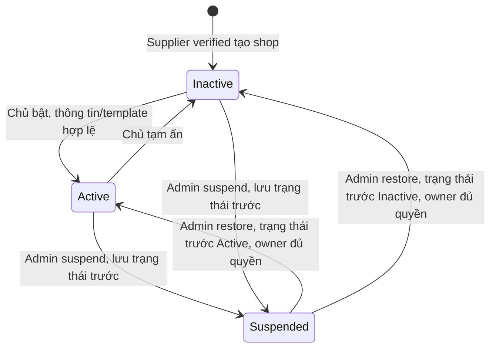

# [SHOP-MANAGEMENT-03] — Tạo và quản lý gian hàng

## I. TÊN TÀI LIỆU, TÍNH NĂNG & TỔNG QUAN

### 1.1. Thông tin

- Module 2, tính năng #3; P0 Critical; feature `shop-management`.
- Ngày: 2026-10-25; version 1.0.0; Draft / Plan only.
- Actors: Supplier verified, Admin, Customer/khách xem shop công khai.

### 1.2. Mục tiêu

Supplier tạo một shop có nhận diện riêng, điều khiển việc hiển thị; Customer xem đúng thông tin công khai và lọc sản phẩm. Admin có thể ngừng hiển thị shop vi phạm bằng quyết định có lý do/audit. Không mất dữ liệu sản phẩm, giao dịch hoặc lịch sử khi ẩn/suspend shop.

### 1.3. Phạm vi

Bao gồm tạo shop, sửa thông tin/liên hệ public, upload logo/banner, toggle Active/Inactive, Admin suspend/restore, public profile, product filtering, review/reputation read model. Kết hợp template mặc định/revision và appearance từ #4.

Không bao gồm tạo/sửa sản phẩm, nhập tồn kho, checkout mới, đánh giá mới, billing, chuyển quyền sở hữu, xóa shop hoặc sửa slug. Những luồng order/bid đang có phải kiểm tra Shop.Active cùng eligibility tại điểm nhận giao dịch mới; tiếp tục nghĩa vụ cũ không bị vô hiệu chỉ vì shop bị ẩn.

### 1.4. Invariants và ma trận quyền

`CanManageShop = user active + not deleted + Role Supplier + profile Verified + not deleted`. RequestedRole Supplier không đủ. Mỗi mutation đọc và khóa lại các row quyền hiện tại trong transaction.

| Actor/trạng thái | Đọc public | Đọc shop của mình | Tạo/sửa/theme/toggle | Suspend/restore |
| --- | --- | --- | --- | --- |
| Anonymous/Customer thường | Shop đủ điều kiện public | Không | Không | Không |
| Customer đang xác minh/rejected | Như khách | Không vào workspace shop | Đi trang Customer đăng ký Supplier | Không |
| Supplier verified, chưa có shop | Như khách | 404 SHOP_NOT_FOUND | Tạo một shop | Không |
| Supplier verified, shop Inactive/Active | Theo visibility | Có | Có, chỉ shop của mình | Không |
| Supplier verified, shop Suspended | Không public | Có + lý do | Chỉ đọc; mutation bị chặn | Không |
| Supplier bị revoke/khóa | Không public | Không cấp mới quyền quản lý | Không; về luồng Customer tương ứng | Không |
| Admin active | Public nếu đủ điều kiện | Admin read endpoint | Không mạo danh sửa shop Supplier | Có, có version/lý do |

Rule public là conjunction: Shop Active/not deleted AND owner active/not deleted/Role Supplier AND profile Verified/not deleted. Áp dụng cho profile, products, reviews, categories và các link API theo slug/ID, không chỉ trang header. Unavailable trả 404 chung cho public; chủ/Admin nhận trạng thái chi tiết qua endpoint riêng.

## II. FLOW CHART TOÀN BỘ LUỒNG

### 2.1. Sequence tạo shop

```mermaid
sequenceDiagram
  autonumber
  actor S as Supplier verified
  participant FE as Colony Supplier UI
  participant API as ShopsController
  participant SVC as ShopService
  participant REPO as IShopRepository / DTO transaction
  participant DB as PostgreSQL
  S->>FE: Nhập tên, slug, liên hệ, chọn template
  FE->>API: POST /shops/me + Idempotency-Key
  API->>API: Request DTO validation
  API->>SVC: Request DTO + actor từ JWT
  SVC->>REPO: Execute transaction, ShopLockScopeDto
  REPO->>DB: Khóa User → Profile → Shop → Template
  REPO-->>SVC: ShopBusinessStateDto mới nhất
  SVC->>SVC: Eligibility, ownership, 1 shop, template/media hợp lệ
  SVC->>REPO: ShopWriteDto + AuditWriteDto + IdempotencyWriteDto
  REPO->>DB: INSERT Inactive + audit + idempotency; commit
  REPO-->>SVC: PersistResultDto
  SVC-->>API: OwnerShopResponse
  API-->>FE: 201 ApiResponse, version=1
  FE-->>S: Lưu thật thành công; cho phép preview/bật hiển thị
```

### 2.2. Trạng thái lưu và quyền hiển thị



Revoke/disable owner là cổng eligibility độc lập, không tự ghi đè trạng thái shop hoặc làm mất suspension. Khi owner không đủ quyền, shop vẫn không public dù cột status còn Active. Khi re-verified, trạng thái Suspended vẫn giữ; Admin restore kiểm tra lại owner verified trước khi thực hiện. Không phát sinh trạng thái PendingShop không có trong business.

## III. CHI TIẾT TỪNG BƯỚC XỬ LÝ

| Bước, mục đích | Input → Output | Validation/Business | Ngoại lệ |
| --- | --- | --- | --- |
| 1. Mở quản lý shop | Actor → OwnerShopResponse hoặc empty state | JWT hợp lệ; DB capability mới nhất | 401/403; 404 chỉ nghĩa là chưa tạo, không tạo shop trong GET |
| 2. Chuẩn bị media | File/purpose → mediaAssetId | DTO multipart, signature/scan/decode, verified owner, purpose và quota | 400/413/415/429; 503 scanner/storage; không giữ DB lock khi gọi Cloudinary |
| 3. Tạo shop | CreateShopRequest + key → shop Inactive/version 1 | Name/slug/contact/template đúng; owner/profile từ server; check một shop dưới User lock | 409 duplicate supplier/slug/key; 403 revoked; rollback toàn bộ mutation |
| 4. Cập nhật thông tin | UpdateShopRequest + expectedVersion → version+1 | Trim/NFKC; plain text; ownership, media Ready cùng owner/purpose; không sửa owner/slug/status/theme bằng DTO này | 400/404/409; giữ draft FE khi thất bại |
| 5. Bật/tắt hiển thị | SetMyShopVisibilityRequest → version+1 | Chỉ Active/Inactive, không Suspended; Active cần tên/slug/template revision hợp lệ và eligibility | 409 suspended/stale; không âm thầm bỏ suspension |
| 6. Suspend/restore | AdminShopModerationRequest → version+1 | Admin hiện tại, reason 10–1000; Suspend lưu status cũ; Restore phục hồi status cũ, owner phải đủ quyền | 403 self/role không hợp lệ; 409 state/version; audit cùng transaction |
| 7. Public profile | slug → PublicShopResponse | Public gate; chỉ projection fields công khai; badge/reputation lấy DB, không nhận từ Supplier | 404 unavailable; không tiết lộ lý do suspend/pháp lý |
| 8. Product query | slug + filters/cursor → CursorPage<ProductCardResponse> | Gate shop, category/price/variant filters cùng candidate variant; bounded read | 400 invalid filter/cursor; 404 shop bị ẩn giữa các request |
| 9. Review/contact | slug + cursor → public review/contact DTO | Chỉ IsPublic/not deleted; display name đã áp chính sách ẩn danh, không trả email cá nhân | 404 unavailable; empty state khi chưa có review |

### 3.1. Profile và thông tin public

- Owner tự chọn công khai contact email/phone/address riêng; không tự động lấy toàn bộ dữ liệu legal trong verification hay user email.
- Name/description là plain text đã encode khi render. Logo/banner dùng mediaAssetId server cấp, không URL client chỉ định.
- Badge Verified, reputation score và average rating do read model tính từ supplier profile/review thực tế. Không có dữ liệu → hiển thị “Chưa có đánh giá”, không điền 98%, ISO hoặc số review giả.
- Không trả user flags, legal documents, review moderation reason, outbox hoặc provider credential.

### 3.2. Lọc sản phẩm đúng biến thể

- Read subset phục vụ shop được triển khai trong feature này dù module product CRUD chưa có controller. Không giả định `/products` hiện đã hoạt động.
- Category là category hiện hữu và chưa xóa; v1 lọc đúng categoryId, không tự gộp descendants.
- Giá hiển thị là khoảng giá hợp lệ của variant: `product.BasePrice + variant.PriceAdjustment`, dùng decimal/DB numeric. Các filter flavor/filling/weight/price/inStock phải cùng thỏa trên một variant, tránh ghép giá của variant A và nhân của variant B.
- Sản phẩm có status Active hoặc OutOfStock có thể xem; Inactive/deleted bị ẩn. Không có variant hợp lệ thì không xuất card; inStockOnly=true yêu cầu Active và stock > 0. Public không lộ SKU nội bộ/toàn bộ tồn kho nếu không cần.
- Newest/priceAsc/priceDesc dùng tie-breaker product.Id; cursor gắn shop/filter/sort. Giá/tồn kho vẫn có thể đổi giữa các trang; cursor không phải snapshot toàn catalog.
- Endpoint reviews chỉ đọc transaction reviews public hiện có; tính điểm, tạo review hoặc sửa review thuộc module khác.

### 3.3. Giao dịch đang tồn tại

Ẩn/suspend không xóa sản phẩm, order, contract, bid, payment hoặc lịch sử. Rà soát create/confirm order và create/award bid để khóa cùng User/Profile/Shop trước kiểm tra mới; fulfillment cũ đi theo chính sách Module 1/4/6, không bị buộc shop phải Active mới giao hàng được.

## IV. ĐẶC TẢ KỸ THUẬT API

Contract đầy đủ và field matrix: [03_API_DTO_VALIDATION.md](./03_API_DTO_VALIDATION.md).

| Endpoint đề xuất | Auth | Ý nghĩa |
| --- | --- | --- |
| GET/POST `/api/v1/shops/me` | Supplier verified | Đọc/tạo shop của actor |
| PUT `/api/v1/shops/me` | Supplier verified | Thông tin public; không đổi slug |
| PATCH `/api/v1/shops/me/visibility` | Supplier verified | Active/Inactive |
| POST `/api/v1/shops/me/media` | Supplier verified | Upload Logo/Banner |
| GET `/api/v1/shops/{slug}` | Public | Profile + appearance đã publish |
| GET `/api/v1/shops/{slug}/products` | Public | Bounded/filter read subset |
| GET `/api/v1/shops/{slug}/categories` | Public | Category filter suggestions có phân trang |
| GET `/api/v1/shops/{slug}/reviews` | Public | Public reviews phân trang |
| GET `/api/v1/admin/shops` và `/{shopId}` | Admin | Summary phân trang và chi tiết moderation |
| PATCH `/api/v1/admin/shops/{shopId}/status` | Admin | Suspend/Restore với reason/version |

Tất cả JSON dùng ApiResponse<T>, errorCode ổn định, field errors, path, traceId, time UTC. Rate policies theo actor/IP, giới hạn đề xuất ở tài liệu 03. Tránh `/shops/me` bị route slug bắt nhầm bằng static route và reserved slug.

## V. KIẾN TRÚC PHÂN TẦNG VÀ TỔ CHỨC MÃ NGUỒN

- Domain: giữ Shop/ShopStatus, bổ sung version, public contact, media references, suspension fields; không phụ thuộc DTO/persistence.
- Application: `IShopService`, `ShopService`, `ShopPublicQueryService`; request/response và persistence DTO dưới `DTOs/Shops/{Requests,Responses,Persistence}`. `ShopPolicyHelper`, `ShopSlugHelper`, `ShopResponseHelper` chứa logic thuần túy; messages ở `ShopConstants`.
- Persistence contract: `IShopRepository`, `IShopTransaction` trong Application/Common/Interfaces. Repository nhận DTO command/query và trả DTO snapshot/projection/result; entity EF chỉ nội bộ Infrastructure. Chi tiết Unit of Work ở 03/04.
- Infrastructure: `ShopRepository`, mapping DTO↔entity, EF config/index/FK, media adapter tái sử dụng CloudinaryStorageService. Không đặt business rule trong SQL repository.
- WebApi: `ShopsController` mỏng; auth/rate/validation/HTTP; chuyển actor qua `ShopActorDto` do server tạo. Admin endpoint cũ delegate về ShopService mới, bỏ lối cập nhật status thiếu version.
- FE: shopService/useMyShop, chia StoreSetUp thành form thông tin và appearance; public ShopPage dùng Customer layout. Xem 05.

## VI. BẢO MẬT & KIỂM THỬ

- Ownership ở DB snapshot trong transaction, không tin supplierId từ form/JWT role cũ. UUID.Empty bị chặn; overposting fields bị từ chối.
- 23505 unique supplier/slug phải trả 409 đúng mã; 23503 do template bị thay đổi trả conflict phù hợp; không lộ SQL.
- N+1 Admin hiện tại phải thay bằng projection count theo group/join; không tải navigation collection theo từng row.
- Test create cùng owner/cùng slug từ hai owner, stale update, suspend vs visibility, revoke vs create/save/activate, media của owner khác và public shop bị ẩn.
- Test actual HTTP model binding/MVC validation cho body/query; không chỉ gọi service. Record validation đặt ở constructor parameter nếu positional, hoặc dùng DTO init properties; regression bài học revoke/read-all đã có.
- Các tiêu chí query count, migration/preflight và test matrix ở 04/06. Không chạy DDL hoặc mutation thật trong bước lập plan.
