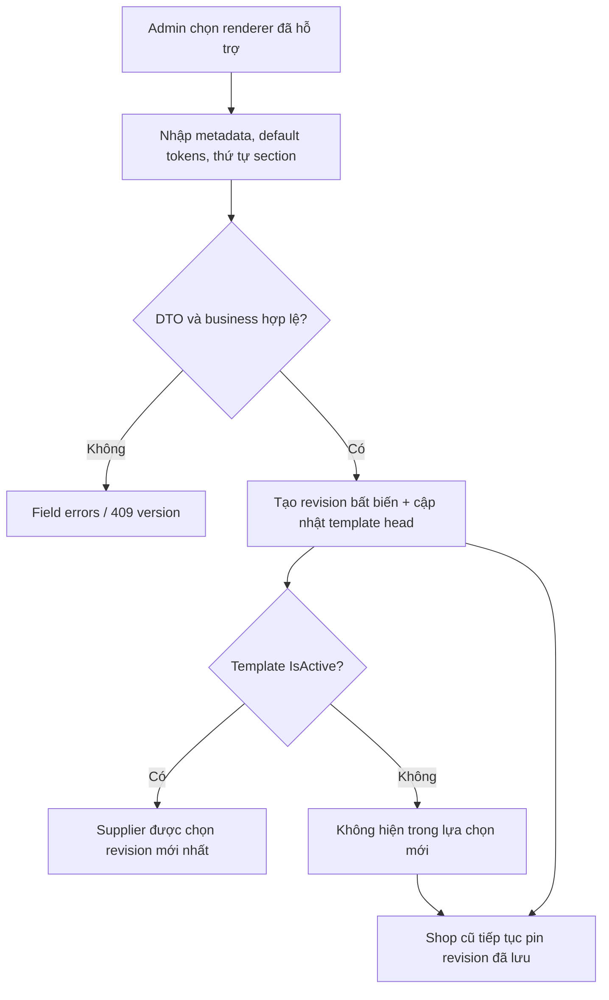

# [SHOP-MANAGEMENT-04] — Tùy chỉnh giao diện gian hàng

## I. TÊN TÀI LIỆU, TÍNH NĂNG & TỔNG QUAN

### 1.1. Thông tin

- Module 2, tính năng #4; P1 High; feature `shop-management`.
- Ngày: 2026-10-25; version 1.0.0; Draft / Plan only.
- Actors: Supplier verified và Admin quản trị template. Customer chỉ xem theme đã lưu.

### 1.2. Mục tiêu và phạm vi

Cung cấp ít nhất 5 layout có thể phân biệt bằng cấu trúc thực, không chỉ khác màu. Supplier chọn mẫu, đổi typed design tokens, preview ngay và lưu mà không làm thay đổi sản phẩm. Admin thêm metadata/revision từ renderer đã deploy, ẩn/hiện và gắn nhãn Premium.

Không xây website builder chạy mã tùy ý, không upload HTML/CSS/JS, không remote renderer, không marketplace bán template. Premium chỉ là nhãn: chưa có module entitlement/payment để chặn quyền sử dụng. Nếu cần thu phí, thiết kế riêng trước khi thêm paywall.

### 1.3. Kho mẫu và renderer

| Template code/rendererKey ổn định | Cấu trúc hiển thị đề xuất |
| --- | --- |
| `heritage` | Banner trên, mô tả thương hiệu, grid sản phẩm và review |
| `royal-gift` | Hero tách hai cột, vùng giới thiệu quà tặng, card sản phẩm lớn |
| `minimal-grid` | Header gọn, bộ lọc sidebar desktop và product grid dày |
| `artisan-story` | Logo/thông tin thương hiệu cạnh nội dung, story section và grid |
| `modern-catalog` | Tabs danh mục, filter ngang, danh sách/catalog card |

Tên marketing có thể dịch ở FE; code/rendererKey không đổi. Cả 5 có mobile layout; cùng render ProductCard/PublicShopResponse an toàn. “Thêm template” của Admin là tạo cấu hình dùng một renderer đã đăng ký; renderer hoàn toàn mới cần thay đổi FE được review/deploy trước. Admin không nhập URL script hay tên React component bất kỳ.

## II. FLOW CHART TOÀN BỘ LUỒNG

### 2.1. Supplier preview và lưu

```mermaid
sequenceDiagram
  actor S as Supplier verified
  participant FE as Appearance editor + shared renderer
  participant API as ShopsController
  participant SVC as ShopAppearanceService
  participant REPO as DTO persistence transaction
  participant DB as PostgreSQL
  FE->>API: GET /shops/me + /shop-templates
  API-->>FE: Shop version, template revision, tokens, danh sách mẫu
  S->>FE: Chọn mẫu và đổi tokens
  FE->>FE: Validate cơ bản, render local draft, không ghi DB
  S->>FE: Lưu giao diện
  FE->>API: PUT /shops/me/appearance + key + expectedVersion
  API->>SVC: Validated typed DTO + actor
  SVC->>REPO: Transaction khóa User → Profile → Shop → Template
  REPO-->>SVC: Fresh permission/shop/template DTO
  SVC->>SVC: Rule template availability, revision, tokens, contrast
  SVC->>REPO: AppearanceWriteDto + audit + idempotency
  REPO->>DB: Conditional update version; commit
  API-->>FE: AppearanceResponse + shop version mới
  FE->>FE: Đánh dấu đã lưu; public dùng cùng revision/tokens
```

### 2.2. Admin publish revision và visibility



Ẩn template không thay đổi hàng nghìn shop. Version mới không tự áp dụng lên shop cũ. Không xóa revision đang được tham chiếu; thao tác Admin là tạo revision mới hoặc thay metadata/status head.

## III. CHI TIẾT TỪNG BƯỚC XỬ LÝ

| Bước | Input → Output | Kiểm tra | Error handling |
| --- | --- | --- | --- |
| 1. Load editor | OwnerShop + catalog → editor state | Supplier đủ quyền, shop không suspended | Giữ Customer flow nếu chưa approved; không tạo shop qua GET |
| 2. Chọn template | templateId/revision → draft | FE hỗ trợ renderer/schemaVersion; template còn selectable | Nếu vừa bị ẩn: BE từ chối chọn mới, UI yêu cầu chọn lại |
| 3. Override tokens | ColorPicker/Slider → typed draft | Key/type/range, màu HEX, text/background contrast | Không inject trực tiếp chuỗi CSS chưa validate |
| 4. Live preview | Draft + public-safe fixture/data → renderer | Cùng component renderer với trang public, CSS scope riêng | Không gọi write API khi kéo màu; preview không được đánh dấu đã lưu |
| 5. Save | Appearance DTO + key/version → persisted appearance | Fresh eligibility, owner, expectedVersion, exact revision, allowlist/contrast | 409 giữ draft và yêu cầu tải lại; không tự overwrite hoặc auto retry khác key |
| 6. Admin tạo/sửa | AdminTemplate DTO → head/revision | Renderer được allowlist, revision hợp lệ, ≥5 selectable sau thay đổi | Một save chỉ một revision; race dùng template version + unique code |
| 7. Ẩn/hiện/premium | Status DTO → head version+1 | Không ẩn mẫu mặc định hoặc làm số selectable <5; Premium là bool nhãn | Shop đang dùng mẫu ẩn vẫn render pinned revision, không forced migration |
| 8. Public render | Pinned revision + overrides → effective tokens/layout | Public gate shop, schema/renderer hợp lệ | Renderer không hỗ trợ thì dùng safe fallback đã deploy, không thực thi cấu hình lạ |

### 3.1. Token schema v1

`custom_colors` lưu object typed, dù tên cột lịch sử chỉ nói màu. Payload không nhận JSON string, CSS text hoặc dictionary tùy ý.

| Field | Type/range đề xuất | CSS variable do FE tự ánh xạ |
| --- | --- | --- |
| primaryColor | `#RRGGBB` | `--shop-primary` |
| backgroundColor | `#RRGGBB` | `--shop-background` |
| textColor | `#RRGGBB` | `--shop-text` |
| surfaceColor | `#RRGGBB` | `--shop-surface` |
| buttonTextColor | `#RRGGBB` | `--shop-button-text` |
| borderRadiusPx | integer 0–24 | `--shop-radius: <number>px` |
| fontScale | decimal 0.85–1.25, tối đa 2 chữ số thập phân | `--shop-font-scale` |

FE và BE tính contrast text/background, text/surface, buttonText/primary đạt tối thiểu 4.5:1 cho chữ thường. Default tokens của 5 mẫu phải pass; không claim người dùng chọn màu tùy ý vẫn accessible. Không cho `url()`, `@import`, `expression`, `var()` lồng, font URL, JS, SVG payload hoặc CSS selector do client định nghĩa.

### 3.2. Merge/reset và revision

- Effective tokens = default tokens của pinned revision + override fields đã cho phép.
- Supplier gửi đầy đủ override object mong muốn; `{}` xóa mọi override. Key vắng mặt dùng default; null không được dùng như CSS value.
- Chuyển template reset override về `{}` trong draft, có cảnh báo trước khi đổi nếu đang dirty; Supplier có thể chỉnh lại trước save.
- Lưu cùng template/revision đang pin được phép kể cả head đang hidden; không được chuyển shop khác sang hidden template hoặc nâng hidden template lên revision mới. Ngoại lệ này được xác định bằng exact current tuple trong transaction.
- Khi head đã có revision mới nhưng người dùng chọn từ catalog cũ: nếu đang chuyển/nâng template, trả 409 TEMPLATE_REVISION_CHANGED; không tự dùng revision khác. Catalog hiển thị đề nghị nâng cho shop hiện hữu; nâng là thao tác Supplier chủ động.
- Revision lưu defaults/layout/schemaVersion/rendererKey bất biến. Head chứa code, metadata, IsActive, IsPremium, currentRevisionId, version. Storefront không đọc defaults từ head mới nhất.

### 3.3. Nội dung không bị theme sửa

Change appearance chỉ cập nhật template/revision/overrides, Shop.Version và audit/idempotency. Không UPDATE products, product variants, promotions, review hay stock. Một aggregate shop version dùng chung cho information/visibility/theme/moderation nhằm ngăn lost update giữa hai tab.

### 3.4. Preview và dữ liệu chưa lưu

Preview là local draft, không public preview URL, không lưu sản phẩm giả. Khi chưa có hàng, dùng Empty state hoặc preview fixture ghi rõ “Dữ liệu minh họa”, không thể checkout. DOM preview nằm trong `.shop-preview-root`; theme custom properties không đè CustomerHeader/ColonyAdminLayout. Chỉ public renderer và preview root dùng các token này.

## IV. ĐẶC TẢ KỸ THUẬT API

| Endpoint đề xuất | Quyền/ý nghĩa |
| --- | --- |
| GET `/api/v1/shop-templates` | Supplier verified, catalog selectable và latest revision; có pagination |
| GET `/api/v1/shops/me/appearance` | Supplier verified, pinned template dù head hidden |
| GET `/api/v1/shops/me/preview` | Owner-only, profile và tối đa 12 product cards để preview shop Inactive; DTO public-safe |
| PUT `/api/v1/shops/me/appearance` | Supplier verified, key + shop expectedVersion |
| GET/POST `/api/v1/admin/shop-templates` | Admin, danh sách hoặc thêm template |
| GET/PUT `/api/v1/admin/shop-templates/{templateId}` | Admin, detail hoặc publish revision mới |
| PATCH `/api/v1/admin/shop-templates/{templateId}/availability` | Admin, IsActive + expectedVersion |
| PATCH `/api/v1/admin/shop-templates/{templateId}/premium` | Admin, IsPremium + expectedVersion |
| POST `/api/v1/admin/shop-templates/media` | Admin, thumbnail asset với purpose TemplatePreview |

Response kết hợp effective tokens, overrides, rendererKey, schemaVersion, templateRevisionId, selected version; không trả custom_css legacy. Contract và từng field ở tài liệu 03. Public profile đã chứa appearance đã lưu nên không cần gọi template catalog theo từng shop.

## V. KIẾN TRÚC PHÂN TẦNG VÀ TỔ CHỨC MÃ NGUỒN

- Domain: ShopTemplate, ShopTemplateRevision và Shop references; không chứa rendering engine hoặc dependency vào React/CSS framework.
- Application: `ShopAppearanceService`, `ShopTemplateService`; `ThemeTokensRequest/Dto`, `TemplateLayoutRequest/Dto`; `ShopThemeHelper` normalize/merge/contrast, `ShopRendererRegistry` allowlist schema thuần dữ liệu. Server rule không lấy renderer list từ client.
- Persistence: template query/write/revision DTO, transaction snapshot DTO; Infrastructure map sang entity/JSONB. DTO không trả string JSON chưa parse để FE tự evaluate.
- WebApi: controller riêng template; field validation, auth/rate limits; controller không gọi DbContext.
- FE: `ShopAppearanceEditor`, `ShopLivePreview`, `ThemeTokenForm`, `TemplatePicker`, `ShopRendererRegistry` và 5 renderer. Template builder Admin chỉ nhập schema, không code editor. Tái sử dụng renderer ở PublicShopPage.
- Revision mới chỉ deploy sau khi BE/FE cùng hỗ trợ schema. Schema version lạ không được ghi/publish; mẫu lỗi runtime dùng fallback cố định và ghi telemetry không kèm secret.

## VI. BẢO MẬT & KIỂM THỬ

- Reject unknown fields cả top-level và nested tokens/layout; test CSS injection qua từng token, JSON key lặp, recursive layout, renderer giả, remote URL, overflow số và NaN.
- Preview không gọi save API; đổi template không làm tăng/giảm số product/stock. Escape mô tả của Admin/Supplier, không `dangerouslySetInnerHTML`.
- Template hide/select cùng lúc: chỉ một state hợp lệ theo template lock; shop đã pin không bị mất theme. Hai Admin cùng ẩn không được làm selectable <5.
- Global catalog minimum/default invariants dùng một singleton catalog guard row khi mutation thay đổi IsActive/IsDeleted/default; query count không tăng theo số shop dùng mẫu. Xem 04.
- Test actual MVC validation record/nested DTO và parser unknown fields. Test refresh/reload UI sau save, 409 giữ draft, multi-tab update, mobile/contrast và keyboard.
- Seed idempotent ≥5 templates + revisions + baseline safe default. Không chạy lại bootstrap admin như một migration seed tiện tay. Chi tiết ở 06.
