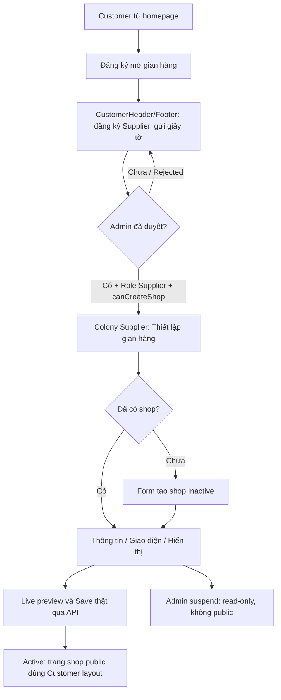

# Tích hợp mooncake-fe và flow UI

Ngày 2026-10-25, plan only. React/Ant Design và apiClient hiện có là baseline; không thay toàn bộ router hay các module khác để làm shop.

## 1. Flow theo role đã chốt



`requestedRole=Supplier` không mở workspace shop. Không thêm role selector vào register. Không tạo shop tự động khi Admin duyệt Supplier: sau duyệt người dùng có bước tạo shop riêng. Existing verification routes/notifications tiếp tục quy tắc Customer layout tới approved.

## 2. Route và màn hình

| Route/UI | Layout | Dữ liệu / thao tác |
| --- | --- | --- |
| `/#dang-ky-nha-cung-cap` | Customer | Giữ flow verification đang có, không gộp shop form vào đây |
| `/#nha-cung-cap/thiet-lap-gian-hang` | Colony Supplier, verified capability | GET /shops/me, create/edit info, bật/tắt Active, upload logo/banner |
| `/#nha-cung-cap/giao-dien-gian-hang` | Colony Supplier | TemplatePicker, token editor, live preview, save/reset/nâng revision |
| `/shop/{slug}` | CustomerHeader/Footer | Public profile/product filters/reviews/verified badge/contact + theme đã publish |
| `/#admin/gian-hang` | Colony Admin | Server-paged shop list, detail, suspend/restore với reason/version |
| `/#admin/mau-gian-hang` | Colony Admin | Catalog, add/edit revision, availability, premium label, safe thumbnail upload |

Public route là URL path theo business. App hiện dùng hash cho workspace và path cho Google callback; bổ sung route parser/boundary cho `/shop/:slug` cùng popstate/deep-link fallback, không làm hỏng `/auth/google/callback` và các hash route cũ. App navigation tới shop public phải tạo path thật, không `/#shop/slug`. Cấu hình hosting fallback về index.html là checklist deploy, không tự sửa server config trong bước plan. Kiểm thử mở URL trực tiếp/reload/back/forward và slug 404.

Menu Supplier tách “Thông tin gian hàng” và “Giao diện gian hàng”. Nút homepage cho Customer vẫn “Đăng ký mở gian hàng”; verified Supplier đã có shop có thể tới workspace/shop public qua menu tài khoản. Không dùng nhãn “Đã mở gian hàng” chỉ vì Supplier vừa được duyệt nhưng chưa tạo shop.

## 3. Màn tạo/cập nhật thông tin

- GET /shops/me 404 SHOP_NOT_FOUND → empty state + CTA “Tạo gian hàng”; 403 → refresh auth và quay đúng Customer verification flow, không coi là chưa có shop.
- Form Ant Design: tên, slug chỉ lúc tạo, mô tả, public contact riêng, logo/banner, template ban đầu. Cho biết shop sẽ bắt đầu ẩn và cần bật sau khi chuẩn bị.
- Slug preview `/shop/{slug}` từ draft, không hứa slug đã giữ chỗ. Không cần API check-slug v1; service/DB quyết định tại save. 409 slug attach field error.
- Ảnh dùng Upload customRequest qua shopService, FormData, idempotency, tiến trình và lỗi scanner/storage rõ ràng; không đưa secret/provider URL vào form input. Image public khác legal file private; chọn public logo/banner phải có diễn giải trước upload.
- Media upload đang chạy không cho save nếu asset chưa Ready. Remove logo/banner là set null ở lần PUT tiếp theo, không hard delete asset đang có trong revision/audit.
- Sau tạo thành công hiển thị status Inactive/version đã trả. Badge header lấy trạng thái BE, không mock. Bật Active là mutation riêng có xác nhận và expectedVersion; ẩn shop giải thích không hủy nghĩa vụ giao dịch cũ.
- Suspended: Alert với lý do cho owner, disable edit/theme/activate; không hiện CTA “Bật lại” của Supplier. Admin restore ở UI Admin, không sửa status local trên Supplier.

## 4. Appearance editor và public renderer

### 4.1. Components đề xuất

```text
src/constants/shop.js, shopTemplates.js, apiEndpoints.js
src/services/shopService.js, shopTemplateService.js
src/hooks/useMyShop.js, useShopMutation.js, useShopAppearanceDraft.js
src/utils/shopTheme.js, shopValidation.js, shopRoutes.js
src/components/shop/ShopInformationForm.jsx
src/components/shop/ShopMediaUpload.jsx
src/components/shop/TemplatePicker.jsx
src/components/shop/ThemeTokenForm.jsx
src/components/shop/ShopLivePreview.jsx
src/components/shop/renderers/ShopRenderer.jsx
src/components/shop/renderers/{Heritage,RoyalGift,MinimalGrid,ArtisanStory,ModernCatalog}.jsx
src/Pages/Supplier/{StoreSetUp,ShopAppearance}.jsx
src/Pages/Shops/PublicShopPage.jsx
src/Pages/Admin/{ShopManagement,ShopTemplateManagement}.jsx
```

Controls dùng Ant Design Form, Tabs, Card, ColorPicker, Slider/InputNumber, Select, Switch, Upload, Image, Drawer/Modal, Alert, Empty, Skeleton, Result và icons. Icon có aria-label/title, image có alt; không thêm input/button HTML thô. Dùng useApp message trong AntApp provider hiện có.

### 4.2. State của editor

Phân biệt `persisted`, `draft`, `dirty`, `isLoading`, `isSaving`, `conflict`, `error`. Load template và shop có AbortController/request generation; chuyển account/route bỏ response cũ. Không lưu draft nhạy cảm vào localStorage; rời trang khi dirty có confirm, refresh trình duyệt có beforeunload phù hợp.

Chọn mẫu → reset tokens draft theo quy tắc 02; ColorPicker đổi preview local, không POST/PUT từng lần kéo. Dùng cùng theme merge/validator semantics với BE; BE vẫn authoritative. “Đặt lại” là reset draft; chỉ “Lưu giao diện” mới ghi API. Preview có badge “Chưa lưu” khi dirty, không đổi shop public cho người khác.

Info và appearance dùng Shop.Version chung. Own successful response được dùng cập nhật version/baseline cho phần đã lưu; không reset draft tab khác. Nếu fetch bên ngoài cho thấy version thay đổi trong khi đang dirty, yêu cầu reload/so sánh; không tự nâng expectedVersion rồi gửi draft cũ. 409 giữ draft và vô hiệu auto retry, cho chọn tải baseline mới và tự áp lại thay đổi.

Template head hidden nhưng shop đang pin: vẫn hiển thị current template riêng với nhãn “Mẫu hiện tại không còn cho chọn mới”. Không auto chuyển sang mẫu đầu tiên. Template cập nhật revision: có CTA “Xem bản mới”/chủ động lưu, không tự thay public.

### 4.3. Preview dữ liệu thật và trống

GET `/shops/me/preview` là read-only owner endpoint trả public-safe shop projection và tối đa 12 product cards từ shop của chính actor, kể cả Inactive; ownership/eligibility kiểm tra như owner GET. Không public hóa nội dung Inactive và không đưa endpoint này cho Anonymous. DTO response riêng, không chứa legal documents/internal stocks/SQL entities.

Preview local kết hợp snapshot này với template/tokens draft; không tạo preview URL ngoài ứng dụng, không gửi public payload vào endpoint ghi. Nếu chưa có sản phẩm dùng Empty hoặc minh họa gắn nhãn rõ; không lấy catalog của shop khác hoặc mock order để lấp đầy.

### 4.4. Render CSS an toàn

CSS variables được tạo từ typed values đã validate tại FE; scope `.shop-preview-root` và `.shop-public-root`, không đè layout ngoài root. Ant components trong renderer nhận theme tokens tương ứng qua ConfigProvider scoped. Không evaluate layout JSON thành JSX code/HTML. BE và FE cùng enum schemaVersion/rendererKey; unknown renderer dùng safe fallback cố định, không fetch JS URL.

Ít nhất 5 template có cấu trúc thật như 02, responsive desktop/mobile, focus/contrast đúng. Public profile và preview render cùng component, không duy trì hai UI lệch nhau.

## 5. Public shop

- Tải profile/appearance rồi product/review page riêng để không payload khổng lồ. API unavailable → Result “Gian hàng hiện không khả dụng”, không hiển thị mock shop thay thế.
- Header có logo/banner/name, Verified chỉ từ backend, reputation/rating hoặc empty state, public contact opt-in. Theme không che badge verified hay thông tin an toàn giao dịch.
- Bộ lọc: category suggestions từ `/shops/{slug}/categories`, giá min/max, flavor/filling/weight, còn hàng; sort. Query state ở URL search params của path public, debounce text 300ms và abort request trước; đổi filter reset cursor, không dùng cursor của filter cũ.
- Card giá phản ánh variant hợp filter, khi mở chi tiết checkout vẫn bắt chọn variant và kiểm tra giá/tồn kho mới. Chưa có product-detail API tương ứng thì không giả lập order thành công; nối boundary read với Module 3 trong backlog.
- Reviews được phân trang, không tải toàn bộ; giữ anonymous display policy, text encode. Không fetch private user profile để tự ghép thông tin review.
- Shop bị suspend/revoke giữa lúc khách xem: request mới trả 404 thì dừng load-more, hiển thị unavailable; checkout BE check lại, không dựa dữ liệu cache cũ. Không hứa realtime shop events khi feature chưa thiết kế outbox riêng.

## 6. Admin UI

- ShopManagement dùng table phân trang/search/status server; detail Drawer không tải sản phẩm/review đầy đủ. Reason bắt buộc 10–1000 ở Suspend/Restore, expectedVersion đúng snapshot đang xem.
- Confirmation ghi rõ hidden/suspended không xóa order/product. 409 giữ reason và buộc tải lại; 403/503 không cập nhật bảng thành công giả.
- TemplateManagement hỗ trợ code lúc tạo, renderer enum, metadata, thumbnail, default colors/radius/font, section options hợp renderer, IsActive/IsPremium action riêng.
- Nhãn Premium không icon khóa mua hoặc redirect payment. Hiding default/đưa selectable dưới 5 được BE chặn, UI giải thích lỗi business.
- Publish revision cho biết các shop đang dùng bản cũ không bị đổi theo. Không có nút “Áp dụng tất cả shop” trong scope.
- Existing ControllerPage/adminService callers cần chuyển sang paged contracts và versioned moderation DTO; không giữ endpoint cũ cho phép cập nhật status thiếu version.

## 7. API client và lỗi

Endpoints tập trung apiEndpoints; apiClient xử lý Bearer/refresh, FormData Content-Type và blob như hiện có. Mutation hook một logical key giữ qua network retry, key mới chỉ khi user đổi payload/attempt. Double click bị khóa bằng ref và loading.

Field errors map Form.setFields; focus field đầu lỗi. Business/errorCode map nhãn Việt tập trung, traceId giữ cho support. 403 refresh quyền; 404 distinguish owner none/public unavailable; 409 không tự ghi đè; 429 tôn trọng Retry-After; 503 scanner/storage giữ draft và cho retry có kiểm soát.

Không success toast/mock fallback cho mutation hoặc shop public dù VITE_ENABLE_MOCK_FALLBACK=true. Preview fixture chỉ là UI minh họa trong editor, không đi qua production service như dữ liệu đã lưu. Không reset dữ liệu form khi API gặp lỗi.

## 8. Tiêu chí UI nghiệm thu

- Customer/pending Customer không vào được StoreSetUp, vẫn đăng ký Supplier bằng layout Customer.
- Supplier verified chưa có shop có empty/create thật; tạo xong reload giữ dữ liệu; public chỉ thấy khi Active.
- ≥5 template distinct; kéo màu không phát sinh write; save → reload/public giống preview đã lưu.
- Conflict/hide/revoke/suspension khi đang edit không báo success giả, không mất draft.
- Deep-link public/reload/back hoạt động; mobile không tràn nội dung; controls có label và keyboard focus.
- Admin moderation/catalog dùng API thật, version và reasons; không còn 4 template local cố định và toast lưu giả của StoreSetUp.
