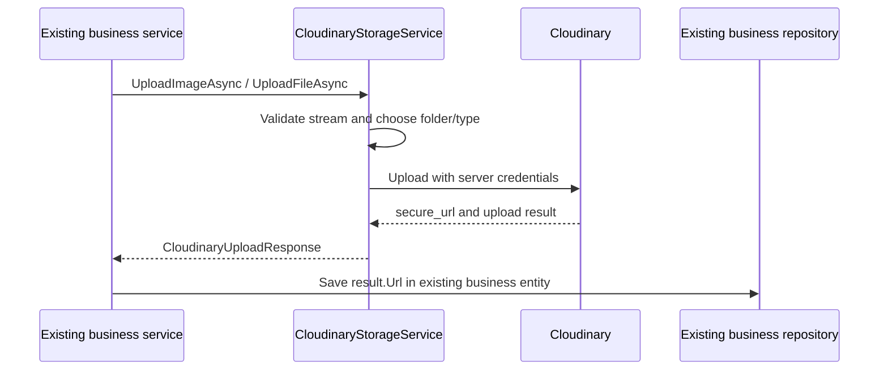

# [STORAGE-FILE] — Plan một service upload lên Cloudinary

## 1. Mục tiêu và phạm vi

- **Feature:** `storage-file`.
- **Phiên bản:** 2.2 — một service upload; toàn bộ giá trị cấu hình đọc từ appsettings.json.
- **Ngày cập nhật:** 2026-10-24.
- **Trạng thái:** Đã triển khai; thư mục và project test riêng đã được gỡ theo yêu cầu, giữ lại tài liệu plan này.

Xây dựng **một implementation `CloudinaryStorageService`** nhận stream, upload lên Cloudinary và trả thông tin file, trong đó có URL. Service nghiệp vụ hiện có nhận kết quả rồi tự lưu URL vào các cột hiện có như `AvatarUrl`, `ImageUrl`, `FileUrl` hoặc `SignedDocumentUrl`.

Service này không truy cập database. Không tạo entity quản lý file, bảng mới, repository, migration, service điều phối thứ hai, trạng thái attachment hoặc background cleanup. Không thêm controller/API, sửa luồng avatar/supplier, triển khai download hay xóa file trong phạm vi này.

Interface, options và một record kết quả nhỏ chỉ phục vụ contract/DI/cấu hình; không phải model database và không phát sinh tầng lưu trữ mới.

## 2. Folder và quyền truy cập

Giữ nguyên cấu trúc Cloudinary đã cung cấp:

```text
mooncake/
├── files/
└── images/
    ├── private/
    └── public/
```

| Thao tác | Folder | Resource type | Delivery type | Quyền đọc |
| --- | --- | --- | --- | --- |
| Upload ảnh public | `mooncake/images/public` | `image` | `upload` | Truy cập tự do bằng URL HTTPS |
| Upload ảnh private | `mooncake/images/private` | `image` | `authenticated` | Cần cơ chế truy cập được cấp quyền |
| Upload file | `mooncake/files` | `raw` | `authenticated` | Luôn private |

**Private là quyền truy cập của asset**, không phải trạng thái vòng đời cần lưu DB. File không có tùy chọn public. JPG/PNG được upload bằng phương thức upload file vẫn là file private; không tự chuyển sang nhánh ảnh public theo MIME.

Tên folder không tự bảo vệ asset. Service phải đặt delivery type tường minh khi upload. Chọn `authenticated` cho nội dung private để bảo vệ cả bản gốc và các bản biến đổi; Cloudinary delivery type `private` có hành vi khác với bản biến đổi. Tham khảo [Cloudinary delivery types](https://cloudinary.com/documentation/image_trans_flags_delivery_types).

Cloudinary không xác thực JWT ứng dụng bằng việc nhận URL asset. Service upload chỉ thiết lập bảo vệ tại Cloudinary; phần kiểm tra user và cấp quyền đọc nội dung private thuộc luồng sử dụng sau này. Plan này không xây dựng luồng download hoặc tạo URL truy cập có chữ ký.

## 3. Config trong appsettings.json

Merge section sau vào `src/Mooncake.EcommercePlatform.WebApi/appsettings.json`, giữ nguyên các section đang có:

```json
{
  "Cloudinary": {
    "CloudName": "t8rh8x0i",
    "ApiKey": "<cloudinary_api_key>",
    "ApiSecret": "<cloudinary_api_secret>",
    "Secure": true,
    "FolderMode": "Dynamic",
    "PublicImagesFolder": "mooncake/images/public",
    "PrivateImagesFolder": "mooncake/images/private",
    "FilesFolder": "mooncake/files",
    "MaxImageSizeBytes": 5242880,
    "MaxFileSizeBytes": 10485760,
    "UploadTimeoutSeconds": 60,
    "AllowedImageExtensions": [ ".jpg", ".jpeg", ".png", ".webp" ],
    "AllowedFileExtensions": [ ".pdf", ".jpg", ".jpeg", ".png" ]
  }
}
```

### 3.1. Mapping credential

| Thông tin đã cung cấp | Key trong appsettings.json |
| --- | --- |
| Cloud name sau dấu `@` | `Cloudinary:CloudName` |
| `cloudinaryApiKey` | `Cloudinary:ApiKey` |
| `cloudinarySecret` | `Cloudinary:ApiSecret` |

Không cần thêm `cloudinaryUrl`: SDK được khởi tạo từ ba trường trên. Connection URL dạng `cloudinary://<api_key>:<api_secret>@<cloud_name>` chứa credential, không phải URL file để lưu DB.

Credential thật chỉ điền trong cấu hình local được Git ignore hoặc cấu hình môi trường. `appsettings.sample.json` dùng cùng key với `ApiKey`, `ApiSecret` để trống. Không chép secret thật vào plan/test case hoặc frontend.

Có thể override bằng `Cloudinary__CloudName`, `Cloudinary__ApiKey`, `Cloudinary__ApiSecret` và các key `Cloudinary__...` tương ứng.

### 3.2. Validation cấu hình

Bind vào **một class `CloudinaryOptions`** tại Infrastructure, kiểm tra khi startup:

`CloudinaryOptions` chỉ khai báo thuộc tính nhận giá trị từ section `Cloudinary`, không hardcode giá trị mặc định cho folder, folder mode, extension, giới hạn dung lượng, timeout hoặc HTTPS. Mọi giá trị này nằm trong `appsettings.json` và `appsettings.sample.json`; thiếu hoặc sai cấu hình sẽ không vượt qua validation.

1. Cloud name, API key, API secret bắt buộc có giá trị và không còn placeholder.
2. `Secure = true`; timeout và giới hạn byte là số dương.
   Implementation giới hạn buffer tối đa 64 MiB và timeout tối đa 300 giây để cấu hình không tạo mức sử dụng tài nguyên không giới hạn.
3. Ba folder đọc từ cấu hình, khác nhau và là đường dẫn tương đối hợp lệ; không chứa `..`, backslash hoặc đường dẫn tuyệt đối. File cấu hình hiện tại giữ đúng cây folder ở mục 2.
4. `FolderMode` chỉ nhận `Dynamic` hoặc `Fixed`.
5. Danh sách extension đọc từ cấu hình, không rỗng và mỗi extension có dạng `.png`, `.pdf`, ...; không lặp lại allowlist trong source code. SDK vẫn cần chấp nhận nội dung khi upload ảnh.
6. Validation startup không gọi Cloudinary hoặc thực hiện upload.

`FolderMode = Dynamic` là cấu hình mẫu, cần kiểm tra mode thực tế của product environment trước khi triển khai; ảnh chụp folder không đủ để xác định mode. Không tự chuyển mode tài khoản. Không thêm tầng folder theo môi trường vào cây hiện tại.

Giới hạn 5 MiB cho ảnh, 10 MiB cho file là chính sách ban đầu của ứng dụng, không phải mô tả quota Cloudinary. Có thể điều chỉnh bằng cấu hình trong phạm vi tài khoản cho phép.

## 4. Contract của một service upload

### 4.1. Interface

Đặt interface tại `Application/Common/Interfaces/ICloudinaryStorageService.cs` để các service Application có thể sử dụng mà không tham chiếu Infrastructure:

```csharp
public interface ICloudinaryStorageService
{
    Task<CloudinaryUploadResponse> UploadImageAsync(
        Stream content,
        string fileName,
        bool isPrivate,
        CancellationToken cancellationToken = default);

    Task<CloudinaryUploadResponse> UploadFileAsync(
        Stream content,
        string fileName,
        CancellationToken cancellationToken = default);
}
```

- `UploadImageAsync`: bên gọi chọn public/private phù hợp nghiệp vụ; service tự chọn folder và delivery type tương ứng.
- `UploadFileAsync`: luôn upload private; không có tham số `isPublic` hoặc `isPrivate` để đổi quyền.
- Không nhận folder, public ID hoặc delivery type tùy ý từ bên gọi.
- Nhận `Stream` thay vì `IFormFile` để contract Application không phụ thuộc ASP.NET Core.
- Caller quản lý vòng đời input stream; service không dispose stream caller truyền vào.
- Implementation chỉ có một class `CloudinaryStorageService`; không thêm `FileService`, provider wrapper hoặc repository.

### 4.2. Kết quả trả về

Một record DTO tại `Application/DTOs/Files/Responses/CloudinaryUploadResponse.cs`:

```csharp
public sealed record CloudinaryUploadResponse(
    string Url,
    string PublicId,
    string ResourceType,
    string DeliveryType,
    long SizeBytes);
```

`Url` lấy từ `secure_url` của kết quả SDK. Với private asset, Cloudinary có thể trả sẵn chữ ký trong path `s--...--`; service bỏ đoạn chữ ký để trả URL canonical không cấp quyền truy cập. Không lưu URL đã ký vào DB. Các trường còn lại là thông tin kết quả upload, không tạo yêu cầu lưu metadata vào DB. Bên gọi có thể chỉ dùng `Url`.

Với private asset, URL canonical vẫn được trả về để lưu vào cột nghiệp vụ; URL này không cho phép truy cập tự do. Không trả connection URL, API secret hoặc toàn bộ SDK result.

## 5. Luồng upload



Hành động lưu DB trong sơ đồ do luồng nghiệp vụ hiện có thực hiện khi tích hợp; không triển khai thay đổi các luồng đó trong feature này.

### 5.1. Chuẩn bị đầu vào

1. Kiểm tra stream khác null và readable, tên file không rỗng.
2. Lấy tên an toàn, bỏ path và control characters; lấy extension bằng API xử lý path.
3. Kiểm tra extension theo nhóm ảnh/file; không nhận URL từ xa hoặc base64 qua contract này.
4. Giới hạn số byte thực tế đọc, kể cả stream không seek được; không chỉ tin `Length` hoặc kích thước client khai báo. Với giới hạn nhỏ ở trên có thể dùng buffer trong RAM có giới hạn, dừng khi vượt 1 byte.
5. Từ chối stream rỗng. Cancellation phải được kiểm tra trong quá trình đọc và truyền sang SDK.
6. Không xem extension là bằng chứng nội dung an toàn. Với image upload, Cloudinary phải chấp nhận nội dung là ảnh thì mới trả thành công. Quét malware hoặc bộ giải mã PDF/ảnh riêng không nằm trong phạm vi service upload này.

### 5.2. Chọn folder và tên asset

- Chọn một trong ba folder theo phương thức upload và `isPrivate` của ảnh.
- Sinh basename bằng GUID để tránh trùng tên; không dùng tên file gốc làm public ID.
- File `raw` giữ extension đã kiểm tra trong public ID; image public ID không thêm extension.
- `Overwrite = false`; không tự ghi đè asset có sẵn.
- Giữ asset trực tiếp trong folder đã chọn, không tạo cây folder nghiệp vụ/user mới.

Mapping folder theo [Cloudinary folder modes](https://cloudinary.com/documentation/folder_modes):

| Mode | Tham số upload |
| --- | --- |
| Dynamic | `asset_folder = selectedFolder`; `public_id = selectedFolder/basename`; không tự prefix thêm lần nữa |
| Fixed | `folder = selectedFolder`; `public_id = basename`; Cloudinary kết hợp folder và basename |

Lưu ý folder Media Library và public ID độc lập trong dynamic mode. Implementation dùng tham số tương ứng của phiên bản SDK đã pin và đọc public ID thực tế từ kết quả.

### 5.3. Gọi SDK và trả kết quả

1. `UploadImageAsync` dùng `ImageUploadParams`, resource `image`, delivery `upload` hoặc `authenticated`.
2. `UploadFileAsync` dùng `RawUploadParams`, resource `raw`, delivery luôn `authenticated`.
3. Khởi tạo và cấu hình client bằng options; không thay credential trên client dùng chung giữa các request.
4. Tạo linked cancellation token kết hợp token caller với `UploadTimeoutSeconds`.
5. Kiểm tra lỗi HTTP và `Error` trong kết quả SDK; không coi chỉ việc method trả object là upload thành công.
6. Kết quả thành công phải có HTTPS URL, public ID và đúng resource/delivery type đã yêu cầu. Với private asset, bỏ chữ ký truy cập provider trả sẵn trước khi trả URL cho bên gọi. Nếu thiếu hoặc sai policy thì báo lỗi, không trả URL public dự phòng.
7. Map kết quả sang `CloudinaryUploadResponse`; không gọi DB trong service.
8. Không tự retry upload bằng public ID mới sau timeout, vì request trước có thể đã tạo asset.

`SizeBytes` phản ánh kích thước asset provider lưu. Cloudinary có thể chuẩn hóa ảnh khiến kích thước khác input; không yêu cầu ảnh giữ nguyên số byte. Với file `raw`, kiểm tra kích thước provider trả về khớp số byte input.

### 5.4. Lỗi và trách nhiệm bên gọi

| Trường hợp | Hành vi service |
| --- | --- |
| Stream null/không đọc được/rỗng hoặc tên không hợp lệ | Báo lỗi validation trước khi upload |
| Extension không hỗ trợ | Báo lỗi validation |
| Vượt giới hạn byte | Dừng đọc, báo lỗi, không tiếp tục upload |
| Caller hủy | Truyền cancellation, giữ ngữ nghĩa `OperationCanceledException` |
| Hết timeout nội bộ | Báo lỗi timeout có thông điệp rõ ràng |
| SDK lỗi credential/network/quota | Báo lỗi upload với thông điệp an toàn; không lộ credential |
| SDK trả thành công nhưng sai resource/delivery hoặc thiếu URL | Báo lỗi kết quả không hợp lệ |

Dùng exception/message theo quy ước repository; mọi message trong source code là constants tiếng Anh. Không log options, secret, connection URL hoặc SDK result thô.

Upload Cloudinary và ghi DB của bên gọi không có transaction chung. Nếu upload thành công nhưng bên gọi không lưu DB, asset có thể chưa được tham chiếu. Plan này không tự thêm tracking/cleanup để xử lý trường hợp đó; việc quản lý vòng đời chỉ bổ sung khi có yêu cầu riêng.

## 6. File cần tạo hoặc cập nhật khi triển khai

| File | Vai trò |
| --- | --- |
| `Application/Common/Interfaces/ICloudinaryStorageService.cs` | Contract hai phương thức upload |
| `Application/DTOs/Files/Responses/CloudinaryUploadResponse.cs` | Record kết quả nhỏ |
| `Infrastructure/Options/CloudinaryOptions.cs` | Bind cấu hình Cloudinary |
| `Infrastructure/Services/CloudinaryStorageService.cs` | Implementation duy nhất gọi SDK |
| `Infrastructure/DependencyInjection.cs` | Bind/validate options, đăng ký client và service |
| `Infrastructure/Mooncake.EcommercePlatform.Infrastructure.csproj` | Tham chiếu SDK `CloudinaryDotNet` |
| `WebApi/appsettings.json` | Key và credential local |
| `WebApi/appsettings.sample.json` | Cùng key, không có secret thật |

Các đường dẫn trong bảng thuộc `src/Mooncake.EcommercePlatform.*` tương ứng. Helper thuần có thể tách khỏi class nếu logic kiểm tra/đọc stream phức tạp theo quy tắc repository; không tạo thêm service hoặc tầng repository.

Package cho feature là `CloudinaryDotNet`, đã pin phiên bản `1.29.3` tương thích .NET 8. Không bổ sung EF package, ImageSharp hoặc PdfPig cho phạm vi upload đơn thuần.

Đăng ký `ICloudinaryStorageService → CloudinaryStorageService` trong `AddInfrastructure(configuration)` hiện có. Không cần thêm một application implementation chỉ để chuyển tiếp lời gọi. Không thay DbContext, entity hoặc schema.

## 7. Trình tự thực hiện

1. Thêm options và JSON cấu hình ở mục 3.
2. Thêm interface và record kết quả.
3. Thêm SDK, implement hai phương thức upload theo policy folder/quyền.
4. Đăng ký DI và validation startup.
5. Kiểm tra config binding, validation, mapping folder, delivery type và xử lý lỗi/cancellation.
6. Build solution; chỉ chạy kiểm thử upload thật khi có yêu cầu, không cần giữ một project test riêng trong feature.

Không tự thực hiện thay đổi Cloudinary asset hiện có khi triển khai service. Việc kiểm kê/chuyển quyền asset cũ nằm ngoài feature này.

## 8. Cách sử dụng và nghiệm thu

Inject `ICloudinaryStorageService` vào service nghiệp vụ hiện có. `AddInfrastructure(configuration)` đã đăng ký implementation qua DI.

Các ví dụ sau là những lần gọi độc lập; mỗi lần dùng stream riêng hoặc reset vị trí stream trước khi dùng lại:

```csharp
var publicImage = await storage.UploadImageAsync(content, "photo.jpg", isPrivate: false, cancellationToken);
var privateImage = await storage.UploadImageAsync(content, "photo.jpg", isPrivate: true, cancellationToken);
var document = await storage.UploadFileAsync(content, "document.pdf", cancellationToken);

// Save through the existing business entity and repository.
entity.FileUrl = document.Url;
```

Caller sở hữu và dispose input stream. Lỗi input/extension/dung lượng dùng `ArgumentException`; cấu hình hoặc provider/result không hợp lệ dùng `InvalidOperationException`/`OptionsValidationException`; timeout nội bộ dùng `TimeoutException`; caller hủy giữ `OperationCanceledException`.

Lệnh build từ root repository:

```powershell
dotnet build Mooncake.EcommercePlatform.sln --no-restore
```

Tiêu chí nghiệm thu:

- Có đúng một implementation service upload, không có model DB/repository/migration cho file.
- Toàn bộ giá trị config lấy từ `appsettings.json` qua options/DI; options không chứa giá trị mặc định cho các thuộc tính cấu hình.
- Ảnh public vào `mooncake/images/public`, đọc tự do bằng URL HTTPS.
- Ảnh private vào `mooncake/images/private`, delivery `authenticated`.
- Mọi file vào `mooncake/files`, delivery `authenticated`; không có tùy chọn public.
- Service trả URL và thông tin upload để bên gọi tự lưu URL vào cột DB hiện có.
- Validation kích thước thực tế, lỗi SDK, timeout và cancellation được xử lý.
- Kiểm thử thật xác minh public URL đọc được không xác thực, private URL unsigned bị từ chối; đó là kiểm tra policy upload, không phải triển khai API download.

## 9. Tham chiếu

- [Quy tắc repository](../../AGENTS.md).
- [Cloudinary .NET integration](https://cloudinary.com/documentation/dotnet_integration).
- [Cloudinary .NET upload](https://cloudinary.com/documentation/dotnet_image_and_video_upload).
- [Cloudinary upload parameters](https://cloudinary.com/documentation/upload_parameters).
- [Cloudinary delivery types](https://cloudinary.com/documentation/image_trans_flags_delivery_types).
- [Cloudinary folder modes](https://cloudinary.com/documentation/folder_modes).
