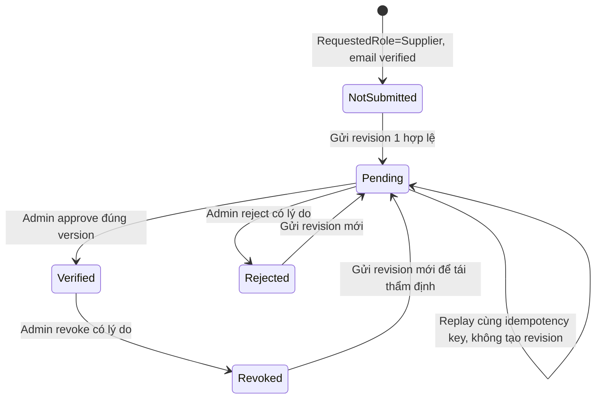
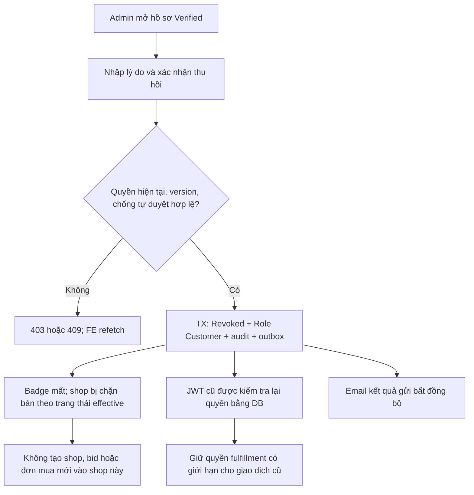

# [SUPPLIER-VERIFICATION] — TÀI LIỆU THIẾT KẾ CHI TIẾT

## I. TÊN TÀI LIỆU, TÍNH NĂNG & TỔNG QUAN

### 1.1. Thông tin tài liệu

| Thuộc tính | Giá trị |
| --- | --- |
| Tên | Xác minh & duyệt nhà cung cấp, BE + mooncake-fe |
| Feature key | `supplier-verification` |
| Business | Module 1 — tính năng #2 — P0 Critical |
| Phiên bản | 1.0.0 |
| Người thiết kế | Kế hoạch kỹ thuật phục vụ team triển khai/review |
| Ngày lập | 2026-10-24, Asia/Saigon |
| Trạng thái | Draft — thiết kế trước, chưa triển khai |
| Template | `../template/FEATURE_DETAIL_DESIGN_TEMPLATE.md` |

Tài liệu giữ sáu phần I–VI của template. Ví dụ message tiếng Việt trong template
được điều chỉnh theo quy tắc BE: message/error constant, identifier và log dùng
tiếng Anh; FE hiển thị bản dịch tiếng Việt. OTP không thuộc tính năng duyệt hồ sơ;
không thêm OTP chỉ để điền các bước mẫu trong template.

### 1.2. Mục tiêu nghiệp vụ

- Chỉ doanh nghiệp được Admin xác minh mới có quyền tạo gian hàng và tham gia RFQ.
- Supplier thấy được hồ sơ đã gửi, trạng thái, lý do từ chối và cách gửi lại.
- Admin duyệt đúng phiên bản tài liệu, có căn cứ và lịch sử kiểm toán.
- Thu hồi quyền bán hàng có hiệu lực với phiên đang đăng nhập, không chờ JWT hết hạn.
- Email kết quả được gửi lại khi hạ tầng email tạm lỗi, không rollback quyết định.
- Tài liệu pháp lý chỉ chủ hồ sơ và Admin có thẩm quyền được xem.

### 1.3. Phạm vi

**Bao gồm:** onboarding sau xác thực email; upload/xem tài liệu riêng tư; gửi/gửi lại
hồ sơ; hàng đợi có tìm kiếm/phân trang; xem revision; approve/reject/revoke;
audit; email; SignalR và in-app notifications bền vững cho feature này; capability
bán hàng; badge công khai; FE Supplier/Admin và cập nhật AuthContext. Test phải
kiểm tra cả BE và FE, kể cả mất kết nối/reconnect.

**Ranh giới:** không xây lại login/register, không tự tạo gian hàng sau duyệt,
không thực hiện eKYC/OCR hoặc tự đối chiếu cơ quan thuế, không tự hoàn tiền/hủy
hợp đồng khi thu hồi. Không xây lại generic storage service hoặc thông báo realtime
toàn hệ thống. Real-time giới hạn ở workflow xác minh Supplier; REST catch-up và
polling có giới hạn là phương án phục hồi, không thay yêu cầu real-time đã bổ sung.

### 1.4. Hiện trạng đã đọc và khoảng trống

| Nơi hiện tại | Phát hiện từ source | Kế hoạch |
| --- | --- | --- |
| `AuthService.RegisterAsync` | Tạo `Role=Customer`, lưu `RequestedRole` | Giữ mô hình; bổ sung dữ liệu onboarding trong `/auth/me` |
| `SuppliersController` | Có apply, me, pending, review | Mở self-read cho người đăng ký Supplier; thêm detail/history/revoke/upload |
| `SupplierService.GetPendingAsync` | Lặp profile rồi đọc documents từng hồ sơ | Thay bằng projection danh sách có phân trang; không tải file trên hàng đợi |
| `SupplierService.ReviewAsync` | Đọc Pending trước transaction, chưa có version | Đọc/kiểm tra/ghi trong transaction với khóa và expected version |
| `SupplierRepository.SaveApplicationAsync` | Transaction hiện có; tài liệu cũ bị soft-delete khi gửi lại | Lưu submission snapshot và giữ tài liệu thuộc revision cũ |
| `BaseEntity.Id` | Không tự cấp GUID; DB có default | Cấp ID rõ ràng và `Add` cho entity mới; không dùng `Id == Empty` làm tiêu chí sau khi cấp ID |
| `SupplierService.GetProfileAsync` | Helper private và ánh xạ DTO trong service | Tách mapping thuần sang static `SupplierVerificationHelper` |
| `SupplierProfileConfiguration` | Unique UserId/TaxCode đã có | Tái sử dụng; chuẩn hóa MST và kiểm tra trùng trước migration |
| `WorkflowEvent`, `AuditLog` | Có bảng sự kiện/audit; review hiện ghi WorkflowEvent | Thêm audit quản trị, submission/revoke event trong cùng transaction |
| `IEmailSender` | Đã có SMTP sender; supplier review chưa gọi gửi kết quả | Transactional outbox + worker dùng sender hiện có |
| `Notification`, FE notification UI | Có bảng; chưa có Supplier Hub/publisher, FE dùng mock | SignalR + durable inbox + unread APIs và real-time UI |
| `ICloudinaryStorageService` | Upload private raw file, trả metadata; không có API upload hồ sơ/read private | Tích hợp trong feature này, không nhận file URL từ FE |
| FE `SuppilerProfile.jsx` | Form và thông báo thành công đang là mock | Thay phần pháp lý bằng API + hook; giữ phần uy tín ngoài phạm vi |
| FE `ApprovePage.jsx` | Approve/reject/revoke chỉ cập nhật local state | Kết nối API, version conflict, lý do và audit thật |
| FE `StoreSetUp.jsx` | Badge Verified đang hiển thị cố định | Badge lấy dữ liệu capability/verification thật |
| FE `App.jsx`, layout | Điều hướng demo mở trang các role; chưa là authorization | Guard route và capability, không coi menu là bảo mật |

Các phát hiện là đọc source trong workspace, không phải kết quả test runtime/DB.
Tài liệu register cũ mô tả một phần flow OTP khác source; không lấy đó làm bằng
chứng endpoint Supplier đã sẵn sàng. `GET suppliers/me` hiện giới hạn Supplier/Admin
trong khi người chờ duyệt thường mang role Customer: đây là lỗi contract cần sửa.

### 1.5. Chính sách đề xuất cần owner chốt

| Chủ đề | Mặc định thiết kế đề xuất | Ảnh hưởng |
| --- | --- | --- |
| Giấy tờ | BusinessLicense + FoodSafetyCertificate; tài liệu khác tùy chọn | Có thể cần ngoại lệ theo loại hình; không khẳng định đây là quy định pháp luật |
| Định dạng | PDF/JPEG/PNG; không SVG, archive, HTML hoặc URL ngoài | Bảo vệ tài liệu pháp lý và viewer |
| Dung lượng | Tối đa 10 file/revision, 10 MiB/file, 50 MiB/revision | Dùng giới hạn nhỏ hơn nếu storage config hiện tại thấp hơn |
| MST | Chuẩn hóa, 10 số hoặc 10 số + nhánh 3 số, lưu khóa canonical | Owner chốt hỗ trợ mã nước ngoài/định dạng khác trước khi hard-code |
| Từ chối/thu hồi | Reason 10–1000 ký tự sau trim | Không công khai lý do trên shop |
| Gửi lại sau thu hồi | Được gửi revision mới; chưa tự khôi phục quyền | Admin phải duyệt lại; không phục hồi quyết định đình chỉ shop độc lập |
| Sửa khi Pending | Không sửa hồ sơ đã gửi; nhận quyết định rồi gửi revision mới | Tránh Admin duyệt tài liệu thay đổi giữa chừng |
| Xét duyệt | Chưa bắt buộc hai Admin; không được tự duyệt chính mình | Maker/checker riêng là phase tiếp theo nếu doanh nghiệp yêu cầu |
| Lưu trữ | Chưa chốt số năm; giữ lịch sử khi chưa có chính sách được phê duyệt | Không tự xóa bằng job hoặc soft-delete hàng loạt |
| SLA | Hàng đợi cảnh báo sau 2 ngày làm việc, chưa cam kết với khách | Cần owner xác nhận trước đưa vào UI |

## II. FLOW CHART TOÀN BỘ LUỒNG

### 2.1. Sequence diagram end-to-end

```mermaid
sequenceDiagram
  autonumber
  actor S as Người đăng ký Supplier
  actor A as Admin
  participant FE as mooncake-fe
  participant API as WebApi
  participant APP as Application service/policy
  participant DB as PostgreSQL
  participant ST as Cloudinary private storage
  participant W as Outbox worker
  participant MAIL as Email sender
  participant HUB as SignalR Hub
  S->>FE: Đăng nhập sau xác thực email
  FE->>API: GET auth/me + GET suppliers/me
  API->>APP: Kiểm tra account và requestedRole từ DB
  APP->>DB: Đọc quyền và hồ sơ hiện tại
  API-->>FE: Onboarding capabilities + NotSubmitted/Pending/...
  S->>FE: Điền công ty, MST, địa chỉ, giấy tờ
  FE->>API: POST suppliers/me/documents (multipart)
  API->>APP: Validate quyền, loại/byte thực tế, rate limit
  APP->>DB: Tạo bản ghi upload thuộc owner, transaction ngắn
  APP->>ST: Upload private ngoài DB transaction
  APP->>DB: Lưu metadata + trạng thái file
  API-->>FE: documentId, uploadStatus; không trả public URL
  FE->>API: POST suppliers/me/apply + documentIds + expectedVersion
  APP->>DB: Khóa user/profile, kiểm tra revision, ownership
  APP->>DB: Commit snapshot Pending + event + in-app outbox + idempotency
  API-->>FE: Hồ sơ chờ duyệt + version mới
  W->>DB: Tạo Notification cho Admin có quyền
  W->>HUB: Phát SupplierQueueChanged sau commit
  HUB-->>FE: Admin queue/badge invalidation
  A->>FE: Mở hàng đợi và chi tiết revision
  FE->>API: GET suppliers/applications + GET detail
  API-->>FE: Metadata và revision bất biến
  FE->>API: GET document content (Bearer + kiểm tra object access)
  API->>ST: Lấy nội dung bằng server credential, asset ID tin cậy
  API-->>FE: File stream, private/no-store
  A->>FE: Approve hoặc reject, nhập lý do khi cần
  FE->>API: POST review + submissionId/version + Idempotency-Key
  APP->>DB: TX: khóa, validate Pending và current version
  alt Quyết định hợp lệ
    APP->>DB: Commit status + role + audit + event + email/in-app outbox
    API-->>FE: Quyết định thành công, email queued
    W->>DB: Claim outbox event
    W->>MAIL: Gửi email kết quả, retry nếu tạm lỗi
    W->>DB: Upsert owner Notification theo eventId
    W->>HUB: Phát owner state và notification event
    HUB-->>FE: Invalidate auth/profile/unread
    S->>FE: Mở lại tab / kiểm tra trạng thái
    FE->>API: Refetch auth/me + suppliers/me
    API-->>FE: Quyền hiện tại + Verified hoặc lý do từ chối
  else Version/trạng thái không còn đúng
    API-->>FE: 409, yêu cầu tải hồ sơ mới
  end
```

API `content` dùng proxy có Bearer; không đặt token vào query string. Private read
adapter là phần tích hợp mới, upload service hiện tại chưa cung cấp khả năng này.

### 2.2. State transition



`NotSubmitted` là onboarding state suy ra khi chưa có submission; không cần thêm
role/enum trạng thái xác minh thứ năm. Business `pending_verification` ánh xạ vào
`Pending` trong BE và nhãn “Chờ xác minh” trên FE. `Rejected`/`Revoked` còn hiệu lực
cho tới khi một revision mới được approve; việc gửi lại không cấp quyền tạm thời.

### 2.3. Flow thu hồi



Không tự hủy đơn/hợp đồng, sửa tiền hoặc phạt uy tín trong transaction thu hồi.
Các quyết định tranh chấp/chế tài là workflow riêng có owner.

## III. CHI TIẾT TỪNG BƯỚC XỬ LÝ

### Bước 1 — Nạp trạng thái và kiểm tra điều kiện onboarding

- **Input:** Bearer JWT; user ID từ principal, không nhận owner ID từ client.
- **Validate:** account active, chưa soft-delete, email đã xác minh; requestedRole
  Supplier hoặc Supplier đã có hồ sơ. Admin dùng API quản trị, không nộp thay chủ hồ sơ.
- **Output:** self profile/NotSubmitted và capability; `/auth/me` trả role DB hiện tại,
  requestedRole và summary xác minh.
- **Ngoại lệ:** 401 JWT không hợp lệ; 403 không có điều kiện onboarding. Người có
  quyền onboarding nhưng chưa có profile nhận 200/NotSubmitted, không phải lỗi 404.
- **FE:** Customer thuần không thấy form Supplier; Customer requestedRole Supplier
  vẫn được vào trang onboarding. Không bị redirect vòng lặp vì thiếu role Supplier.

### Bước 2 — Chuẩn hóa và upload tài liệu

- **Input:** file stream + documentType + expiresOn tùy loại giấy tờ.
- **Validate:** allowlist extension/MIME và chữ ký nội dung; byte thực tế, hạn tài
  liệu; giới hạn quota owner. Server không tin `Content-Type`, tên file hay size FE.
- **Xử lý:** tạo document metadata thuộc owner; gọi upload private bên ngoài
  transaction; hoàn tất metadata từ kết quả SDK và kiểm tra an toàn nội dung.
- **Output:** documentId và `Uploading/Ready/Failed/Quarantined` thực tế; chỉ Ready
  được gắn submission. Nếu có pipeline scan bất đồng bộ, trạng thái chờ phải hiển thị
  rõ; không tuyên bố sạch khi scanner chưa chạy. Production phải chốt pipeline kiểm
  tra nội dung với người vận hành trước khi cho tài liệu untrusted được preview.
- **Ngoại lệ:** 413 quá dung lượng; 415 loại không hỗ trợ; 429 quota; 503 provider lỗi.
  File private thành công nhưng lưu DB lỗi không được trả thành công; ghi operation
  correlation để đối soát orphan, không tự xóa tài liệu thuộc submission đã gửi.

### Bước 3 — Gửi hoặc gửi lại hồ sơ

- **Input:** thông tin công ty + documentIds + expectedVersion + Idempotency-Key.
- **Validate:** trim/normalize Unicode, MST canonical; tài liệu đủ theo policy,
  Ready, đúng owner, chưa thuộc submission khác và không hết hạn; whitelist field.
- **Xử lý:** transaction ngắn, lock theo thứ tự User → Profile → Submission/Documents.
  Nếu chưa có profile, cấp GUID rồi `Add`; unique UserId là lớp bảo vệ cuối cùng.
  Kiểm tra version và trạng thái ngay trong transaction. Tạo revision snapshot, gắn
  tài liệu bất biến, đặt current submission, tăng version, ghi event/idempotency
  và outbox InAppRealtime để Admin nhận hồ sơ mới.
- **Output:** Pending + submissionId/revision/version/submittedAtUtc.
- **Ngoại lệ:** 409 nếu đang Pending, đã Verified, MST trùng, version cũ hoặc key
  bị tái sử dụng với payload khác. Không thay tài liệu Pending ngay dưới tay Admin.

### Bước 4 — Admin đọc hàng đợi và thẩm định

- **Input:** status/search/page/pageSize/sort trong allowlist.
- **Validate:** Admin thật, active từ DB; không tự xét hồ sơ của mình.
- **Xử lý:** projection phân trang, không vòng lặp tải documents. Chi tiết tải đúng
  submission revision, không dùng lẫn giấy tờ từ revision cũ và mới.
- **Output:** danh sách summary; detail, history và file metadata theo quyền.
- **Ngoại lệ:** 400 filter sai; 403 thiếu quyền; 404 ID không hợp lệ/không được sở hữu.
  Supplier không được dò hồ sơ khác qua ID hoặc file ID.

### Bước 5 — Approve hoặc reject

- **Input:** profileId, submissionId, expectedVersion, approve; rejectionReason khi reject.
- **Validate:** trạng thái Pending, current submission khớp, version không đổi;
  kiểm tra lại file/expiry/account ở thời điểm commit, không chỉ lúc mở màn hình.
- **Xử lý:** User/Profile locks; approve → Verified và Role Supplier; reject → Rejected
  và Role Customer, giữ RequestedRole Supplier. Cập nhật review metadata của đúng
  revision; ghi WorkflowEvent + AuditLog + email/in-app outbox + idempotency trong một TX.
- **Output:** profile version mới, decision metadata và `notificationStatus=Queued`.
- **Ngoại lệ:** 409 khi Admin khác đã quyết định hoặc revision thay đổi; không tự
  retry quyết định nghiệp vụ trên version mới. 400 nếu thiếu lý do từ chối.

### Bước 6 — Thu hồi và cập nhật quyền xuyên hệ thống

- **Input:** Verified profile + expectedVersion + lý do + idempotency key.
- **Validate:** Admin hiện tại; không tự xử lý; Verified là trạng thái nguồn duy nhất.
- **Xử lý:** TX đổi Revoked, lưu revokedAt/reason/actor, Role Customer; giữ snapshot
  và lịch sử duyệt trước đó; ghi event/audit/outbox. Không hard-delete profile/shop.
- **Output:** Revoked, capability bán mới false, thông báo đang chờ gửi.
- **Public shop:** badge chỉ hiện khi Verified; chỉ được bán khi shop Active AND
  Supplier Verified AND user active. Trạng thái hiệu lực `VerificationBlocked`
  được suy ra, không ghi đè lý do đình chỉ shop thuộc module khác.
- **Giao dịch cũ:** policy riêng cho đọc và fulfillment có giới hạn; không cấp lại
  mọi quyền Supplier. Chi tiết chốt trong tài liệu dữ liệu/bảo mật.
- **Ngoại lệ:** approval/revoke/bid diễn ra đồng thời được tuần tự hóa bằng cùng khóa
  User/Profile ở các command liên quan; không dựa vào disable button ở FE.

### Bước 7 — Email, real-time notifications và đồng bộ FE

- Worker claim outbox, lease ngắn, retry/backoff; không gửi SMTP trong DB transaction.
- Email chỉ có kết quả, lý do dành cho chủ hồ sơ và đường dẫn tới trang cần đăng nhập;
  không đính kèm URL pháp lý hoặc token. Chống HTML injection trong nội dung lý do.
- SMTP không bảo đảm exactly-once; chấp nhận at-least-once với event dedup, có thể có
  email trùng nếu worker crash sau khi gửi trước khi ghi nhận thành công.
- Worker materialize Notification idempotent rồi phát SignalR event tối thiểu cho
  owner/Admin có quyền; không broadcast giấy tờ/lý do tới nhóm tùy ý.
- FE refetch sau mutation/event/reconnect/focus; polling Pending chỉ là fallback
  có giới hạn khi realtime lỗi. Không tự nâng role từ event hoặc giả thành công.
- [Đặc tả đầy đủ FE](./04_FRONTEND_INTEGRATION.md).
- [Real-time, inbox và reconnect](./06_REALTIME_NOTIFICATIONS.md).

## IV. ĐẶC TẢ KỸ THUẬT API

### 4.1. Contract tổng quan

- Giữ base `/api/v1/suppliers`, body success/error bọc `ApiResponse<T>` hiện có.
- Self APIs dùng ownership + eligibility policy, không chặn theo Supplier role đơn thuần.
- Admin APIs yêu cầu Admin từ DB; endpoints file chỉ owner/Admin.
- Write endpoints bắt buộc `Idempotency-Key`; command tác động profile có expectedVersion.
- HTTP 400/401/403/404/409/413/415/429/503 có hành vi FE rõ ràng.
- Rate limit tính theo account + IP có quota file; không chỉ dùng process memory
  nếu production nhiều instance. Chi tiết policy trong tài liệu API.

### 4.2. Request minh họa

```json
{
  "submissionId": "4be42eb3-23b2-4b83-9b1c-e604a1ca9348",
  "expectedVersion": 7,
  "approve": false,
  "rejectionReason": "The food safety certificate is unreadable."
}
```

### 4.3. Response và lỗi

```json
{
  "status": 200,
  "message": "Supplier application reviewed successfully.",
  "data": {
    "profileId": "c13ed165-b06a-449f-b26f-6b81f4bd4230",
    "verificationStatus": "Rejected",
    "version": 8,
    "notificationStatus": "Queued"
  },
  "path": "/api/v1/suppliers/c13ed165-b06a-449f-b26f-6b81f4bd4230/review",
  "traceId": "9c9da56c48f34282a48a004981a849b8",
  "time": "2026-10-24T03:00:00Z"
}
```

`status` đồng nhất HTTP; server UTC, FE hiển thị Asia/Ho_Chi_Minh. Không đưa tên
công ty, MST hoặc chi tiết lỗi SQL vào message chung. Error code ổn định được bổ
sung có kiểm soát, không sửa cấu trúc wrapper một cách ngầm định.

[Danh sách endpoint và payload đầy đủ](./02_API_CONTRACTS.md).

## V. KIẾN TRÚC PHÂN TẦNG VÀ TỔ CHỨC MÃ NGUỒN

### 5.1. Backend

| Tầng | File/thành phần hiện có hoặc dự kiến | Trách nhiệm |
| --- | --- | --- |
| Domain | SupplierProfile, SupplierVerificationDocument, User | Trạng thái và metadata; không phụ thuộc EF/HTTP |
| Domain mới | SupplierVerificationSubmission, OutboxMessage, IdempotencyRecord | Snapshot, giao nhận email và replay an toàn |
| Application | ISupplierService, SupplierService | Orchestration, invariant và policy nghiệp vụ |
| Application | ISupplierRepository và transaction abstractions | Contract truy vấn/khóa/persist; không lộ DbContext |
| Application | Supplier DTOs, SupplierVerificationHelper, message/error constants | Validation/normalization/mapping thuần, lỗi tiếng Anh |
| Application | ICloudinaryStorageService hiện có; private-content interface mới | Upload tái sử dụng; contract đọc asset có quyền thuộc feature này |
| Infrastructure | SupplierRepository, EF configurations/migration | LINQ/parameterized SQL, transaction, lock, index |
| Infrastructure | Private document adapter, outbox worker, idempotency store | Cloudinary, SMTP qua IEmailSender, lease/retry |
| WebApi | SuppliersController, DTO binding, authorization/rate-limit | Điều phối service, Bearer, response/correlation |
| WebApi | JWT principal freshness/policies | Kiểm tra account DB, current role trước role authorization |
| WebApi | SupplierVerificationHub, publisher adapter qua IHubContext | Authenticated user-targeted push sau commit, không lộ tầng WebApi vào Infrastructure |

Giữ chiều Domain ← Application ← Infrastructure ← WebApi; controller không gọi
repository. Infrastructure không tự quyết định approve/reject. Transaction unit
nhận command đã được Application điều phối và đảm bảo khóa/atomic persistence.
Không tạo “God service” dùng chung mọi module.

### 5.2. Frontend

- Constants: endpoints/routes/status/permissions riêng.
- Services: mở rộng `supplierService.js` qua `apiClient`; tách file operation nếu cần.
- Hooks: `useSupplierVerification`, `useSupplierApplications`, mutation/in-flight guard.
- UI: tái sử dụng `SuppilerProfile.jsx`, `ApprovePage.jsx`, `ColonyAdminLayout` và theme.
- Auth: `/auth/me`, capability và route guards; không chỉnh JWT ở phía client.
- Ant Design `Form`, `Upload`, `Steps`, `Table`, `Drawer`, `Modal`, `Alert`, `Tag` và
  `@ant-design/icons`; không tạo thẻ tương tác HTML thay component Ant Design.

## VI. BẢO MẬT & KIỂM THỬ

### 6.1. Checklist bảo mật và tính toàn vẹn

- [ ] N+1 được loại bỏ bằng projection/batch; kiểm chứng số truy vấn theo page size.
- [ ] Unique DB + version + shared lock order bảo vệ apply/review/revoke và command bán hàng.
- [ ] Mọi raw SQL có parameter; sort/identifier từ allowlist, không nối string đầu vào.
- [ ] Account/ownership/current permission được kiểm tra ở BE kể cả JWT chưa hết hạn.
- [ ] File private, document IDs thuộc owner, nội dung được kiểm tra và xem qua API có quyền.
- [ ] Immutable submission; quyết định/audit/outbox/idempotency commit nguyên tử.
- [ ] Không log tài liệu, token, signed URL, email body, lý do pháp lý nguyên văn.
- [ ] Rate limit/quota và retry không biến lỗi hạ tầng thành thành công giả.
- [ ] Realtime nhận đúng actor; event tối thiểu, durable inbox, dedup/version và REST catch-up.
- [ ] OTP one-time-use của template không áp dụng cho command duyệt; idempotency
  key chống lặp command, không được mô tả như xác thực thay thế JWT.

### 6.2. Nhóm kiểm thử bắt buộc

Happy path đủ hai role; sai quyền/IDOR; file sai/oversize; từ chối thiếu lý do;
MST trùng; double submit; hai Admin review; review đối đầu resubmit; revoke đối đầu
bid/shop/order; stale JWT; SMTP crash/retry; replay idempotency; query-count N+1;
SQL injection payload; FE loading/409/401/403/focus refresh và accessibility;
real-time offline/reconnect, event trùng/lệch thứ tự và hai instance.

Xem [thiết kế dữ liệu và cơ chế bảo vệ](./03_DATA_CONCURRENCY_SECURITY.md),
[test matrix và rollout](./05_DELIVERY_TEST_PLAN.md).
