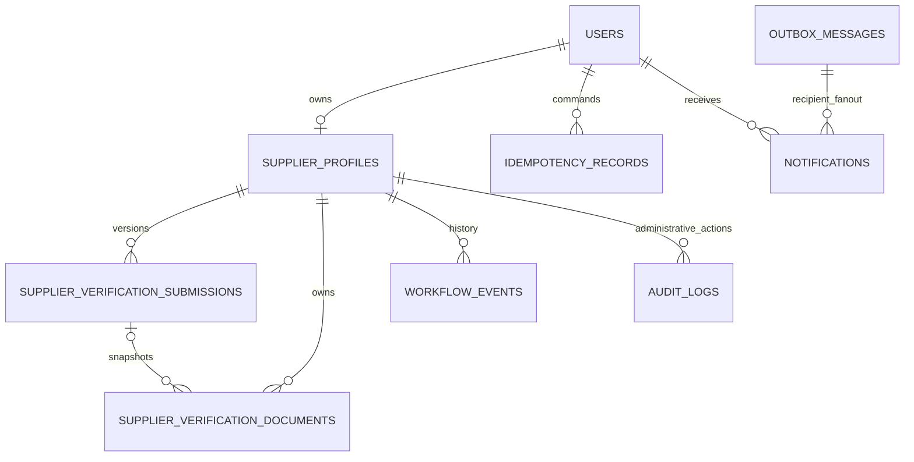

# [SUPPLIER-VERIFICATION] — DỮ LIỆU, CONCURRENCY & SECURITY

Thiết kế đề xuất, chưa tạo migration. Schema thực tế phải kiểm tra bằng migration
snapshot và PostgreSQL staging trước khi phát hành; không chạy SQL lên DB production
trong bước lập plan.

## 1. Mô hình dữ liệu



Quan hệ WorkflowEvent/AuditLog tới profile là logical reference vì đây là bảng
đa aggregate; không tùy tiện thêm FK chỉ dành cho Supplier. Không tạo bảng file
chung mới; metadata nằm trong `SupplierVerificationDocument` hiện có.

### 1.1. SupplierProfile hiện có — thêm dữ liệu điều phối

| Field | Thiết kế |
| --- | --- |
| `Id`, `UserId` | Giữ GUID và unique UserId hiện có; không tạo nhiều profile khi resubmit |
| `VerificationStatus` | Giữ enum Pending/Verified/Rejected/Revoked |
| `Version` mới | bigint NOT NULL default 0; concurrency token application-managed |
| `CurrentSubmissionId` mới | Nullable GUID tới revision gần nhất; null là chưa nộp |
| `LastApprovedSubmissionId` mới | Nullable GUID; truy vết bộ hồ sơ đã từng được duyệt |
| `LastSubmittedAtUtc` mới | UTC để sort/index hàng đợi |
| `VerifiedAt`, `ReviewedAt`, `ReviewedByUserId` | Projection quyết định hiện tại; lịch sử không phụ thuộc các field bị ghi đè |
| `RevokedAtUtc`, `RevokedByUserId`, `RevocationReason` mới | Metadata thu hồi; lịch sử đầy đủ ở event/audit |
| `TaxCode` | Canonical sau normalize; unique hiện có, không lập unique trùng chức năng |

CompanyName/TaxCode/Address là projection của current submission khi đã nộp.
Shell profile được tạo khi upload lần đầu có TaxCode null, CurrentSubmissionId null;
không xuất hiện trong hàng đợi Pending. Trạng thái NotSubmitted do API suy ra.

Khi resubmit sau Revoked, profile chuyển Pending nhưng quyền vẫn false; dấu vết
thu hồi không bị xóa khỏi lịch sử. Quyền bán mới chỉ được mở lại khi Verified.

### 1.2. SupplierVerificationSubmission — bảng mới, snapshot nghiệp vụ

- `Id`, `SupplierProfileId`, `Revision`, `CompanyName`, `TaxCode`, `Address`,
  `Description`, `SubmittedAtUtc`, `SubmittedByUserId`.
- `Status`: Pending/Verified/Rejected; `ReviewedAtUtc`, `ReviewedByUserId`,
  `RejectionReason`, `Source` (Web/LegacyImport).
- Nội dung công ty và file set bất biến từ lúc submit; review chỉ ghi metadata quyết
  định một lần. Revoke ghi sự kiện mới và đổi profile, không viết lại quyết định
  Verified của một submission đã duyệt trong quá khứ.
- Unique `(SupplierProfileId, Revision)`; partial unique tối đa một submission
  Pending/profile. FK current/lastApproved phải trỏ submission cùng profile;
  dùng composite FK hoặc kiểm tra transaction + constraint phù hợp được migration test.
- Không tạo số revision bằng `max+1` không có khóa; tính khi đang giữ profile lock.

### 1.3. SupplierVerificationDocument — mở rộng bảng hiện có

- Thêm `OwnerUserId`, `SubmissionId` nullable, `UploadStatus`, `Sha256`,
  `ProviderPublicId`, `ProviderResourceType`, `ProviderDeliveryType`,
  `UploadOperationId`, `ValidationCompletedAtUtc`.
- Giữ FileUrl để tương thích lưu trữ nội bộ; **không trả URL này trong public/self
  list DTO**. Chỉ BE tin metadata từ Cloudinary SDK, không từ FE.
- `ContentType`, `FileSizeBytes`, original filename do server xác nhận; expiresOn
  thuộc giấy tờ, không nhầm với hạn signed URL/download.
- `OwnerUserId` và profile ownership phải khớp; document của revision cũ chỉ đọc,
  không soft-delete để thay nội dung khi resubmit. Gỡ staged file không xóa file đã nộp.
- File Ready mới được attach; validation async phải hoàn tất trước submit/review.
- Không suy publicId bằng cách cắt URL không tin cậy. Legacy metadata thiếu phải
  đối soát/import; không tự tin là private chỉ vì URL có folder tên `private`.

### 1.4. WorkflowEvent / AuditLog / Notification — tái sử dụng

WorkflowEvent gồm Submitted, Resubmitted, Approved, Rejected, Revoked; event ID,
profileId, submissionId, revision, aggregateVersion, actor, UTC và lý do phù hợp.
Không fake lịch sử trước thời điểm có bằng chứng.

AuditLog ghi hành động Admin, before/after state, version, traceId, actor từ
principal, IP đã xử lý theo proxy tin cậy. Full reason pháp lý nằm ở dữ liệu nghiệp
vụ có quyền; audit chung chỉ reasonCode/hash hoặc reference để tránh lan truyền PII.
Không cung cấp API sửa/xóa audit thường; production DB role giới hạn quyền sửa log.

Notification hiện có UserId/Type/Title/Content/IsRead/ReferenceId/ReferenceType.
Bổ sung `SourceEventId`, `AggregateVersion`, `AudienceKind`, `ReadAtUtc`, `Sequence` và unique
`(UserId, SourceEventId, Type)` để materialize mỗi thông báo đúng một lần.
Thêm `User.NotificationSequence` bigint: cấp sequence tăng theo user dưới User row
lock, commit counter và notification cùng TX. Unique `(UserId, Sequence)` cho row
đã cấp sequence; legacy rows được backfill theo user trước khi bật read-all snapshot.
Một notification bị retry/dedup không được cấp sequence mới. Counter giúp read-all
có high-watermark an toàn khi một transaction tạo notification đồng thời.
Chi tiết realtime và quyền người nhận ở [06_REALTIME_NOTIFICATIONS.md](./06_REALTIME_NOTIFICATIONS.md).

### 1.5. Outbox và idempotency — bảng mới

**OutboxMessage:** Id/EventId, EventType, AggregateId, AggregateVersion,
OccurredAtUtc, payload tối thiểu, channel/work item, status, attemptCount,
nextAttemptAtUtc, leaseUntilUtc, lastErrorCode, completedAtUtc.
Unique `(EventId, Channel)`; Email và InAppRealtime tiến độ độc lập. Không đánh dấu
domain event hoàn tất chỉ vì đã gửi email trong khi chưa tạo notification.

**IdempotencyRecord:** actorId, operation, resourceScope, key, requestHash,
status, resultReference/result summary, createdAtUtc, expiresAtUtc.
Unique `(ActorId, Operation, ResourceScope, Key)`; không đưa DTO có file URL/token
vào response cache. Header key không thay thế authorization.

## 2. Transaction boundaries và race condition

### 2.1. Nguyên tắc khóa

Mọi command thay đổi quyền Supplier hoặc tạo giao dịch bán mới phải theo thứ tự:
**Các User liên quan theo GUID tăng dần → SupplierProfile → current Submission →
Documents theo ID tăng dần → các bản ghi downstream theo quy tắc của module**.
User liên quan gồm actor và target owner (hoặc buyer/seller), loại trùng ID; do đó
Admin bị demote/khóa đồng thời cũng được kiểm tra dưới cùng boundary thay vì chỉ
khóa tài khoản Supplier. Khóa ngắn trong DB, không gọi
Cloudinary/SMTP/SignalR khi đang giữ khóa. Hai request không có profile cùng khóa
User trước khi insert để không rơi vào khoảng trống không khóa được.

Repository cung cấp primitives đọc có khóa/conditional update; Application giữ
quyết định nghiệp vụ. Raw lock SQL dùng parameter binding; không nối Guid/string.
Không chạy `Task.WhenAll` nhiều query trên cùng DbContext.

PostgreSQL row lock là cơ chế tuần tự hóa command; expectedVersion chống ghi từ
màn hình cũ. Đây là hai mục đích khác nhau. Row lock không thay thế version và
việc `BeginTransaction` sau bước đọc/kiểm tra không tự bảo vệ race.

### 2.2. Pseudocode transaction review

```text
Authenticate actor; load current account role for policy
Normalize/validate command and calculate canonical request hash
Begin transaction
  Lock actor and target User rows in sorted ID order, then SupplierProfile row
  Recheck actor authorization inside command boundary (no self-review)
  Check existing idempotency key under its unique scope
    Same hash + completed => return recorded decision reference
    Different hash => 409; no business write
  Verify profile.Version == expectedVersion
  Verify currentSubmissionId == command.submissionId and Pending
  Load snapshot/document metadata; validate account/file readiness/expiry
  Decide result in Application
  Persist profile with WHERE id AND version == expectedVersion; version += 1
  Persist current submission decision, User.Role and review metadata
  Append WorkflowEvent + AuditLog
  Insert Outbox Email and InAppRealtime work items
  Complete idempotency record with result references
Commit
Return committed result (not email delivered / push delivered)
```

`Version` được đánh dấu concurrency token trong EF; bắt concurrency exception
thành 409, không retry tự động review trên entity mới. Nếu dùng ExecuteUpdate,
phải kiểm tra affectedRows và đảm bảo cùng transaction; không giả định EF sẽ
tự ném concurrency exception cho mọi bulk update.

### 2.3. Tình huống và kết quả bắt buộc

| Đồng thời / lỗi | Cơ chế | Kết quả |
| --- | --- | --- |
| Hai submit đầu cùng user | User row lock + unique UserId + idempotency | Một profile, một revision Pending |
| Hai user cùng MST | Unique canonical TaxCode trong DB | Một commit; bên còn lại 409, không 500 |
| Hai Admin approve/reject | Lock + expectedVersion/currentSubmission | Một quyết định; bên thua 409 |
| Supplier resubmit khi Admin đang mở hồ sơ cũ | Submission bất biến + current ID/version | Admin không duyệt nhầm revision mới |
| Admin review hồ sơ bị account khóa | Kiểm tra active trong transaction; shared User lock với user administration | Không nâng quyền account inactive |
| Timeout sau commit rồi retry | Same scoped idempotency key/hash | Trả kết quả trước, không thêm audit/email/notification |
| Một key dùng payload khác | Unique key + canonical hash | 409 trước khi sửa dữ liệu |
| Hai revoke cùng version | Lock/version | Một Revoked event, một bộ outbox |
| Revoke đối đầu tạo shop/submit bid | Cùng User/Profile lock trong các transaction này | Thao tác commit trước được công nhận; sau revoke thì chặn |
| Revoke đối đầu Customer tạo đơn ở shop đó | Order command phải lock/check supplier eligibility trước tạo đơn | Không phát sinh đơn mới sau điểm revoke commit |
| Deadlock/serialization failure | Lock order + bounded transient retry toàn transaction trước kết quả commit | Giữ key; không retry bất tận; không retry version conflict |
| Process chết khi giữ TX | DB rollback; outbox cùng TX | Không quyết định nửa vời |
| Cloudinary upload xong, DB lưu metadata lỗi | Không báo Ready; operation ID và đối soát orphan | Không attach nhầm file hoặc public hóa |
| Nhiều worker gửi cùng event | Lease + unique per-channel/per-recipient | At-least-once delivery, xử lý dedup |

Đối với quy trình bid đã được gửi trước revoke, không tự xóa bid. Customer accept
bid sau revoke phải kiểm tra lại eligibility trong cùng command transaction và
từ chối award cho Supplier không Verified. Tranh chấp/quyết định hợp đồng đã có
được giải quyết riêng, không phá dữ liệu lịch sử.

### 2.4. JWT cũ và quyền thực tế

- Bổ sung current-account validation trước role authorization của API/hub connect:
  đọc user từ DB, kiểm tra active/deleted, thay role claims bằng **role hiện tại**.
  Không giữ cả role cũ lẫn role mới trong ClaimsPrincipal.
- Không lấy RequestedRole làm Supplier role. Customer requestedSupplier chỉ có
  capability onboarding cho đến khi approve.
- Protected seller commands còn kiểm tra Verified và ownership trong transaction;
  lần kiểm tra lúc JWT middleware không loại được TOCTOU.
- Approval đổi DB role; `/auth/me` phản ánh tức thì. Refresh JWT qua flow hiện có
  để UI/claim lâu dài nhất quán; không yêu cầu FE tự sửa token hoặc chờ 15 phút.
- Nếu dùng cache quyền ở phase sau phải có invalidation/revocation SLA được test.
  Phase đầu không cache authority cho thao tác bán mới, dù push realtime đang lỗi.
- Tổng quát account lock/admin demotion/role-edit phải dùng cùng mutation boundary,
  không để generic Admin updateUser cấp Supplier mà bỏ qua hồ sơ Verified.

**Fulfillment sau revoke:** role Customer không được mở toàn bộ seller API.
Thiết kế policy `SupplierExistingFulfillment` cho đọc hồ sơ giao dịch của mình,
xác nhận sản xuất/giao của đơn đã Confirmed/Processing/Shipped trước thời điểm
thu hồi, và thực hiện nghĩa vụ của hợp đồng đã ký. Kiểm tra ownership + timestamp
nguồn + allowed transition; không cho nhận Pending order mới, tạo bid/shop/product
mới hoặc tự sửa giá/hợp đồng. Account bị khóa vì lý do an ninh có thể bị chặn cả
fulfillment, chuyển Admin can thiệp. Endpoint tương ứng phải đổi từ role-only
sang policy cụ thể; thêm `[Authorize]` đơn thuần là chưa đủ.

## 3. N+1 và hiệu năng truy vấn

### 3.1. Lỗi hiện tại cần loại bỏ

`GetPendingAsync` gọi GetPendingProfiles một lần rồi `GetProfileAsync` cho từng
profile; helper lại đọc documents. N hồ sơ sinh tối thiểu 1+N query. Hàng đợi
cũng chưa phân trang nên payload và query tăng theo toàn bộ số hồ sơ.

### 3.2. Thiết kế query budget

| Read path | Mục tiêu command DB của dữ liệu feature, không tính account check |
| --- | --- |
| Admin list page | 2: count + projection page, correlated count documents trong SQL |
| Detail | Tối đa 3: profile, current submission, batch documents |
| History | Count + page, hoặc cursor page nếu không cần total |
| Self | Tối đa 3–4 query cố định, không theo số tài liệu |
| Notification page + unread | Tối đa 3 query cố định, không query theo từng row |

- `AsNoTracking`, Select chỉ field cần; không Include nhiều collection gây cartesian
  explosion, không `.ToList()` trước Where/Skip/Take.
- Nếu cần document summary nhiều profile: một query IN page IDs có bound rồi group
  in-memory. Không song song hóa N query để gọi là sửa N+1.
- Tránh gọi Cloudinary/SMTP/URL signing cho từng row trong list. File chỉ đọc khi
  user mở từng tài liệu đã có quyền.
- Page default20/max100, sort ổn định có ID tie-break; debounce search FE 300ms,
  cancel request cũ. Deep pagination lớn cần keyset sau khi có số liệu.
- Index đề xuất: profile `(VerificationStatus, LastSubmittedAtUtc, Id)` WHERE
  !IsDeleted AND CurrentSubmissionId IS NOT NULL; submission `(ProfileId, Revision)`;
  document `(SubmissionId, IsDeleted)` và `(OwnerUserId, UploadStatus)`;
  outbox `(Status, NextAttemptAtUtc)`; notification `(UserId, CreatedAt, Id)`.
- Tìm kiếm tên bằng case-insensitive contains cần đo EXPLAIN ANALYZE trên staging;
  không khẳng định B-tree tăng tốc `%keyword%`. Cân nhắc pg_trgm khi dataset cần,
  migration extension chỉ sau kiểm tra hạ tầng.

## 4. SQL injection, IDOR, XSS và file

### 4.1. SQL injection

- LINQ/EF parameterized cho search/MST/Guid; raw SQL khóa nhận DbParameter hoặc
  FromSqlInterpolated/FormattableString đúng API. Không interpolate thành string
  rồi truyền FromSqlRaw.
- Tên cột và chiều ORDER BY không parameterize như value: ánh xạ enum allowlist
  sang expression compile-time. Không dùng query string làm identifier.
- `%`/`_` trong tìm kiếm LIKE escape nếu business muốn literal match; đây là vấn đề
  semantics khác với SQL injection. Input length và timeout ngăn truy vấn nặng.
- 23505 unique violation chỉ map các constraint được biết sang 409. Không trả SQL
  text/connection string/tên schema cho client. Least-privilege DB role, không DDL
  từ tài khoản runtime.

### 4.2. Object access và dữ liệu nhạy cảm

- Self APIs derive userId từ verified principal; mọi profile/document/history có
  ownership filter ở query. Không dựa vào UUID khó đoán như một biện pháp bảo mật.
- Admin phải active/current role DB; cấm tự duyệt. Truy cập hồ sơ ngoài quyền trả
  lỗi không tiết lộ tồn tại. Customer chỉ thấy badge công khai, không tài liệu/MST
  nội bộ/nhận xét Admin.
- Lý do từ chối được escape khi render/email; không dangerouslySetInnerHTML;
  header filename loại CR/LF/control/path traversal.
- Audit file-view/access-denied có ID/trace/actor, không file bytes hoặc bearer.

### 4.3. Private document lifecycle

- Tái sử dụng UploadFileAsync: raw/authenticated theo plan storage, kể cả ảnh giấy
  tờ được upload qua nhánh file. Không đổi generic folder sang per-user public.
- Feature bổ sung adapter đọc asset private bằng metadata đã lưu; không có API nhận
  URL arbitrary để backend tải hộ, tránh SSRF/internal network access.
- Bảo vệ content bằng BE stream proxy, authorization mỗi lần mở; không cache CDN
  public. Không suy “private folder” là access control.
- Nếu triển khai signed URL ở phase khác: phải có TTL thực sự và test expiry cho
  đúng provider/resource type. URL có chữ ký không đồng nghĩa mặc định hết hạn;
  không hứa thu hồi bytes đã tải về hoặc tức thời chặn URL đã phát hành.
- File có chữ ký nội dung không có nghĩa là sạch malware. Pipeline scan/validation
  phải có kết quả thực; fail-closed trước submit khi policy yêu cầu kiểm tra.
- Không tự purge hồ sơ đã gửi; TTL orphan staged và retention do owner chốt.

## 5. Email, in-app và realtime reliability

Quyết định/profile/role/audit và hai outbox channel commit cùng nhau. Worker không
chạy như fire-and-forget Task.Run trong HTTP request. Claim bằng lease transaction
ngắn và `FOR UPDATE SKIP LOCKED`; không giữ row lock lúc gọi network. Nhiều worker
có thể xử lý aggregate khác nhau; event order/version được FE reconcile.

- Retry đề xuất 1m/5m/15m/1h, có jitter và max attempts; dead-letter có dashboard.
- InAppRealtime channel tạo Notification có unique event/user/type và sequence
  cấp trong transaction user lock, commit trước
  push. Push lỗi không xóa notification đã lưu và không cản email.
- Push không phải kho durable; FE catch-up bằng REST và detail version.
- Không hứa exactly-once SMTP hoặc exactly-once WebSocket. Idempotent consumer và
  notification unique key giảm trùng; FE dedup eventId.
- Worker recipient resolution kiểm tra current Admin/account, không broadcast hồ
  sơ pháp lý tới tất cả client hoặc group mà client được tự chọn.

## 6. Observability và chỉ tiêu đề xuất

Metrics: pending count/oldest age, submit/review/revoke conflict rate, query count
và p95/p99, upload errors/orphan, outbox backlog/lag, dead-letter, realtime delivery
lag/reconnect/catch-up rate. TraceId theo request và eventId theo workflow.

Mục tiêu để load-test: list page20 p95 <500ms trong môi trường staging được mô tả;
command DB <1s không tính upload; realtime p95 ≤3s từ commit tới client online ở
tải chuẩn. Đây là mục tiêu nghiệm thu dự kiến, chưa có benchmark chứng minh.

## 7. Nguồn kỹ thuật chính thức

- EF phát hiện xung đột theo concurrency token và affected update; thiết kế version
  cần bắt lỗi phù hợp: [EF Core concurrency](https://learn.microsoft.com/en-us/ef/core/saving/concurrency).
- Projection và tránh N+1 khi đọc quan hệ:
  [EF Core efficient querying](https://learn.microsoft.com/en-us/ef/core/performance/efficient-querying).
- Khóa hàng và deadlock cần lock order thống nhất:
  [PostgreSQL explicit locking](https://www.postgresql.org/docs/17/explicit-locking.html).
- Phân biệt parameterized SQL và Raw SQL:
  [EF Core SQL queries](https://learn.microsoft.com/en-us/ef/core/querying/sql-queries).
- Asset private/authenticated và cơ chế cấp quyền đọc của provider:
  [Cloudinary access control](https://cloudinary.com/documentation/control_access_to_media).

Các lựa chọn version, query budget, lock order và TTL trong plan là quyết định
thiết kế cho repository này; không phải cấu hình tự động của các thư viện.
