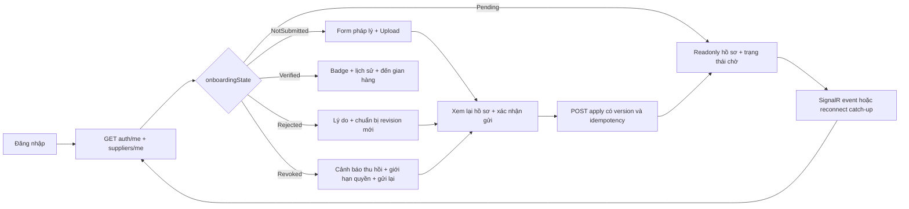

# [SUPPLIER-VERIFICATION] — TÍCH HỢP MOONCAKE-FE

Plan UI/UX và tổ chức code, chưa thay source FE. Dùng React 19, Ant Design đang có,
theme `src/theme/antdTheme.js`, `@ant-design/icons` và Colony Admin Layout theo
`mooncake-fe/.agents/AGENTS.md` hiện tại.

## 1. Entry points và quyền điều hướng

| Người dùng | Entry | Trạng thái / điều hướng |
| --- | --- | --- |
| Chưa login | Trang onboarding | Mở login, lưu return route an toàn nội bộ |
| Customer thuần | Không có entry Supplier | Result 403 nếu tự nhập route |
| Customer requestedRole Supplier | `nha-cung-cap/xac-minh` | Được gửi hồ sơ, xem Pending/Rejected/Revoked dù chưa có role Supplier |
| Supplier Verified | Hồ sơ + “Xác minh doanh nghiệp” | Xem hồ sơ đã duyệt/lịch sử; link thiết lập shop |
| Admin | `admin/phe-duyet` hiện có | Hàng đợi, chi tiết, reject/approve/revoke và lịch sử |

Giữ `nha-cung-cap/ho-so` và file `SuppilerProfile.jsx` hiện hữu làm điểm tích hợp,
không đổi toàn bộ đường dẫn hoặc sửa tên typo trên diện rộng trong feature này.
Route xác minh mới dùng cùng section pháp lý được tách component. Route dùng hash
hiện tại; không buộc migrate router toàn dự án chỉ để triển khai tính năng.

- App guard kiểm tra đăng nhập, current role/requestedRole và capability trước
  render. Chỉ thiếu role Supplier không đủ để chặn onboarding.
- Menu không thể cấp quyền. Ẩn/disable entry bán hàng và hiển thị hướng dẫn phù hợp;
  BE vẫn là authority cuối cùng.
- Quick navigation demo trong App phải gated bởi environment/mode; không làm bypass
  guard hoặc hiển thị trang Admin trong production cho Customer.
- Layout không hiển thị badge, pending count hoặc số thông báo hardcode cho tính
  năng này; dữ liệu lấy từ API, realtime dùng để yêu cầu refresh.

## 2. Supplier journey

### 2.1. Form gửi hồ sơ

- Ant Design `Steps`: Thông tin doanh nghiệp → Giấy tờ → Kiểm tra & gửi.
- `Form`/`Input`/`Input.TextArea`: tên công ty, MST, địa chỉ, mô tả; trim validation
  và max length đồng bộ BE. Không kết luận “doanh nghiệp hợp pháp” chỉ từ MST đúng format.
- `Upload` với customRequest gọi service; `beforeUpload` chỉ là kiểm tra trải nghiệm,
  BE kiểm tra file thật. Mỗi file có status Uploading/Ready/Failed/Quarantined và
  nút thử lại/gỡ khi chưa attach; không nhận URL pháp lý nhập tự do.
- Phân loại `BusinessLicense`, `FoodSafetyCertificate`, OptionalOther bằng Select.
  DatePicker cho giấy tờ có hạn, hiển thị ngày theo locale; UTC timestamp khác date-only.
- Review bước cuối hiện đầy đủ công ty và danh sách file; checkbox xác nhận tính
  chính xác của thông tin. Đây không phải chữ ký điện tử hoặc OTP.
- Gửi bị disable khi thiếu file bắt buộc, file chưa Ready, form sai hoặc request
  đang chạy. In-flight guard trong hook bổ sung cho disabled UI, key giữ nguyên khi retry.
- Bản nháp form ở state trong phiên; không lưu tài liệu, blob, lý do pháp lý hoặc
  URL private trong localStorage. Nhắc khi rời form chưa gửi, không chặn vô cớ.
- Một tab khác đã submit: nhận realtime invalidation/refetch; không tự ghi đè draft
  đang nhập. Hiển thị Alert và cho xem lại trước thao tác tiếp theo.

### 2.2. Màn hình trạng thái

| Trạng thái | UI chính | Hành động |
| --- | --- | --- |
| NotSubmitted | Card hướng dẫn, Form/Steps | Upload và gửi |
| Pending | Tag vàng, Timeline đã gửi, snapshot readonly | Xem file/lịch sử; chờ thông báo |
| Rejected | Alert lý do, thời điểm quyết định, revision bị từ chối | Chuẩn bị revision mới; không sửa revision cũ |
| Verified | Tag xanh “Đã xác minh”, ngày duyệt | Đến shop nếu capability cho phép; xem lịch sử |
| Revoked | Alert đỏ, lý do và ngày thu hồi, chỉ dẫn giao dịch đang có | Gửi tái thẩm định, xem nghĩa vụ giao dịch cũ |

Không đánh đồng Verified với điểm uy tín, Gold partner hoặc chứng nhận chất lượng
bánh. Không giữ badge chỉ vì user từng đăng nhập với Role Supplier.

## 3. Admin journey và UI

### 3.1. Hàng đợi

- Dùng `ColonyAdminLayout role=Admin`, giữ activeKey `admin/phe-duyet`.
- `Tabs`/`Segmented`: Pending, Verified, Rejected, Revoked, tất cả; state enum thống
  nhất PascalCase ở service, nhãn tiếng Việt ở constants/formatters.
- `Table` server pagination/filter/search; rowKey profileId. Cột: doanh nghiệp,
  MST, revision, ngày gửi, trạng thái, số tài liệu, thao tác xem.
- Search debounce300ms, reset page1 khi đổi filter, cancel request cũ bằng signal
  trong service. Đáp ứng tới sau của request cũ không được ghi đè query mới.
- Realtime chỉ tăng indicator “Có hồ sơ mới/cập nhật”, invalidate có debounce;
  không tự nhảy pagination hoặc đóng Drawer lúc Admin đang đọc.
- Không gọi API detail/preview cho mọi row hoặc fetch full dataset để lọc client-side.

### 3.2. Chi tiết hồ sơ

- `Drawer` hoặc trang detail chia `Descriptions`, danh sách tài liệu và `Timeline`.
- Luôn hiển thị revision/submittedAt và decision hiện tại; reviewer không duyệt
  một profile summary mà chưa biết bộ giấy tờ cụ thể.
- File `Button` gọi content API với Bearer, tạo object URL cho preview/download;
  giải phóng URL khi đóng/unmount; lỗi file không làm mất Drawer.
- `Modal.confirm` approve nói rõ cấp quyền bán mới cho Supplier; quyết định kèm
  submissionId và version đang mở.
- Reject dùng `Modal` + `Form.Item` lý do 10–1000 ký tự, kiểm tra trim; giữ lý do khi
  request lỗi. Toast thành công chỉ sau response commit thật.
- Revoke chỉ hiện cho Verified; màu danger, bắt buộc lý do, nêu tác động tới quyền
  bán mới và badge. Không viết “tất cả hợp đồng bị hủy” vì plan không làm việc đó.
- 409 hoặc event version mới hơn khi đang mở: đánh dấu stale, disable nút quyết
  định và tải mới sau xác nhận. Không tự approve lại trên phiên bản mới.
- Audit timeline phân trang; lý do hiển thị bằng text an toàn, không HTML.

## 4. Tổ chức source dự kiến

| File/nhóm | Thay đổi |
| --- | --- |
| `src/constants/apiEndpoints.js` | Thêm upload/status/content/history/applications/detail/revoke + notification APIs/hub path |
| `src/constants/routes.js` | Route onboarding, admin detail nếu cần, aliases và guard config |
| `src/constants/supplierVerification.js` mới | Status/document type/labels/error mapping/policy UI |
| `src/services/supplierService.js` | Giữ apply/getMyProfile; mở rộng request, pagination, AbortSignal, Idempotency-Key |
| `src/services/supplierDocumentService.js` mới | Multipart, metadata polling, blob content/error handling |
| `src/hooks/useSupplierVerification.js` mới | Self load, upload state, submit mutation, reset/refetch |
| `src/hooks/useSupplierApplications.js` mới | Query state, request sequence, admin mutations/version conflict |
| `src/components/supplier-verification/*` mới | Form/Upload/StatusCard/Timeline/DocumentPreview/ReviewModal |
| `src/Pages/Supplier/SuppilerProfile.jsx` | Thay section pháp lý mock; giữ nghiệp vụ uy tín ngoài scope |
| `src/Pages/Admin/ApprovePage.jsx` | Thay seed/local mutation bằng API/hook |
| `src/Pages/Supplier/StoreSetUp.jsx` | Guard capability và badge backend |
| `src/components/layout/ColonyAdminLayout.jsx` | Badge/dropdown notification thật, menu capability phù hợp |
| `src/context/AuthContext.jsx`, `useAuth` | Thêm refreshCurrentUser/capability state, đồng bộ auth:changed |
| `src/services/apiClient.js` | Giữ single-flight refresh; hỗ trợ FormData/blob/cancel và normalized errorCode |
| Realtime services/context/hooks | Chi tiết [06_REALTIME_NOTIFICATIONS.md](./06_REALTIME_NOTIFICATIONS.md) |

Không gọi axios/fetch trực tiếp từ view; mọi REST request dùng apiClient. SignalR
transport dùng client SDK trong service, không ép WebSocket đi qua Axios interceptor.
Token provider dùng chung cơ chế refresh session an toàn.

## 5. Đồng bộ quyền, cache và real-time

- `refreshCurrentUser()` lấy `/auth/me` sau submit/review event, khi focus và khi
  reconnect; AuthContext lưu phản hồi server chứ không sửa role từ event payload.
- Source of truth của workflow vẫn là REST/DB. SignalR event là invalidation hint;
  event Verified không tự bật canCreateShop nếu chưa refetch thành công.
- `useSupplierVerification`/queue subscribes event theo profile ID khi đang mở;
  singleton session connection ở provider, không mỗi page một connection.
- Khi revoke: hủy data request liên quan, refetch auth/profile, đóng UI bán mới
  nếu quyền mất. Không hủy request fulfillment đã commit; BE xử lý transaction.
- Request generation/session ID ngăn response của user trước cập nhật state của
  user vừa login. Logout stop hub, xóa state thông báo/capability và không reconnect.
- Tab khác: BroadcastChannel hoặc storage event báo auth thay đổi, không phát token
  hay file. Mỗi tab có thể có hub connection riêng; dedup theo eventId từng tab.
- Poll fallback30s có jitter chỉ khi page Pending/queue visible và realtime đang
  reconnect/offline; dừng khi unmount/tab hidden/logout. Focus refetch một lần.
  Không vừa polling nhanh vừa SignalR liên tục.

## 6. Ma trận phản hồi UI

| Điều kiện | Ant Design UI | Dữ liệu form |
| --- | --- | --- |
| Load đầu | Skeleton/Spin, nút disabled | Không hiển thị dữ liệu mẫu như dữ liệu thật |
| Empty | Empty/Result NotSubmitted | Cho onboarding đúng quyền |
| 400 | Form.Item help + Alert | Giữ field/file Ready |
| 401 refresh thất bại | Result và login return route | Không tự replay mutation mới sau login |
| 403 mất quyền | Result/Alert + refresh user | Không fallback mock hoặc giữ nút cấp quyền |
| 409 version | Alert warning, “Tải phiên bản mới” | Giữ reason để copy, buộc xem lại snapshot |
| 413/415 | Upload error theo file | Không xóa file khác đã Ready |
| 429 | Alert Retry-After/countdown | Không reset bước form |
| Storage/5xx/network | Alert + Retry | Idempotency key giữ cho cùng attempt |
| Commit thành công | message.success + refetch | Readonly snapshot; email/push chỉ nói đang xử lý |
| Realtime mất kết nối | Badge/Alert nhỏ “Đang kết nối lại” | Cho REST hoạt động, không khóa gửi hồ sơ vì hub lỗi |

Mock theo quy tắc dự án chỉ phục vụ demo rõ nhãn khi flag bật; tách data store/session,
không dùng catch mọi 401/403/409 để giả approve/reject/revoke hoặc giả email đã gửi.
Mutation production không báo thành công nếu API thất bại. Demo realtime nếu có
phải ghi “minh họa”, không trộn event thật và seed.

## 7. Accessibility, responsive và nghiệm thu UI

- Labels/validation rõ ràng, focus field lỗi đầu tiên; mọi icon button có aria-label.
- Ant Modal/Drawer focus trap và trả focus về nút mở; thao tác bàn phím đầy đủ.
- Trạng thái có text + màu, không chỉ màu; message không là nơi duy nhất chứa lỗi.
- Table hỗ trợ màn hẹp bằng scroll/cột gọn; form single-column ở mobile, không
  yêu cầu sửa toàn bộ layout Supplier/Admin.
- Chuỗi tiếng Việt đúng Unicode; BE English message/errorCode map sang FE copy.
- Không commit `.env`, sửa appsettings/credential hoặc cấu hình DI trong bước lập
  plan. Dependency SignalR và wiring BE được ghi backlog để triển khai sau.
- Sau khi triển khai: build bắt buộc, lint vùng sửa, component tests cho state
  machine/409 và E2E Supplier–Admin–Supplier với hai browser contexts.
