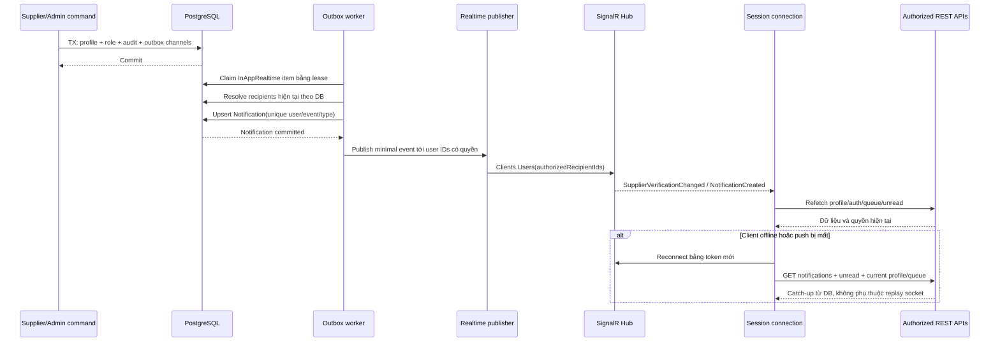

# [SUPPLIER-VERIFICATION] — REAL-TIME NOTIFICATIONS

Bổ sung theo yêu cầu người dùng: real-time cho **tính năng xác minh Supplier**,
bao gồm in-app notifications bền vững, chuông chưa đọc, cập nhật trạng thái và queue.
Ngày 2026-10-24; plan only. Không mở rộng toàn bộ sự kiện RFQ/Order/Payment trong
Module 11 ở đợt triển khai này.

## 1. Hiện trạng và lựa chọn kiến trúc

- Domain đã có `Notification`, DbSet, index user/unread và user/createdAt.
- Chưa tìm thấy Hub/MapHub/AddSignalR hoặc publisher realtime cho Supplier.
- FE `Notification.jsx`, dropdown và Badge trong ColonyAdminLayout đang dùng mock.
- Dùng **ASP.NET Core SignalR (.NET 8)** và `@microsoft/signalr` client; REST dùng
  apiClient, hub transport dùng SDK riêng trong service. Không cài package ở bước plan.
- Domain event/outbox là nguồn phát; **DB Notification** là nguồn lịch sử chưa đọc.
  WebSocket không thay thế DB và không phải bằng chứng người dùng đã đọc.
- Không dùng in-memory static event bus làm cơ chế production nhiều instance.

## 2. Event và người nhận

| Business event | Thông báo bền vững | Real-time invalidation | Email |
| --- | --- | --- | --- |
| `SupplierApplicationSubmitted` | Admin active: có hồ sơ chờ duyệt | Admin queue/badge; owner trạng thái đã gửi | Không bắt buộc email Admin |
| `SupplierApplicationResubmitted` | Admin active: có revision mới | Admin queue; owner state/version | Không bắt buộc email Admin |
| `SupplierVerificationApproved` | Owner: hồ sơ đã được duyệt | Owner auth/profile/capabilities; Admin queue/detail | Owner, kết quả duyệt |
| `SupplierVerificationRejected` | Owner: hồ sơ bị từ chối | Owner profile; Admin queue/detail | Owner, kết quả + lý do |
| `SupplierVerificationRevoked` | Owner: xác minh bị thu hồi | Owner auth/capabilities/shop; Admin queue/detail | Owner, kết quả + lý do |
| `SupplierDocumentValidationCompleted` | Không tạo chuông mỗi file | Owner upload metadata, nếu có scan async | Không |
| `NotificationRead` | Cập nhật bản ghi có sẵn | Các tab/thiết bị của cùng owner refetch unread | Không |

Admin action thành công có toast trực tiếp; không tạo thêm một notification cho
chính mình chỉ để nói thao tác vừa thực hiện. Các Admin còn lại nhận invalidation
queue tối thiểu; không nhất thiết tạo notification mới cho mỗi quyết định của đồng nghiệp.
Owner submit nhận trạng thái realtime cho tab khác, tránh thêm hai chuông trùng ý nghĩa.

Không đẩy công ty, MST, file URL, email, nội dung giấy tờ hoặc lý do từ chối/thu hồi
qua hub. Thông báo owner chỉ ghi tiêu đề chung và link nội bộ; lý do đọc qua API
có authorization. Quy tắc này cũng áp dụng toast khi màn hình bị khóa/mất quyền.

## 3. Sequence publish sau commit



Email channel dùng worker progress riêng; email lỗi không chặn realtime/in-app,
push lỗi không rollback quyết định và không xóa notification.

## 4. Hub contract và authentication

### 4.1. Endpoint

- Hub: **`/hubs/supplier-verification`**, root ngoài `/api/v1`.
- Hub yêu cầu authenticated active account; server đọc userId từ NameIdentifier
  có chữ ký và current-account validation. FE không truyền userId/group để subscribe.
- Hub không có method approve/reject/revoke/read-file hoặc broadcast từ client.
- Dùng `IUserIdProvider` map GUID userId chuẩn, stable; publisher gửi user-targeted
  bằng `Clients.User(s)`/Users, không tin arbitrary `JoinGroup` từ browser.
- CORS/Origin allowlist chính xác FE origin, HTTPS/WSS production; proxy hỗ trợ
  upgrade/idle timeout. Không `AllowAnyOrigin` với credential.
- Giới hạn kết nối đồng thời/account/IP và kích thước event; keepalive/timeout
  theo reverse proxy, không nêu một con số chưa load-test là bắt buộc thư viện.

### 4.2. Access token và kết nối dài

- `accessTokenFactory` đọc token mới nhất bằng session adapter, dùng single-flight
  refresh chung với apiClient. Không chụp token một lần vào closure vĩnh viễn.
- `.NET 8` bật `CloseOnAuthenticationExpiration`; khi hết token connection đóng,
  reconnect lấy token mới. Không giả định role thay đổi trong DB tự thay principal
  của WebSocket đang mở.
- Browser WebSocket/SSE có thể đưa `access_token` vào query do hạn chế header API.
  BE chỉ đọc query token cho đúng hub path; **redact toàn query/token** trong proxy,
  middleware/Serilog/telemetry. Không cho REST private-content nhận query token.
- Logout FE stop/dispose connection và cancel reconnect timer trước clear session;
  server không coi đó là biện pháp bảo mật duy nhất vì browser có thể không hợp tác.
- Mọi API đọc chi tiết vẫn kiểm tra current DB role/ownership. Admin recipient
  dispatch phải kiểm tra role hiện tại, không publish vào nhóm Admin chứa membership
  cũ sau demotion. Hub payload không chứa dữ liệu hồ sơ nhạy cảm.
- Account inactive bị loại khỏi recipient resolution; xử lý session disconnect
  khi revoke session/admin lock nếu có connection registry. Không dựa vào group
  membership cũ để cấp quyền; scope đợt này không xây hệ thống presence toàn cục.

### 4.3. Payload tối thiểu

Event `SupplierVerificationChanged`:

```json
{
  "schemaVersion": 1,
  "eventId": "7411b953-3795-49be-86cd-f61245d19504",
  "eventType": "SupplierVerificationApproved",
  "occurredAtUtc": "2026-10-24T03:10:00Z",
  "profileId": "c13ed165-b06a-449f-b26f-6b81f4bd4230",
  "aggregateVersion": 8,
  "invalidate": ["supplier-profile", "auth-capabilities"]
}
```

Admin queue broadcast theo authorized user IDs dùng event `SupplierQueueChanged`
chỉ `{schemaVersion,eventId,occurredAtUtc,invalidate:["supplier-queue"]}`;
không bắt tất cả Admin tải document hoặc công bố profileId ra đối tượng không cần.

Event `NotificationCreated`:

```json
{
  "schemaVersion": 1,
  "eventId": "7411b953-3795-49be-86cd-f61245d19504",
  "notificationId": "6b1f481d-c72e-4243-b340-f17cf61c5b30",
  "type": "SupplierVerificationApproved",
  "occurredAtUtc": "2026-10-24T03:10:00Z"
}
```

Không cộng unread `+1` mù theo socket event. Cùng event có thể tới nhiều lần hoặc
trước/sau REST response; refetch unread hoặc merge notificationId duy nhất.
Không sử dụng event làm command cấp quyền hoặc hiển thị lý do pháp lý đầy đủ.

## 5. REST notification APIs — mới

Các endpoint này dùng `ApiResponse<T>`, Bearer và policy owner; filter type giới
hạn feature Supplier trong phase này, không giả định đã có notification API.

| Endpoint dưới `/api/v1` | Hành vi |
| --- | --- |
| `GET /notifications?category=SupplierVerification&page=1&pageSize=20` | Own notifications, stable CreatedAt+Id ordering, max100/page |
| `GET /notifications/unread-count?category=SupplierVerification` | Count server-authoritative, không lộ userId khác |
| `PATCH /notifications/{id}/read` | Own notification, false→true; lặp lại vẫn 200, không tăng version business |
| `POST /notifications/read-all` | Own category, payload `{category,readThroughToken}`; không đánh dấu nhầm thông báo sau snapshot |

Notification data: id, type, title/content chung, referenceId/referenceType,
sourceEventId, aggregateVersion, sequence, isRead/readAtUtc/createdAtUtc, target route key từ
allowlist. Không gửi URL arbitrary cho FE `window.location`.

Read-all dùng **sequence theo user**, không lấy clock FE hoặc timestamp làm cutoff:

1. Materialize notification: lock User, kiểm tra dedup, tăng NotificationSequence,
   insert Notification.Sequence cùng transaction rồi commit. Worker fanout batch có
   giới hạn, khóa users theo ID tăng dần, không tạo N query đọc recipient.
2. GET list/unread summary trả `readThroughToken` opaque, được server bảo vệ chữ
   ký/purpose, chứa actorId/category/sequence high-watermark đã commit/expiry5min.
   Counter có thể cao hơn các item trang đầu: read-all có nghĩa đánh dấu toàn bộ
   inbox tới thời điểm snapshot, không chỉ trang đầu. UI phải mô tả đúng điều này.
3. POST validate token đúng user/category/hạn; update own notification Sequence≤cutoff.
   Notification commit sau snapshot có sequence lớn hơn, vẫn unread.
4. Không dùng PostgreSQL sequence toàn cục rồi giả định thứ tự cấp bằng thứ tự commit.
   User row lock được giữ tới commit tạo ra ordering cần thiết theo từng inbox.
5. Opaque token có thể dùng ASP.NET Core Data Protection purpose riêng; multi-instance
   cần key ring dùng chung và bảo vệ key phù hợp. Không dùng token đọc để xác thực
   API khác, không cho client tự đặt cutoff tương lai. Token hết hạn yêu cầu refetch.

Single-read idempotent theo trạng thái, không bắt buộc header key; read-all thêm
Idempotency-Key để replay snapshot, không tạo chuỗi read events vô hạn. Read event
chỉ phát khi có hàng đổi. Receipt của push không tự đánh dấu đã đọc.

List/unread không được phát lại nội dung Admin cũ khi user đã mất quyền. Thông báo
audience Admin chỉ đọc được nếu current DB role vẫn Admin; unread count dùng cùng
filter, không chỉ userId. Owner notices vẫn được đọc khi Supplier bị thu hồi nhưng
account còn active. Chi tiết vẫn kiểm tra quyền ở endpoint đích.

## 6. At-least-once, thứ tự và reconnect

- `SourceEventId` trên Notification unique theo user/type, outbox retry không tạo
  hai notification. EventId stable cho một business event; delivery attempt ID riêng.
- FE có bounded LRU dedup eventId+eventName trong session, không một Set tăng vô hạn.
- Profile response/event dùng aggregateVersion; không áp response version7 lên state
  version8. Request generation còn bảo vệ filter/query khác nhau và session logout.
- Event cũ/đến lệch thứ tự không overwrite status; event mới hơn chỉ invalidate.
  Không cam kết tổng thứ tự giữa Email, QueueChanged, NotificationCreated và REST.
- Trước hoặc ngay sau connect, đăng ký listener rồi fetch REST snapshot. Nếu event
  tới khi fetch đang chạy, đánh dấu dirty và refetch một lần sau; tránh khoảng hở
  “fetch xong mới subscribe” làm mất cập nhật. Snapshot inbox dùng sequence/token;
  không dùng chỉ Max CreatedAt của trang đầu làm high-watermark.
- `withAutomaticReconnect` xử lý mất kết nối; lỗi `.start()` đầu tiên có bounded
  exponential backoff+jitter riêng, không vòng retry 0ms.
- Reconnect luôn refetch current auth/profile/queue/notifications theo màn hình đang
  mở; không chỉ lấy `afterId=maxSeen` vì notification cũ có thể commit muộn.
- Mỗi lần reconnect đọc trang mới nhất + unread + profile version; inbox lịch sử
  phân trang từ DB nên socket mất không mất thông báo. Event không phải durable log
  để FE tự tính nghiệp vụ dựa trên offset.
- Polling fallback30s có jitter khi hub lỗi/không thể reconnect, dừng khi kết nối
  ổn định và khi tab hidden/logout. Badge kết nối dùng trạng thái thật.

## 7. Scale-out và vị trí code

**Một instance dev:** SignalR built-in + PostgreSQL durable notifications/outbox.
**Production nhiều instance:** cần Redis backplane hoặc dịch vụ SignalR quản lý;
plan mặc định Redis backplane cùng vùng triển khai, health check và sticky sessions
theo transport/load balancer. Không bỏ qua scale-out chỉ vì local chạy được.
Redis backplane là fanout, không thay notification DB hoặc outbox. Redis hỏng:
command/REST vẫn hoạt động, FE fallback; backlog có giới hạn và alert.

| Tầng | Thành phần dự kiến |
| --- | --- |
| Domain | Notification mở rộng, event schema, OutboxMessage |
| Application | Notification DTOs/service/repository, IRealtimeNotificationPublisher abstraction |
| Infrastructure | Notification repository, outbox recipient/materialization worker |
| WebApi | SupplierVerificationHub, SignalR publisher adapter dùng IHubContext, IUserIdProvider, mapping/auth/CORS |
| FE constants/service | Hub path từ env/base resolver; realtimeService; notificationService REST |
| FE context/hooks | NotificationProvider + useSupplierVerificationEvents, một connection/session/tab |
| FE views/layout | Ant Badge/Dropdown/List/Tabs/Alert; thay mock feature-scoped count |

WebApi adapter triển khai interface Application và dùng IHubContext vì Hub thuộc
WebApi. Infrastructure worker gọi abstraction đã đăng ký DI, **không reference WebApi**
và không new Hub trực tiếp. Cân nhắc worker cùng process WebApi trong đợt đầu;
tách process sau phải có publish transport rõ ràng, không giả DI local hoạt động
qua process. Wiring/config là công việc tương lai, không sửa trong plan này.

## 8. Kiểm thử và tiêu chí chấp nhận realtime

1. Supplier submit/resubmit: Admin online thấy chỉ báo queue trong mục tiêu ≤3s p95;
   REST list có revision mới. Owner tab khác nhìn thấy Pending sau refetch.
2. Approve/reject/revoke: owner nhận in-app notice và refresh status/auth; reason
   chỉ lấy qua REST, không nằm trong WebSocket payload.
3. Hai Admin cùng review: chỉ một event commit, một notice owner; bên thua 409.
4. Mất socket khi quyết định: reconnect/focus lấy được thông báo từ DB và đúng quyền.
5. Duplicate/out-of-order event: không duplicate toast, unread hoặc rollback version.
6. Crash sau Notification insert trước push: retry không tạo row mới; inbox không mất.
7. Token expired/refresh lỗi/logout: stop/reconnect đúng; không gửi token vào log.
8. Admin mất role/account bị khóa khi vẫn connected: không nhận profile-sensitive
   push, không đọc được Admin notification/detail từ connection/token cũ.
9. Không thể chọn group/userId của người khác; REST mark-read sai owner trả404.
10. Hai instance + Redis + client kết nối instance khác worker: nhận event/catch-up;
    mất Redis không làm command fail hoặc xóa notification.
11. React StrictMode mount/unmount và chuyển route: không nhiều listener/connection,
    không toast lặp, timer và Blob URL được cleanup.
12. Read-all đối đầu notification mới: notice mới sau cutoff vẫn unread; nhiều tab
    đọc đồng thời count luôn lấy server, không âm.

Thêm metric outbox→notification/push lag, failures, reconnect, connections/account,
catch-up rate và unread query latency; không log raw payload/token.

## 9. Nguồn chính thức đối chiếu

- Token factory, quyền và token expiration trên SignalR .NET8:
  [SignalR authentication](https://learn.microsoft.com/en-us/aspnet/core/signalr/authn-and-authz?view=aspnetcore-8.0).
- Automatic reconnect không retry initial start; cần xử lý start riêng:
  [SignalR JavaScript client](https://learn.microsoft.com/en-us/aspnet/core/signalr/javascript-client?view=aspnetcore-8.0).
- Scale-out, Redis và session affinity tùy hosting/transport:
  [SignalR hosting and scaling](https://learn.microsoft.com/en-us/aspnet/core/signalr/scale).

Các lựa chọn outbox, recipient policy, dedup và REST catch-up là thiết kế của tính
năng này, không phải bảo đảm delivery được SignalR tự cung cấp.
