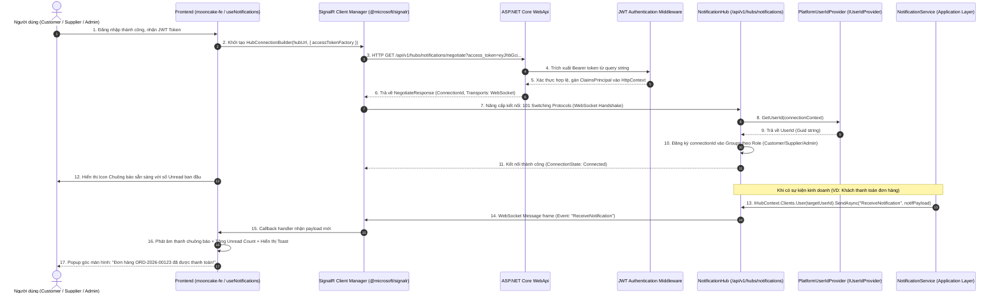

# [FEATURE-26] THIẾT KẾ KIẾN TRÚC SIGNALR & WEBSOCKET REAL-TIME NOTIFICATIONS
## Tài Liệu Thiết Kế Chi Tiết (Detail Design Document - Part 01)

---

## I. TỔNG QUAN TÍNH NĂNG & MỤC TIÊU NGHIỆP VỤ

### 1.1. Thông tin tài liệu
- **Tên tính năng:** Hệ thống Thông báo Thời Gian Thực qua WebSocket / SignalR Hub (Real-Time Push Notifications)
- **Mã tính năng (Feature Key):** `realtime-notifications-signalr` (Feature #26)
- **Phân hệ thuộc về:** Module 11 – Hệ thống & Vận hành
- **Người thiết kế:** Team Kỹ thuật / Solution Architect
- **Phiên bản:** `1.0.0`
- **Trạng thái:** `Approved`

### 1.2. Mục tiêu nghiệp vụ (Business Goals)
1. **Phát sóng tức thì không độ trễ (Zero Latency Real-time Push):** Đẩy thông báo từ Server tới trình duyệt của người dùng đích trong $< 200\text{ ms}$ khi có bất kỳ sự kiện kinh doanh nào phát sinh (có đơn hàng mới, gửi báo giá, ký số hợp đồng, cập nhật ảnh PoD, nhận tiền cọc VNPay Sandbox, giải ngân Escrow, hoặc khiếu nại tranh chấp).
2. **Loại bỏ hoàn toàn cơ chế Polling:** Tiết kiệm băng thông mạng và giảm tải cho Database PostgreSQL, không thực hiện các vòng lặp `setInterval` định kỳ.
3. **Đồng bộ trạng thái đa tab & đa thiết bị (Multi-tab Synchronization):** Khi người dùng mở nhiều tab hoặc truy cập cùng lúc trên máy tính và điện thoại, việc đánh dấu đã đọc tại một nơi sẽ lập tức cập nhật số đếm badge (Unread Count) ở tất cả các nơi khác qua WebSocket.
4. **Tự phục hồi kết nối có độ trễ thông minh (Exponential Backoff Auto-Reconnect):** Khi mạng gián đoạn, client tự động kết nối lại theo khoảng thời gian tăng dần `[0, 2s, 5s, 10s, 30s]`, đồng thời tự động đồng bộ lại các thông báo bị lỡ trong lúc offline.

---

## II. FLOW CHART & SEQUENCE DIAGRAM

### 2.1. Sequence Diagram: Bắt Tay WebSocket & Luồng Đẩy Thông Báo Real-time



---

## III. CHI TIẾT TỪNG BƯỚC XỬ LÝ (STEP-BY-STEP LOGIC)

### Bước 1: Trích Xuất JWT Token & Bắt Tay WebSocket
Do giao thức WebSocket trong trình duyệt tiêu chuẩn không cho phép đính kèm custom headers (`Authorization: Bearer ...`), client truyền token qua tham số query `access_token`.
- Trong cấu hình `JwtBearerEvents`:
  ```csharp
  options.Events = new JwtBearerEvents
  {
      OnMessageReceived = context =>
      {
          var accessToken = context.Request.Query["access_token"];
          var path = context.HttpContext.Request.Path;
          if (!string.IsNullOrEmpty(accessToken) && path.StartsWithSegments("/api/v1/hubs/notifications"))
          {
              context.Token = accessToken;
          }
          return Task.CompletedTask;
      }
  };
  ```

### Bước 2: Định Danh Người Dùng Tập Trung (`PlatformUserIdProvider`)
- Hiện thực interface `IUserIdProvider`:
  ```csharp
  public sealed class PlatformUserIdProvider : IUserIdProvider
  {
      public string? GetUserId(HubConnectionContext connection)
      {
          return connection.User?.FindFirst(ClaimTypes.NameIdentifier)?.Value;
      }
  }
  ```
- Đăng ký Singleton trong DI Container: `services.AddSingleton<IUserIdProvider, PlatformUserIdProvider>();`.
- Lợi ích: Cho phép phát thông báo trực tiếp qua User ID bằng cú pháp:
  `await _hubContext.Clients.User(userId.ToString()).SendAsync("ReceiveNotification", payload);`.

### Bước 3: Phân Phối Nhóm Theo Vai Trò (Role-based Grouping)
Khi kết nối (`OnConnectedAsync`):
- Đọc claim `ClaimTypes.Role` của người dùng:
  - Role `Admin`: Thêm vào group `"Admins"`.
  - Role `Supplier`: Thêm vào group `"Suppliers"`.
  - Role `Customer`: Thêm vào group `"Customers"`.
- Nhóm ngữ cảnh (Contextual Channels): Khi người dùng mở trang chi tiết hợp đồng, client gọi `JoinContractGroup(contractId)` để nhận các thông báo cập nhật tiến độ real-time của hợp đồng đó.

### Bước 4: Đồng Bộ Hóa Đa Tab Khi Đánh Dấu Đã Đọc
1. Khi người dùng bấm "Đánh dấu đã đọc" hoặc "Đọc tất cả" tại Tab 1:
2. Tab 1 gửi yêu cầu HTTP PATCH/POST lên API.
3. Database cập nhật thành công, API kích hoạt phát sự kiện SignalR:
   `await _hubContext.Clients.User(userId.ToString()).SendAsync("NotificationsMarkedAsRead", new { ReadIds = ids, UnreadCount = newCount });`
4. Tất cả các Tab khác (Tab 2, Tab 3) nhận được sự kiện qua WebSocket và tự động giảm số đếm badge đồng bộ tức thì.

---

## IV. ĐẶC TẢ SỰ KIỆN SIGNALR (SERVER-TO-CLIENT SPECIFICATION)

| Tên sự kiện | Payload DTO | Mục đích & Ý nghĩa |
| :--- | :--- | :--- |
| `ReceiveNotification` | `NotificationItemDto` | Bắn 1 thông báo mới tức thì kèm âm thanh và toast |
| `UnreadCountUpdated` | `{ unreadCount: number }` | Cập nhật số đếm badge khi có thay đổi |
| `NotificationsMarkedAsRead` | `{ ids: string[], unreadCount: number }` | Đồng bộ trạng thái đã đọc trên tất cả các tab đang mở |
| `AllNotificationsRead` | `{ unreadCount: 0 }` | Đồng bộ khi người dùng bấm "Đọc tất cả" |
| `NotificationDeleted` | `{ id: string, unreadCount: number }` | Xóa thông báo khỏi danh sách trên giao diện |

---

## V. KIẾN TRÚC PHÂN TẦNG VÀ TỔ CHỨC MÃ NGUỒN (LAYER MAPPING)

- **Domain:** Thực thể `Notification.cs`, Enums `NotificationCategory`, `NotificationPriority`.
- **Application:**
  - `INotificationService.cs`, `IRealtimeNotificationPublisher.cs`.
  - DTOs: `NotificationItemDto`, `NotificationInboxResponse`, `UnreadCountDto`.
- **Infrastructure:**
  - `NotificationRepository.cs`: Truy vấn PostgreSQL tối ưu qua chỉ mục `idx_notif_unread`.
- **WebApi:**
  - `NotificationHub.cs` tại `/api/v1/hubs/notifications`.
  - `PlatformUserIdProvider.cs`.
  - `SignalRNotificationPublisher.cs`.
  - `NotificationsController.cs`: REST API cho danh sách, đánh dấu đọc, và preferences.
- **Frontend (`mooncake-fe`):**
  - `src/services/signalrService.js`: Quản lý Singleton HubConnection, reconnect, listener registry.
  - `src/services/notificationService.js`: API client kèm Mock Fallback.
  - `src/hooks/useNotifications.js`: Quản lý state toàn cục.
  - `src/components/notification/`: `NotificationBell.jsx`, `NotificationDrawer.jsx`, `NotificationItem.jsx`.

---

## VI. BẢO MẬT & ĐỘ TIN CẬY (SECURITY & RESILIENCE)

1. **Bảo mật kết nối:** Bắt buộc kiểm tra JWT Token trước khi nâng cấp WebSocket. Client không được phép tự phát tin giả mạo đến người dùng khác (One-way push channel từ Server).
2. **Chống rò rỉ bộ nhớ:** Hủy đăng ký listener (`connection.off(...)`) khi React component unmount.
3. **Heartbeat & Keep-Alive:** Cấu hình `ClientTimeoutInterval = TimeSpan.FromSeconds(30)`, `KeepAliveInterval = TimeSpan.FromSeconds(15)` để phát hiện sớm các kết nối bị đứt ngầm.

