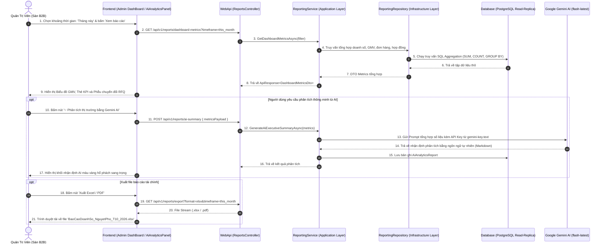

# [FEATURE-28] THIẾT KẾ BÁO CÁO & THỐNG KÊ ĐA CHIỀU, XUẤT DỮ LIỆU & AI INSIGHTS
## Tài Liệu Thiết Kế Chi Tiết (Detail Design Document - Part 03)

---

## I. TỔNG QUAN TÍNH NĂNG & MỤC TIÊU NGHIỆP VỤ

### 1.1. Thông tin tài liệu
- **Tên tính năng:** Hệ Thống Báo Cáo & Thống Kê Đa Chiều Nền Tảng B2B Kèm Xuất Dữ Liệu & Phân Tích Gemini AI (Multi-Dimensional Reporting & Analytics)
- **Mã tính năng (Feature Key):** `multidimensional-reporting-analytics` (Feature #28)
- **Phân hệ thuộc về:** Module 11 – Hệ thống & Vận hành
- **Người thiết kế:** Team Kỹ thuật / Solution Architect
- **Phiên bản:** `1.0.0`
- **Trạng thái:** `Approved`

### 1.2. Mục tiêu nghiệp vụ (Business Goals)
1. **Phân tích kinh doanh đa chiều theo 3 góc nhìn đối tượng (3-Role Dimensions):**
   - **Góc nhìn Quản trị Sàn (Admin Perspective):**
     - Tổng giá trị hàng hóa giao dịch (Platform GMV) và Doanh thu phí sàn theo khung thời gian linh hoạt (Hôm nay, Tuần này, Tháng này, Quý này, Tùy chọn ngày).
     - **Phễu chuyển đổi giao dịch B2B (Conversion Funnel):** Đo lường tỷ lệ chuyển đổi từ *RFQ tạo lập $\rightarrow$ Báo giá nộp $\rightarrow$ Báo giá trúng thầu $\rightarrow$ Hợp đồng ký kết $\rightarrow$ Hợp đồng hoàn thành đúng hạn*.
     - Bảng xếp hạng Top Nhà cung cấp có doanh số cao nhất, tỷ lệ hoàn thành đúng hạn tốt nhất và điểm uy tín cao nhất.
     - Danh mục hương vị và loại hộp bánh Trung thu bán chạy nhất (Best-selling categories & variants).
   - **Góc nhìn Nhà Cung Cấp (Supplier Perspective):** Doanh số từng dòng bánh, tỷ lệ thắng thầu RFQ (Bid Win Rate), biểu đồ biến thiên điểm uy tín qua các hợp đồng, và cảnh báo tồn kho nguyên liệu.
   - **Góc nhìn Khách Hàng Doanh Nghiệp (Customer Perspective):** Lịch sử chi tiêu ngân sách quà tặng Trung thu công ty, danh sách các xưởng bánh uy tín đã hợp tác, và tỷ lệ giao hàng đúng hẹn.
2. **Xuất báo cáo tài chính & kiểm toán chuyên nghiệp (Export Capabilities):**
   - Hỗ trợ xuất dữ liệu ra định dạng **CSV**, **Excel (.xlsx)**, và **PDF** chuẩn hóa hóa đơn chứng từ kế toán cho doanh nghiệp.
3. **Phân tích ngôn ngữ tự nhiên thông minh bằng Google Gemini AI (AI Natural Language Summary):**
   - Tích hợp model `gemini-flash-latest` từ [gemini-key.text](file:///Users/admin/Desktop/PRN232/gemini-key.text):
   - Tự động đọc dữ liệu thống kê số liệu khô khan và sinh ra bản nhận định chiến lược thị trường bánh Trung thu bằng văn phong giám đốc điều hành (Executive Summary): Nhận diện sản phẩm đột phá, dự báo xu hướng hương vị thịnh hành, cảnh báo rủi ro hợp đồng chậm tiến độ.

---

## II. FLOW CHART & SEQUENCE DIAGRAM

### 2.1. Sequence Diagram: Tổng Hợp Báo Cáo Đa Chiều & Kích Hoạt Phân Tích Gemini AI



---

## III. CHI TIẾT TỪNG BƯỚC TỔNG HỢP SỐ LIỆU (AGGREGATION LOGIC)

### Bước 1: Tính Toán Doanh Số Toàn Sàn (GMV & Platform Revenue)
1. Xác định biên ngày bắt đầu (`startDateUtc`) và ngày kết thúc (`endDateUtc`):
   - `today`: Từ 00:00:00 đến 23:59:59 của ngày hiện tại (theo TimeZone Hà Nội `Etc/UTC+7`).
   - `this_week`: Từ Thứ 2 đầu tuần đến thời điểm hiện tại.
   - `this_month`: Từ ngày 1 của tháng đến hiện tại.
   - `custom`: Theo khoảng ngày người dùng chọn trên DatePicker.
2. Tổng hợp các nguồn giao dịch:
   - **Doanh số từ Đơn mua trực tiếp (Orders):** `SUM(total_amount)` của các đơn có `status IN ('Confirmed', 'Processing', 'Shipped', 'Delivered')`.
   - **Doanh số từ Hợp đồng sản xuất B2B (Contracts):** `SUM(total_amount)` của các hợp đồng có `status IN ('Active', 'CompletedOnTime', 'CompletedLate')`.
   - **Doanh thu phí sàn (Platform Fee Revenue):** Bằng $3\%$ của tổng doanh số đã hoàn thành giao dịch.

### Bước 2: Đo Lường Phễu Chuyển Đổi B2B (RFQ Conversion Funnel)
Hệ thống tính toán 5 tầng chuyển đổi của quy trình đấu thầu:
1. **Tầng 1 (RFQs Published):** Tổng số yêu cầu báo giá được đăng tải.
2. **Tầng 2 (Bids Submitted):** Tổng số báo giá chào thầu mà các nhà cung cấp đã nộp.
3. **Tầng 3 (Bids Awarded):** Số lượng báo giá được khách hàng lựa chọn trúng thầu.
4. **Tầng 4 (Contracts Signed):** Số lượng hợp đồng điện tử được 2 bên ký số thành công bằng OTP.
5. **Tầng 5 (Contracts Completed):** Số lượng hợp đồng giao hàng thành công và nghiệm thu hoàn tất.
- Tính toán tỷ lệ phần trăm chuyển đổi giữa các tầng để phát hiện điểm tắc nghẽn (Drop-off rate).

### Bước 3: Bảng Xếp Hạng Nhà Cung Cấp & Sản Phẩm Tiêu Biểu (Top Ranking)
1. **Top Nhà Cung Cấp:** Sắp xếp theo thứ tự ưu tiên:
   $$\text{Rank Score} = (\text{GMV} \times 0.5) + (\text{On-Time Delivery Rate} \times 0.3) + (\text{Reputation Score} \times 0.2)$$
2. **Top Sản Phẩm Best-Seller:** Nhóm theo dòng bánh (Bánh nướng truyền thống, Bánh dẻo hoàng kim, Bánh Lava trứng muối, Bánh dinh dưỡng ít đường) và xếp hạng theo tổng số hộp đã bán ra.

### Bước 4: Tạo Phân Tích Ngôn Ngữ Tự Nhiên Bằng Gemini AI
1. Hệ thống đóng gói số liệu tổng hợp thành chuỗi JSON ngắn gọn.
2. Gửi request tới Google Gemini API với System Prompt chuyên gia kinh tế B2B:
   ```
   Bạn là Giám đốc Phân tích Chiến lược (Chief Analytics Officer) của Sàn Giao Dịch Bánh Trung Thu Doanh Nghiệp Nguyệt Phố.
   Hãy đọc số liệu thống kê sau đây và viết một bản báo cáo ngắn gọn (Executive Summary) gồm 3 phần:
   1. Đánh giá tổng quan tốc độ tăng trưởng GMV và hiệu quả phễu đấu thầu RFQ.
   2. Điểm sáng thị trường: Top sản phẩm và xưởng bánh xuất sắc.
   3. Khuyến nghị chiến lược: Các cơ hội cải thiện tỷ lệ chuyển đổi hợp đồng và chính sách cọc Escrow.
   Văn phong chuyên nghiệp, trang trọng, sử dụng tiếng Việt chuẩn B2B.
   ```
3. Nhận phản hồi định dạng Markdown và hiển thị trực tiếp lên giao diện Admin.

---

## IV. ĐẶC TẢ KỸ THUẬT API BÁO CÁO (REPORTING API SPECIFICATIONS)

### 4.1. Danh mục Endpoints

| Phương thức | Đường dẫn API | Mục đích nghiệp vụ | Phân quyền |
| :--- | :--- | :--- | :--- |
| `GET` | `/api/v1/reports/dashboard-metrics` | Thẻ chỉ số tổng quan GMV, Đơn hàng, Hợp đồng, Tăng trưởng | `Admin` |
| `GET` | `/api/v1/reports/conversion-funnel` | Dữ liệu 5 tầng phễu chuyển đổi RFQ $\rightarrow$ Hợp đồng | `Admin` |
| `GET` | `/api/v1/reports/top-suppliers` | Bảng xếp hạng Top Nhà cung cấp xuất sắc | `Admin`, `Supplier` |
| `GET` | `/api/v1/reports/top-products` | Bảng xếp hạng Top sản phẩm bán chạy nhất sàn | `Admin`, `Supplier` |
| `POST` | `/api/v1/reports/ai-summary` | Gọi Gemini AI sinh nhận định chiến lược thị trường | `Admin`, `Supplier` |
| `GET` | `/api/v1/reports/export` | Xuất file báo cáo tài chính định dạng CSV / XLSX / PDF | `Admin` |

### 4.2. Response Payload: Báo Cáo Phễu Chuyển Đổi RFQ (HTTP 200 OK)
```json
{
  "status": 200,
  "message": "Lấy dữ liệu phễu chuyển đổi thành công.",
  "data": {
    "timeframe": "this_month",
    "funnelStages": [
      { "stage": "RFQs Published", "count": 150, "conversionRate": 100.0 },
      { "stage": "Bids Submitted", "count": 420, "conversionRate": 280.0 },
      { "stage": "Bids Awarded", "count": 132, "conversionRate": 88.0 },
      { "stage": "Contracts Signed (OTP)", "count": 128, "conversionRate": 85.3 },
      { "stage": "Contracts Completed", "count": 115, "conversionRate": 76.7 }
    ],
    "overallSuccessRate": 76.7,
    "averageBidsPerRfq": 2.8
  },
  "path": "/api/v1/reports/conversion-funnel",
  "traceId": "00-84a1e948f2cb-rep-1",
  "time": "2026-10-29T10:35:00Z"
}
```

---

## V. KIẾN TRÚC PHÂN TẦNG VÀ TỔ CHỨC MÃ NGUỒN (LAYER MAPPING)

- **Domain Entities:** `Order.cs`, `Contract.cs`, `RequestForQuotation.cs`, `Bid.cs`, `Payment.cs`, `AiAnalyticsReport.cs`.
- **Application Layer:**
  - Interfaces: `IReportingService.cs`, `IGeminiAnalyticsService.cs`, `IReportExportService.cs`.
  - DTOs: `DashboardMetricsDto.cs`, `ConversionFunnelDto.cs`, `TopSupplierReportDto.cs`, `AiSummaryResponseDto.cs`.
- **Infrastructure Layer:**
  - `ReportingRepository.cs`: Sử dụng EF Core với `.AsNoTracking()` và các câu lệnh `GROUP BY` tối ưu hóa thời gian thực thi.
  - `GeminiAnalyticsService.cs`: Gọi RESTful API tới `https://generativelanguage.googleapis.com` kèm khóa bí mật tại [gemini-key.text](file:///Users/admin/Desktop/PRN232/gemini-key.text).
  - `ReportExportService.cs`: Tạo luồng nhị phân CSV và Excel Stream.
- **WebApi Layer:**
  - `ReportsController.cs` (Kế thừa `BaseApiController`).
- **Frontend Layer (`mooncake-fe`):**
  - Mở rộng [`DashBoard.jsx`](file:///Users/admin/Desktop/PRN232/mooncake-fe/src/Pages/Admin/DashBoard.jsx): Tích hợp Tab Báo Cáo Phễu Chuyển Đổi & Thống Kê GMV.
  - Nút bấm xuất file CSV/Excel với icon `FileDoneOutlined` và `FilePdfOutlined`.
  - Khối hiển thị nhận định thông minh [`AiAnalyticsPanel.jsx`](file:///Users/admin/Desktop/PRN232/mooncake-fe/src/components/ai/AiAnalyticsPanel.jsx).

---

## VI. HIỆU NĂNG TRUY VẤN & BẢO MẬT DỮ LIỆU BÁO CÁO (PERFORMANCE & SECURITY)

1. **Tối Ưu Hóa Truy Vấn Không Khóa Dữ Liệu (`AsNoTracking`):**
   - Toàn bộ các truy vấn báo cáo thống kê đều là truy vấn đọc (Read-only), sử dụng `.AsNoTracking()` trong Entity Framework Core để loại bỏ chi phí quản lý trạng thái đối tượng (Change Tracker).
2. **Bộ Nhớ Đệm Kết Quả Thống Kê (Report Cache with TTL):**
   - Dữ liệu GMV và phễu chuyển đổi toàn sàn được lưu tạm trong Memory Cache với thời hạn 5 phút (`TTL = 300s`). Nhờ đó, hàng ngàn lượt xem bảng điều khiển không gây nghẽn đường truyền Database PostgreSQL.
3. **Phân Quyền Báo Cáo Tuyệt Đối:**
   - Quản trị viên sàn được xem toàn cảnh toàn bộ thị trường.
   - Nhà cung cấp chỉ được xem báo cáo thuộc gian hàng của chính mình (áp dụng bộ lọc tự động `shop_id = currentSupplierShopId`).

