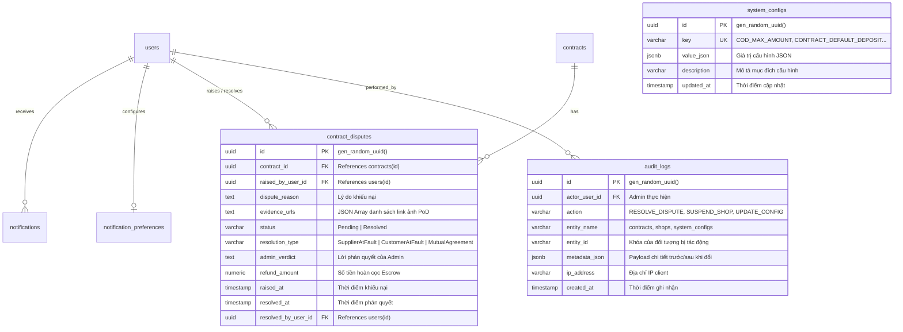

# [DATABASE-SECURITY] CƠ SỞ DỮ LIỆU POSTGRESQL, CHỈ MỤC TỐI ƯU & BẢO MẬT HÀNH ĐỘNG QUẢN TRỊ
## Tài Liệu Thiết Kế Chi Tiết (Detail Design Document - Part 06)

---

## I. THIẾT KẾ BẢNG CƠ SỞ DỮ LIỆU POSTGRESQL

Phân hệ Hệ thống & Vận hành (Module 11) quản lý 5 bảng cơ sở dữ liệu trọng yếu trong PostgreSQL 16:
1. `notifications`: Lưu trữ hộp thư thông báo bền vững của mọi người dùng.
2. `notification_preferences`: Cấu hình tùy chọn kênh nhận tin của người dùng.
3. `contract_disputes`: Hồ sơ khiếu nại tranh chấp hợp đồng B2B.
4. `system_configs`: Lưu trữ tham số vận hành sàn động dưới dạng JSONB.
5. `audit_logs`: Nhật ký kiểm toán bất biến ghi vết mọi thao tác của Quản trị viên.



---

## II. ĐẶC TẢ SQL DDL & INDEX TỐI ƯU TRUY VẤN

```sql
-- 1. Bảng Tranh Chấp Hợp Đồng
CREATE TABLE IF NOT EXISTS contract_disputes (
    id UUID PRIMARY KEY DEFAULT gen_random_uuid(),
    contract_id UUID NOT NULL REFERENCES contracts(id) ON DELETE CASCADE,
    raised_by_user_id UUID NOT NULL REFERENCES users(id),
    dispute_reason TEXT NOT NULL,
    evidence_urls TEXT NULL,
    status VARCHAR(50) NOT NULL DEFAULT 'Pending',
    resolution_type VARCHAR(50) NULL,
    admin_verdict TEXT NULL,
    refund_amount NUMERIC(18, 2) NOT NULL DEFAULT 0,
    raised_at TIMESTAMPTZ NOT NULL DEFAULT NOW(),
    resolved_at TIMESTAMPTZ NULL,
    resolved_by_user_id UUID NULL REFERENCES users(id),
    created_at TIMESTAMPTZ NOT NULL DEFAULT NOW(),
    updated_at TIMESTAMPTZ NOT NULL DEFAULT NOW(),
    is_deleted BOOLEAN NOT NULL DEFAULT FALSE
);

-- 2. Chỉ mục tối ưu hóa tra cứu tranh chấp đang chờ xử lý
CREATE INDEX IF NOT EXISTS idx_disputes_pending 
ON contract_disputes (status, raised_at DESC) 
WHERE (is_deleted = false AND status = 'Pending');

-- 3. Bảng Cấu Hình Sàn Động
CREATE TABLE IF NOT EXISTS system_configs (
    id UUID PRIMARY KEY DEFAULT gen_random_uuid(),
    key VARCHAR(100) UNIQUE NOT NULL,
    value_json JSONB NOT NULL DEFAULT '{}'::jsonb,
    description VARCHAR(255) NULL,
    created_at TIMESTAMPTZ NOT NULL DEFAULT NOW(),
    updated_at TIMESTAMPTZ NOT NULL DEFAULT NOW(),
    is_deleted BOOLEAN NOT NULL DEFAULT FALSE
);

-- 4. Bảng Nhật Ký Kiểm Toán (Audit Logs)
CREATE TABLE IF NOT EXISTS audit_logs (
    id UUID PRIMARY KEY DEFAULT gen_random_uuid(),
    actor_user_id UUID NULL REFERENCES users(id),
    action VARCHAR(100) NOT NULL,
    entity_name VARCHAR(100) NOT NULL,
    entity_id VARCHAR(100) NULL,
    metadata_json JSONB NULL,
    ip_address VARCHAR(50) NULL,
    created_at TIMESTAMPTZ NOT NULL DEFAULT NOW(),
    is_deleted BOOLEAN NOT NULL DEFAULT FALSE
);

CREATE INDEX IF NOT EXISTS idx_audit_timeline 
ON audit_logs (created_at DESC);
```

---

## III. KHÓA BI QUAN & TOÀN VẸN TÀI CHÍNH KÝ QUỸ (CONCURRENCY LOCKING)

### 3.1. Chống Xung Đột Giải Ngân & Hoàn Tiền Đồng Thời (Race Condition Safeguard)
- **Kịch bản rủi ro:** Khách hàng nộp đơn khiếu nại tranh chấp yêu cầu hoàn cọc trong cùng thời điểm Nhà cung cấp bấm nút *"Yêu cầu giải ngân mốc M3"*.
- **Giải pháp xử lý:** Khi có yêu cầu phân xử tranh chấp hoặc giải ngân:
  - Thực hiện khóa bi quan (`Pessimistic Lock`) trên dòng hợp đồng:
    ```csharp
    await using var tx = await _dbContext.Database.BeginTransactionAsync(IsolationLevel.RepeatableRead, ct);
    
    var contract = await _dbContext.Contracts
        .FromSqlRaw("SELECT * FROM contracts WHERE id = {0} FOR UPDATE", contractId)
        .SingleOrDefaultAsync(ct);
        
    if (contract.Status == ContractStatus.Disputed && !isFromAdminArbitration)
    {
        throw new BusinessRuleViolationException("Hợp đồng đang trong quá trình trọng tài giải quyết tranh chấp. Toàn bộ giao dịch giải ngân bị đóng băng.");
    }
    ```
  - Đảm bảo tính toán số dư Escrow chính xác 100%, loại trừ hoàn toàn nguy cơ giải ngân kép (Double-spending).

---

## IV. CHÍNH SÁCH LƯU TRỮ & DỌN DẸP DỮ LIỆU (DATA RETENTION POLICY)

1. **Bảo tồn vĩnh viễn (Zero-Purge Entities):**
   - Bảng `contract_disputes`, `audit_logs`, và các giao dịch `payments` hoàn cọc **tuyệt đối không bao giờ được xóa vật lý (Hard Delete)**. Đây là bằng chứng pháp lý bắt buộc khi có cơ quan trọng tài kinh tế hoặc thuế yêu cầu đối soát.
2. **Dọn dẹp thông báo thông thường (Notification Cleanup):**
   - Đăng ký tác vụ định kỳ `NotificationMaintenanceJob` xóa mềm các thông báo mức `low` và `medium` đã đọc sau 90 ngày nhằm duy trì kích thước cơ sở dữ liệu gọn nhẹ.

---

## V. KIỂM SOÁT AN NINH PHÂN QUYỀN QUẢN TRỊ (ADMIN SECURITY CHECKLIST)

1. **Phân quyền Role-based Access Control (RBAC):**
   - Toàn bộ các thao tác giải quyết tranh chấp, đình chỉ gian hàng, và sửa đổi cấu hình sàn bắt buộc có claim `Role = "Admin"`.
2. **Bảo vệ toàn vẹn Audit Log:**
   - Bảng `audit_logs` chỉ hỗ trợ thao tác `INSERT`, không cấp quyền `UPDATE` hay `DELETE` cho bất kỳ API endpoint nào.
3. **Mã hóa dữ liệu nhạy cảm:**
   - Dữ liệu địa chỉ IP và lý do khiếu nại được làm sạch để chống tấn công Injection và XSS.

