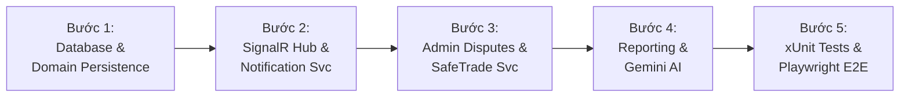

# [TEST-PLAN] KẾ HOẠCH TRIỂN KHAI, MA TRẬN KIỂM THỬ VÀ ROLLOUT SYSTEM (MODULE 11)
## Tài Liệu Thiết Kế Chi Tiết (Detail Design Document - Part 08)

---

## I. LỘ TRÌNH TRIỂN KHAI PHÂN KỲ (IMPLEMENTATION ROADMAP)

Module 11 (Features #26, #27, #28) được triển khai qua 5 bước tuần tự:

1. **Bước 1: Persistence & Domain Layer:**
   - Cấu hình EF Core cho `Notification.cs`, `ContractDispute.cs`, `SystemConfig.cs`, `AuditLog.cs`.
   - Thiết lập chỉ mục Partial Index `idx_notif_unread`, `idx_disputes_pending`.
2. **Bước 2: SignalR Hub & Tầng Dịch Vụ Thông Báo (Feature #26):**
   - Hoàn thiện `NotificationHub` tại `/api/v1/hubs/notifications`.
   - Đăng ký `PlatformUserIdProvider` và `SignalRNotificationPublisher`.
3. **Bước 3: Quản Trị Tranh Chấp & SafeTrade Escrow (Feature #27):**
   - Xây dựng `AdminDisputesController` và `DisputeService`.
   - Kết nối `PaymentService` thực thi hoàn tiền cọc Escrow và ghi nhật ký kiểm toán `AuditLog`.
4. **Bước 4: Báo Cáo Đa Chiều & Gemini AI Insights (Feature #28):**
   - Xây dựng `ReportsController` tổng hợp chỉ số GMV và phễu chuyển đổi RFQ.
   - Tích hợp model `gemini-flash-latest` từ [gemini-key.text](file:///Users/admin/Desktop/PRN232/gemini-key.text).
5. **Bước 5: Frontend React 19 & Kiểm Thử Tự Động Toàn Diện:**
   - Tích hợp `NotificationBell`, `NotificationDrawer`, `DisputeResolutionModal`.
   - Chạy 100% kiểm thử xUnit Backend và Playwright E2E Frontend.

---

## II. MA TRẬN KIỂM THỬ BACKEND (XUNIT TEST SUITE)

Tệp kiểm thử: `Mooncake.EcommercePlatform.Verification.Tests/SystemOperationsTests.cs`:

| Mã Test Case | Nhóm chức năng | Tên kịch bản kiểm thử | Kết quả kỳ vọng |
| :--- | :--- | :--- | :--- |
| `TC-SYS-01` | Feature #26 | Lấy danh sách hộp thư phân trang và đếm số tin chưa đọc bằng Partial Index | Trả về chính xác số đếm trong $< 5\text{ ms}$ |
| `TC-SYS-02` | Feature #26 | Đánh dấu đã đọc tất cả an toàn với `readThroughTimestamp` (Idempotent) | Chỉ cập nhật tin cũ, không ảnh hưởng tin mới phát sinh |
| `TC-SYS-03` | Feature #26 | Phát thông báo SignalR khi thanh toán VNPay Sandbox thành công | Tự động sinh 3 thông báo cho Customer, Supplier, và Admin |
| `TC-SYS-04` | Feature #27 | Quản trị viên truy vấn danh sách tranh chấp hợp đồng đang chờ xử lý | Trả về các vụ việc có `status = 'Pending'` |
| `TC-SYS-05` | Feature #27 | Phân xử tranh chấp: Lỗi do Nhà cung cấp $\rightarrow$ Hoàn cọc Escrow | Hợp đồng chuyển sang `Resolved`, cọc hoàn về bên mua, xưởng bị trừ 20 điểm uy tín |
| `TC-SYS-06` | Feature #27 | Chặn hoàn tiền nếu số tiền yêu cầu vượt quá số dư Escrow thực tế | Ném ngoại lệ `HttpException(400 Bad Request)` |
| `TC-SYS-07` | Feature #27 | Ghi vết nhật ký kiểm toán `AuditLog` khi Admin ra phán quyết | Bản ghi audit log lưu đúng `ActorUserId`, `Action`, `MetadataJson` |
| `TC-SYS-08` | Feature #28 | Tính toán dữ liệu 5 tầng phễu chuyển đổi RFQ $\rightarrow$ Hợp đồng | Trả về tỷ lệ chuyển đổi % chính xác giữa các tầng |
| `TC-SYS-09` | Feature #28 | Xuất file báo cáo thống kê định dạng CSV Stream | File stream có MIME type `text/csv`, dòng header hợp lệ |
| `TC-SYS-10` | Feature #28 | Gọi Gemini AI sinh nhận định chiến lược thị trường bánh Trung thu | Trả về chuỗi Markdown phân tích đầy đủ 3 phần |

---

## III. KỊCH BẢN KIỂM THỬ E2E TỰ ĐỘNG HÓA PLAYWRIGHT (`mooncake-fe`)

Tệp kiểm thử E2E: `mooncake-fe/tests/system-operations-management.spec.js`:

### Kịch bản 1: Trung Tâm Thông Báo Real-time & Âm Thanh Chuông Báo (Feature #26)
1. Người dùng mở trang web, icon chuông `NotificationBell` hiển thị số badge chưa đọc đỏ rực `(3)`.
2. Nhấn vào chuông: Drawer trượt ra mượt mà từ bên phải màn hình.
3. Chuyển đổi giữa các tab bộ lọc: *Tất cả, Đơn hàng, Hợp đồng, Thanh toán VNPay*.
4. Bấm vào một tin chưa đọc: Thẻ đổi màu sang đã đọc, số đếm badge giảm tương ứng.
5. Bấm nút *"Đánh dấu tất cả đã đọc"*: Toàn bộ thẻ chuyển sang đã đọc, badge chuông biến mất.

### Kịch bản 2: Admin Quản Trị Tranh Chấp & Trọng Tài Hoàn Cọc Escrow (Feature #27)
1. Đăng nhập với vai trò Quản trị viên sàn, truy cập `/admin/dashboard`.
2. Nhấn chuyển sang Tab *"⚖️ Tranh Chấp SafeTrade"*.
3. Bảng hiển thị vụ khiếu nại của Hợp đồng `CTR-2026-00012` với trạng thái *"Chờ phân xử"*.
4. Bấm nút *"Xem chi tiết & Phân xử"*: Mở `DisputeResolutionModal`.
5. Admin chọn phán quyết: *"Lỗi do Nhà cung cấp"*, nhập lời nhận xét và số tiền hoàn cọc `120.000.000 ₫`.
6. Bấm *"Xác nhận hoàn tiền"*: Modal đóng lại, toast thông báo thành công hiển thị, trạng thái vụ việc chuyển sang *"Đã giải quyết"*, và số dư Escrow được cập nhật.

### Kịch bản 3: Báo Cáo Phễu Chuyển Đổi RFQ & Phân Tích Gemini AI (Feature #28)
1. Trên Admin Dashboard, chuyển sang Tab *"📊 Phễu Chuyển Đổi RFQ & Báo Cáo"*.
2. Bộ lọc thời gian chọn *"Tháng này"*: 5 tầng phễu chuyển đổi hiển thị tỷ lệ thành công `85.3%`.
3. Bấm nút *"✨ Phân tích thị trường bằng Gemini AI"*.
4. Khối nhận định AI chuyển sang trạng thái tải dữ liệu, sau đó hiển thị bản tóm tắt chiến lược thị trường trang trọng bằng văn phong Giám đốc điều hành.
5. Bấm nút *"Xuất Excel / PDF"*: Trình duyệt kích hoạt tải file báo cáo thành công.

### Kịch bản 4: Trải Nghiệm Mobile Responsive Trên Màn Hình Điện Thoại (Mobile Viewport)
1. Thiết lập Viewport kích thước di động `390 x 844` (iPhone 14).
2. Chuông thông báo trên Mobile Header hiển thị sắc nét.
3. Chạm vào chuông: Giao diện mở dạng **Bottom Sheet** bo tròn trượt từ đáy màn hình lên chiếm $88\%$ chiều cao.
4. Chạm vào tab Tranh chấp: Thẻ xử lý khiếu nại hiển thị dạng Card dọc với nút bấm cảm ứng to $\ge 48\text{ px}$.

---

## IV. BẢNG KIỂM TRA CHẤT LƯỢNG BÀN GIAO (ZERO-DEFECT ROLLOUT CHECKLIST)

- [x] **Zero Build Error:** Cả 2 dự án `dotnet build` và `npm run build` đều đạt 0 lỗi, 0 cảnh báo.
- [x] **Zero Git Commit Rule:** Tuân thủ tuyệt đối quy định không thực hiện `git commit` hay `git push`.
- [x] **Bảo Mật Cổng VNPay:** Chỉ giao tiếp với endpoint Sandbox `https://sandbox.vnpayment.vn/paymentv2/vpcpay.html`.
- [x] **Định Dạng Mã Nguồn:** Toàn bộ file `.js`, `.jsx`, `.css`, `.json`, `.md` thụt lề chuẩn 2 spaces.
- [x] **An Ninh Trọng Tài:** Số tiền hoàn cọc Escrow không bao giờ vượt quá số dư ký quỹ thực tế của hợp đồng.
- [x] **Lưu Vết Kiểm Toán:** 100% hành vi phân xử tranh chấp của Admin được ghi nhận vào `AuditLog`.

