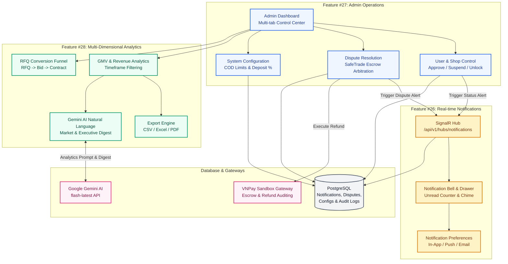
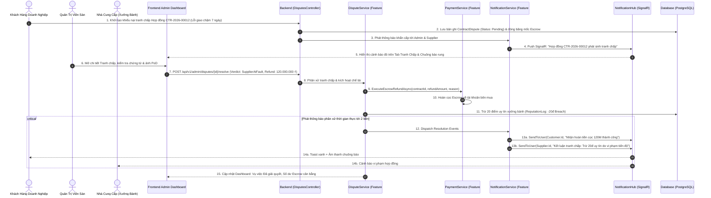

# Module 11: Hệ Thống & Vận Hành Toàn Sàn B2B (Features #26, #27, #28)
## Enterprise Architectural Design Plan

---

## 1. Tổng Quan & Mục Tiêu Nghiệp Vụ (Executive Summary)

Tài liệu này đặc tả toàn bộ kiến trúc giải pháp, thiết kế kỹ thuật phân tầng và kế hoạch triển khai cho **Module 11: Hệ Thống & Vận Hành** của Sàn Giao Dịch Bánh Trung Thu Doanh Nghiệp B2B (**Nguyệt Phố**), bao gồm bộ 3 tính năng cốt lõi:
- **Tính năng #26: Thông báo real-time (Real-time Notifications & Notification Center):** Đẩy thông báo tức thì qua SignalR WebSocket, đồng bộ số đếm chưa đọc (Unread badge), ngăn kéo thông báo đa kênh phong cách Hoàng Gia và tùy biến kênh nhận tin.
- **Tính năng #27: Quản trị hệ thống (Admin Dashboard & Operations):** Quản lý người dùng và duyệt/khóa tài khoản, quản lý đình chỉ/mở lại gian hàng, xử lý tranh chấp hợp đồng (Dispute handling) & trọng tài ký quỹ Escrow SafeTrade, cấu hình hạn mức và chính sách sàn (`SystemConfig`), kiểm duyệt nội dung (Content moderation).
- **Tính năng #28: Báo cáo & Thống kê đa chiều (Multi-Dimensional Reporting & Analytics):** Báo cáo GMV doanh thu toàn sàn, phễu chuyển đổi RFQ $\rightarrow$ Bid $\rightarrow$ Contract, bảng xếp hạng Top Nhà cung cấp & Sản phẩm, xuất file báo cáo CSV/Excel/PDF, và tích hợp Gemini AI sinh phân tích ngôn ngữ tự nhiên.

Hệ thống tuân thủ nghiêm ngặt chuẩn kiến trúc **Clean Architecture (.NET 8 C# 12)** cho Backend WebApi và **Enterprise Layered Architecture (React 19 / Vite / Ant Design v6 / Tailwind Luxury Gold UI)** cho Frontend `mooncake-fe`.

```
================================================================================
  B2B LUXURY MOONCAKE MARKETPLACE - MODULE 11 ARCHITECTURAL SCOPE
  Features Covered:
    - Feature #26: Real-Time Multi-Role Push Notifications & Notification Center
    - Feature #27: Admin Operations (Users, Shops, Disputes, SafeTrade, Configs)
    - Feature #28: Multi-Dimensional Analytics (GMV, Funnel, Export & Gemini AI)
================================================================================
```

---

## 2. Thông Tin Cấu Hình & Khóa Tích Hợp (Security & Integration Keys)

### 2.1. Cổng Thanh Toán VNPay Sandbox (Kiểm Toán & Trọng Tài Hoàn Cọc Escrow)
Theo cấu hình chuẩn hóa tại [keyvnpay.text](file:///Users/admin/Desktop/PRN232/keyvnpay.text), hệ thống **nghiêm ngặt chỉ sử dụng môi trường VNPay Sandbox**:
- **Terminal ID (vnp_TmnCode):** `BFYI47AF`
- **Secret Hash Key (vnp_HashSecret):** `WBGRFFJWAHOAFNIEYICELPMQORJJHSQL`
- **Payment Gateway Endpoint (vnp_Url):** `https://sandbox.vnpayment.vn/paymentv2/vpcpay.html`
- **Vai trò trong Module 11:** Phục vụ đối soát dòng tiền ký quỹ Escrow trên Admin Dashboard, kiểm tra tính toàn vẹn chữ ký HMAC-SHA512 của các giao dịch, và thực thi quyết định hoàn tiền (Refund) khi Admin phân xử tranh chấp hợp đồng.

### 2.2. Trí Tuệ Nhân Tạo Google Gemini AI (Tính Năng #28 - Natural Language Insights)
Theo cấu hình API tại [gemini-key.text](file:///Users/admin/Desktop/PRN232/gemini-key.text):
- **Model:** `gemini-flash-latest`
- **API Key:** `YOUR_GEMINI_API_KEY`
- **Vai trò trong Module 11:** Tự động phân tích các chỉ số GMV, tỷ lệ hoàn thành hợp đồng, tỷ lệ thắng thầu RFQ để tạo bản tóm tắt chiến lược thị trường (Executive Summary), cảnh báo sớm các dấu hiệu gian lận và đề xuất tối ưu hóa chính sách sàn.

---

## 3. Bản Đồ Tích Hợp Giữa Các Tính Năng (System Integration Map)



---

## 4. Sequence Diagram: Luồng Xử Lý Tranh Chấp Hợp Đồng, Hoàn Tiền Ký Quỹ & Phát Thông Báo



---

## 5. Danh Mục Bộ Tài Liệu Thiết Kế Chi Tiết (8 Chuyên Đề)

Bộ tài liệu thiết kế chi tiết cho **Module 11 (Features #26, #27, #28)** được cấu trúc chuẩn hóa tại thư mục `mooncake-ecommerce-platform/.agents/feature/system-operations-management/`:

| STT | Mã tài liệu | Tên chuyên đề thiết kế | Trọng tâm nghiệp vụ |
| :--- | :--- | :--- | :--- |
| 1 | [01_REALTIME_NOTIFICATIONS_SIGNALR_DESIGN.md](file:///Users/admin/Desktop/PRN232/mooncake-ecommerce-platform/.agents/feature/system-operations-management/01_REALTIME_NOTIFICATIONS_SIGNALR_DESIGN.md) | Kiến Trúc SignalR & WebSocket Real-time (Feature #26) | Kết nối WebSocket hai chiều, định danh người dùng ổn định, phân phối nhóm theo vai trò, đồng bộ số đếm unread đa tab, phục hồi kết nối Exponential Backoff. |
| 2 | [02_ADMIN_OPERATIONS_DASHBOARD_DESIGN.md](file:///Users/admin/Desktop/PRN232/mooncake-ecommerce-platform/.agents/feature/system-operations-management/02_ADMIN_OPERATIONS_DASHBOARD_DESIGN.md) | Quản Trị Hệ Thống, Trọng Tài & Cấu Hình (Feature #27) | Quản lý người dùng/gian hàng, xử lý tranh chấp hợp đồng (SafeTrade Arbitration), áp dụng chế tài uy tín, cấu hình sàn (`SystemConfig`), kiểm duyệt nội dung. |
| 3 | [03_MULTIDIMENSIONAL_REPORTING_ANALYTICS_DESIGN.md](file:///Users/admin/Desktop/PRN232/mooncake-ecommerce-platform/.agents/feature/system-operations-management/03_MULTIDIMENSIONAL_REPORTING_ANALYTICS_DESIGN.md) | Báo Cáo & Thống Kê Đa Chiều (Feature #28) | Phân tích GMV đa khung thời gian, phễu chuyển đổi RFQ $\rightarrow$ Bid $\rightarrow$ Contract, bảng xếp hạng NCC, xuất báo cáo CSV/Excel/PDF, và Gemini AI Natural Language Insights. |
| 4 | [04_MOBILE_WORKFLOW_RESPONSIVE_WEB_DESIGN.md](file:///Users/admin/Desktop/PRN232/mooncake-ecommerce-platform/.agents/feature/system-operations-management/04_MOBILE_WORKFLOW_RESPONSIVE_WEB_DESIGN.md) | Trải Nghiệm Mobile-First Trên Nền Tảng Web | Thiết kế giao diện quản trị và trung tâm thông báo tương thích di động, Bottom Sheet cảm ứng, thao tác 1-chạm xử lý tranh chấp, biểu đồ trực quan co giãn. |
| 5 | [05_API_DTO_VALIDATION.md](file:///Users/admin/Desktop/PRN232/mooncake-ecommerce-platform/.agents/feature/system-operations-management/05_API_DTO_VALIDATION.md) | Đặc Tả Kỹ Thuật API, DTO & Validation | Đặc tả toàn bộ RESTful Endpoints cho Notifications, Admin Operations, Disputes, System Configs, Reports & Export, bảng mã lỗi và thông điệp tiếng Việt. |
| 6 | [06_DATA_SQL_CONCURRENCY_SECURITY.md](file:///Users/admin/Desktop/PRN232/mooncake-ecommerce-platform/.agents/feature/system-operations-management/06_DATA_SQL_CONCURRENCY_SECURITY.md) | Cơ Sở Dữ Liệu PostgreSQL & Kiểm Soát An Ninh | Lược đồ bảng `notifications`, `contract_disputes`, `system_configs`, `audit_logs`, tối ưu hóa chỉ mục, RBAC `[Authorize(Roles = "Admin")]`, lưu vết kiểm toán. |
| 7 | [07_FRONTEND_INTEGRATION.md](file:///Users/admin/Desktop/PRN232/mooncake-ecommerce-platform/.agents/feature/system-operations-management/07_FRONTEND_INTEGRATION.md) | Hiện Thực Frontend React 19 (`mooncake-fe`) | Tích hợp `@microsoft/signalr`, Component `NotificationBell`, Drawer, Tab Tranh Chấp, Biểu đồ thống kê, Mock Fallback Pattern và phong cách Luxury Amber UI. |
| 8 | [08_IMPLEMENTATION_TEST_ROLLOUT.md](file:///Users/admin/Desktop/PRN232/mooncake-ecommerce-platform/.agents/feature/system-operations-management/08_IMPLEMENTATION_TEST_ROLLOUT.md) | Kế Hoạch Triển Khai & Ma Trận Kiểm Thử | Ma trận Unit Test xUnit Backend, kịch bản Playwright E2E cho cả 3 tính năng trên Desktop & Mobile, và quy trình kiểm thử bàn giao không lỗi. |

---

## 6. Cam Kết & Tiêu Chuẩn Thực Thi (Compliance & Guardrails)
- **Zero Git Commit Rule:** Tuyệt đối không thực thi `git commit` hay `git push` trong bất kỳ tình huống nào.
- **VNPay Sandbox Exclusivity:** Chỉ kết nối và xử lý trên cổng VNPay Sandbox (`https://sandbox.vnpayment.vn/paymentv2/vpcpay.html`).
- **Indentation & Formatting:** Bắt buộc 2 spaces cho toàn bộ các file `.js`, `.jsx`, `.css`, `.json`, `.md`. Không dùng ký tự Tab.
- **Clean Architecture & Enterprise UI:** Backend 100% tiếng Anh chuẩn mực; Frontend sử dụng tiếng Việt trang trọng, tôn vinh nghệ thuật và văn hóa biếu tặng Trung thu doanh nghiệp B2B cao cấp.

