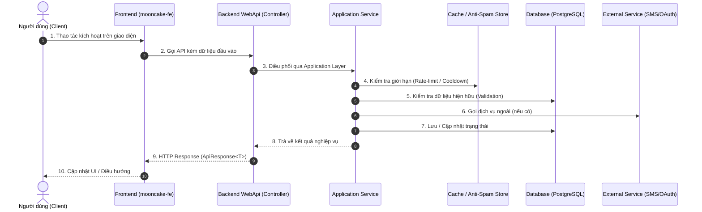
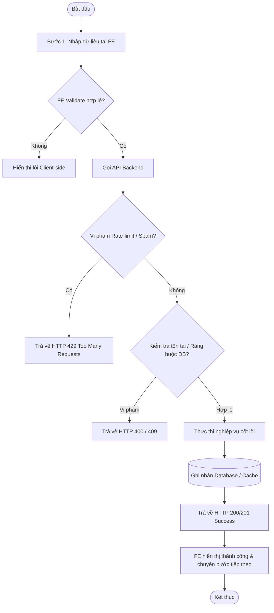

# [MÃ_TÍNH_NĂNG] - TÀI LIỆU THIẾT KẾ CHI TIẾT (DETAIL DESIGN)

---

## I. TÊN TÀI LIỆU, TÍNH NĂNG & TỔNG QUAN

### 1.1. Thông tin tài liệu
- **Tên tài liệu:** Tài liệu thiết kế chi tiết tính năng [Tên Tính Năng]
- **Mã tính năng (Feature Key):** `[feature-name]`
- **Phiên bản tài liệu:** `1.0.0`
- **Người thiết kế:** Team Kỹ thuật / Solution Architect
- **Ngày lập:** YYYY-MM-DD
- **Trạng thái:** [Draft / Under Review / Approved / Implemented]

### 1.2. Mục tiêu nghiệp vụ (Business Goals)
- [Mô tả ngắn gọn mục tiêu của tính năng, giải quyết bài toán gì cho người dùng và hệ thống B2B].
- [Các chỉ số kỳ vọng: Trải nghiệm mượt mà, bảo mật thông tin, hạn chế gian lận/spam].

### 1.3. Phạm vi tính năng (Scope)
- **Bao gồm (In-scope):**
  - [Liệt kê các màn hình, API, nghiệp vụ được hiện thực]
- **Không bao gồm (Out-of-scope):**
  - [Liệt kê các tính năng liên quan nhưng nằm ở phase khác hoặc module khác]

---

## II. FLOW CHART TOÀN BỘ LUỒNG (WORKFLOW DIAGRAM)

### 2.1. Sequence Diagram (Luồng tương tác tổng thể)



### 2.2. State Transition / Flowchart chi tiết



---

## III. CHI TIẾT TỪNG BƯỚC XỬ LÝ (STEP-BY-STEP LOGIC)

Mỗi bước phải được mô tả chi tiết theo cấu trúc chuẩn:
- **Tên bước & Mục đích**
- **Dữ liệu đầu vào & Đầu ra**
- **Quy tắc kiểm tra (Validation Rules)**
- **Xử lý ngoại lệ (Error Handling)**

### Bước 1: Kiểm tra dữ liệu đầu vào & Chuẩn hóa (Input Normalization)
1. Kiểm tra tính toàn vẹn của Request Body (Not null/empty).
2. Chuẩn hóa định dạng (Trim khoảng trắng, chuẩn hóa số điện thoại/email).
3. Validate định dạng qua Regex hoặc FluentValidation:
   - Quy tắc 1: ...
   - Quy tắc 2: ...
4. Ngoại lệ: Nếu không thỏa mãn, ném `HttpException(400, "Thông báo lỗi tiếng Việt")`.

### Bước 2: Kiểm tra chống Spam & Giới hạn tần suất (Anti-Spam & Rate Limiting)
1. Kiểm tra Cooldown thời gian tối thiểu giữa 2 lần thao tác liên tiếp (VD: 60s).
2. Kiểm tra giới hạn tần suất theo Khóa định danh (IP Address hoặc Phone/Account) trong khung giờ (VD: tối đa 5 lần/giờ).
3. Ngoại lệ: Nếu vi phạm, ném `HttpException(429, "Thông báo vượt giới hạn")`.

### Bước 3: Kiểm tra ràng buộc dữ liệu nghiệp vụ (Business Integrity Check)
1. Truy vấn Database kiểm tra bản ghi liên quan (VD: kiểm tra trùng lặp, tài khoản active, soft-delete).
2. Ngoại lệ: Nếu đã tồn tại dữ liệu trùng lặp, ném `HttpException(409, "Dữ liệu đã tồn tại")`.

### Bước 4: Thực thi nghiệp vụ & Tạo mã bảo mật / Giao dịch (Core Execution)
1. Sinh mã xác thực / Token bảo mật sử dụng thuật toán ngẫu nhiên an toàn (`RandomNumberGenerator`).
2. Mã hóa hoặc băm dữ liệu trước khi lưu trữ (Hash SHA-256 / PBKDF2 / BCrypt).
3. Lưu trữ tạm vào Cache / DB kèm thời hạn hết hạn (`ExpiresAtUtc`).
4. Gửi thông báo / SMS / Email (Lưu ý các mục TODO tích hợp nhà mạng hoặc console log).

### Bước 5: Cập nhật cơ sở dữ liệu & Phản hồi (Persistence & Response)
1. Ghi nhận thực thể vào Database theo Clean Architecture qua Repository.
2. Trả về DTO kết quả bọc trong `ApiResponse<T>`.

---

## IV. ĐẶC TẢ KỸ THUẬT API (API CONTRACT SPECIFICATION)

### 4.1. Thông tin Endpoint
- **Phương thức HTTP:** `POST` / `GET` / `PUT` / `DELETE`
- **Đường dẫn (URL):** `/api/v1/[module]/[endpoint]`
- **Yêu cầu xác thực (Auth):** `Anonymous` / `Bearer Token (Authorized)`
- **Rate Limit Policy:** `[Policy Name]` (VD: `auth-login`, `auth-register`)

### 4.2. Request Payload
```json
{
  "fieldA": "value",
  "fieldB": 123
}
```

### 4.3. Response Payload (Chuẩn `ApiResponse<T>`)

#### Phản hồi thành công (HTTP 200 OK / 201 Created)
```json
{
  "status": 200,
  "message": "Thao tác thành công.",
  "data": {
    "resultId": "uuid",
    "expiresIn": 300
  },
  "path": "/api/v1/[module]/[endpoint]",
  "traceId": "c1a2b3c4d5e6f7",
  "time": "2026-10-13T12:00:00Z"
}
```

#### Bảng mã lỗi & Thông điệp phản hồi (Error Codes & Messages)
| HTTP Status | Mã lỗi nội bộ / Ngữ cảnh | Message hiển thị cho người dùng |
| :--- | :--- | :--- |
| `400 Bad Request` | Dữ liệu đầu vào không hợp lệ | `"Dữ liệu gửi lên không đúng định dạng."` |
| `401 Unauthorized` | Phiên xác thực không hợp lệ | `"Phiên làm việc đã hết hạn. Vui lòng thử lại."` |
| `403 Forbidden` | Không có quyền thao tác | `"Bạn không có quyền thực hiện thao tác này."` |
| `409 Conflict` | Xung đột dữ liệu đã tồn tại | `"Dữ liệu đã tồn tại trên hệ thống."` |
| `429 Too Many Requests` | Vượt giới hạn yêu cầu | `"Bạn đã thao tác quá nhiều lần. Vui lòng thử lại sau."` |
| `500 Server Error` | Lỗi ngoài ý muốn phía máy chủ | `"Đã xảy ra lỗi hệ thống. Vui lòng thử lại sau."` |

---

## V. KIẾN TRÚC PHÂN TẦNG VÀ TỔ CHỨC MÃ NGUỒN (LAYER MAPPING)

### 5.1. Backend (Clean Architecture - C# 12 / .NET 8)
- **Domain:**
  - Entities: `[EntityName].cs`
  - Enums: `[EnumName].cs`
- **Application:**
  - Interfaces: `I[Feature]Service.cs`, `I[Feature]Repository.cs`
  - DTOs: `Requests/[Feature]Request.cs`, `Responses/[Feature]Response.cs`
  - Constants: Bổ sung hằng số message tiếng Việt vào `MessageConstant.cs`
  - Helpers/Utils: Bổ sung các static helper tính toán thuần túy
- **Infrastructure:**
  - Repositories: `[Feature]Repository.cs`
  - Caching & Persistence: `ApplicationDbContext.cs`, Entity Configurations
- **WebApi:**
  - Controllers: `[Feature]Controller.cs` (Kế thừa `BaseApiController`)
  - Middleware/RateLimiter: Cấu hình chính sách giới hạn tại `WebApiServiceCollectionExtensions.cs`

### 5.2. Frontend (React 19 / Layered Architecture)
- **Constants:** Khai báo Endpoint tại `src/constants/apiEndpoints.js`
- **Services:** Hiện thực hàm gọi API tại `src/services/[feature]Service.js` qua `apiClient`
- **Custom Hooks:** Đóng gói trạng thái loading, countdown, error tại `src/hooks/use[Feature].js`
- **Components / Popups:** Xây dựng giao diện Modal/Form chuẩn Luxury UI tại `src/components/` hoặc `src/Pages/`

---

## VI. BẢO MẬT & KIỂM THỬ (SECURITY & TESTING PLAN)

### 6.1. Tiêu chuẩn bảo mật (Security Checklist)
- [ ] Không lưu trữ mã xác thực hoặc mật khẩu dưới dạng văn bản rõ (Plain text).
- [ ] Áp dụng cơ chế One-time-use token (Chống Replay Attack).
- [ ] Kiểm tra Time-to-Live (TTL) và tự động hủy sau khi sử dụng.
- [ ] Không để lộ thông tin nhạy cảm qua log hoặc HTTP response headers.

### 6.2. Kịch bản kiểm thử (Test Cases)
1. **Happy Path:** Luồng thao tác chuẩn thành công từ bước đầu tới bước cuối.
2. **Negative - Validation:** Nhập sai định dạng, để trống trường bắt buộc.
3. **Negative - Anti-Spam:** Gửi yêu cầu dồn dập trong khoảng thời gian cooldown.
4. **Negative - Brute Force:** Nhập sai mã OTP quá 5 lần liên tiếp.
5. **Negative - Expired:** Thao tác khi token / OTP đã quá hạn TTL.
